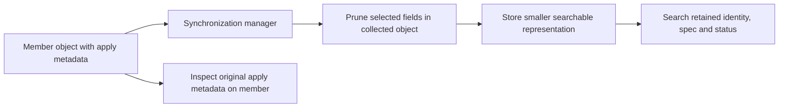

# Reduce Clusterpedia Storage by Pruning Apply Metadata

Author: [nawazdhandala](https://www.github.com/nawazdhandala)

Tags: Kubernetes, Database, Performance

Description: Verify Clusterpedia metadata pruning, estimate object-payload savings, and preserve the source cluster's apply metadata and useful search fields.

A Kubernetes object's useful status can be small while its metadata is comparatively large. Server-side apply records field ownership, and client-side apply can retain a serialized copy of a previous configuration. Repeating those fields across a fleet's search database may consume space without helping the queries you actually run.

Clusterpedia can remove those fields from synchronized objects. Before changing anything, check whether it already does: both relevant gates default to **true in Clusterpedia v0.9.0**. This guide uses that release and **Helm chart2.7.0**, with local payload and render checks rather than a live database benchmark.

## Understand what is being removed

There are two independent targets:

| Object field | Clusterpedia feature gate | Information removed from the stored copy |
| --- | --- | --- |
| `metadata.managedFields` | `PruneManagedFields` | Field-management records used by server-side apply |
| `metadata.annotations["kubectl.kubernetes.io/last-applied-configuration"]` | `PruneLastAppliedConfiguration` | The serialized last-applied configuration annotation |

Kubernetes explains field ownership in its [server-side apply documentation](https://kubernetes.io/docs/reference/using-api/server-side-apply/). Those records can matter when debugging who owns a field on the member cluster. Removing them from a search copy does not mean they are useless everywhere.

The exact annotation key matters. It is not a generic annotation named `lastAppliedConfiguration`. The [v0.9.0 pruning function](https://github.com/clusterpedia-io/clusterpedia/blob/v0.9.0/pkg/synchromanager/clustersynchro/default_resource_synchro.go) removes the fully qualified key shown above and preserves other annotations.



The pruning operation is in the synchronization path. It does not issue an API patch to remove fields from the member object. Do not run metadata-deletion commands against production workloads to imitate it.

## Check the current gates before promising savings

The [official pruning page](https://clusterpedia.io/docs/features/prune-fields/) identifies these as synchronization-manager gates. The [tagged feature definitions](https://github.com/clusterpedia-io/clusterpedia/blob/v0.9.0/pkg/synchromanager/features/features.go) confirm both defaults are enabled.

Inspect your installation values and the running manager's configuration. An old explicit override may disable pruning, while an empty feature-gate map can still use the enabled defaults. If the current stored objects already lack these fields, setting both gates to true again is unlikely to produce new savings from those same objects.

Also identify consumers that expect the removed fields. A search-based ownership audit or a tool that reads the last-applied annotation may need to query the member API instead. Treat the retained representation as a deliberate data contract, not a byte-for-byte archival copy of every Kubernetes object.

## Measure a protected representative sample

Use a read-only member context and a non-sensitive Deployment selected for the review. The raw request avoids kubectl's normal display handling of managed fields:

```bash
set -euo pipefail
umask 077
mkdir pruning-review
kubectl --context MEMBER_CONTEXT get \
  --raw='/apis/apps/v1/namespaces/payments/deployments/checkout' \
  > pruning-review/source.json
```

Replace the context, namespace, and name. This writes a full object to a new protected directory and does not change the cluster. Keep it private: annotations or workload specifications may contain configuration you should not publish.

Save this as `estimate-pruning.py`:

```python
import copy
import json
from pathlib import Path

original = json.loads(Path("pruning-review/source.json").read_text())
if not isinstance(original, dict) or not isinstance(original.get("metadata"), dict):
    raise SystemExit("Expected one Kubernetes object with metadata")

pruned = copy.deepcopy(original)
metadata = pruned["metadata"]
metadata.pop("managedFields", None)
annotations = metadata.get("annotations")
key = "kubectl.kubernetes.io/last-applied-configuration"
if isinstance(annotations, dict) and key in annotations:
    del annotations[key]
    if not annotations:
        metadata.pop("annotations", None)

def size(value):
    return len(json.dumps(value, separators=(",", ":"), ensure_ascii=False).encode("utf-8"))

before, after = size(original), size(pruned)
print(json.dumps({"before_bytes": before, "after_bytes": after,
                  "removed_bytes": before - after}))
```

Run it with `python3 estimate-pruning.py` from the directory containing `pruning-review`. It prints only byte counts and leaves the source file unchanged. The calculation compares compact JSON encodings, so whitespace differences in the captured response do not dominate the estimate.

This is an object-payload estimate. Database pages, indexes, compression, transaction logs, replicas, and backups can change the relationship between removed JSON bytes and physical disk usage. Sample several representative resource types rather than extrapolating from one unusually large object.

## Make the policy explicit in Helm

If the reviewed policy is to prune both fields, this is the chart2.7.0 values fragment:

```yaml
clustersynchroManager:
  featureGates:
    PruneManagedFields: true
    PruneLastAppliedConfiguration: true
```

Save it as `pruning-values.yaml`, then render it with your complete reviewed installation values and verified chart archive:

```bash
helm template clusterpedia ./clusterpedia-2.7.0.tgz \
  --namespace clusterpedia-system \
  -f reviewed-installation-values.yaml -f pruning-values.yaml \
  > rendered.yaml
```

The local Helm3.17.3 render check confirmed that the manager command contains both true gate settings. Inspect that specific Deployment, and protect the complete rendered output as you would other installation configuration.

The flags are process configuration. If the running manager needs a change, use a controlled rollout through your normal deployment owner. Plan for synchronization recovery work rather than assuming a configuration edit instantly rewrites all existing rows.

## Verify the new stored representation

After the pilot manager is running the intended configuration, compare a known object from the member with its Clusterpedia representation. Use the single-member typed resource path for that object and inspect the two target fields plus important retained fields.

Confirm that namespace, name, UID, owner references, application annotations, specification, and status remain useful to your consumers. The local fixture for this article verified that the estimator removes only the two requested metadata targets while preserving those unrelated structures. That is a test of the estimator, not of live synchronization.

Check both newly observed objects and previously stored objects. Enabling a gate is not proof that every old record has already passed through the updated processing path. Observe synchronization behavior and use a controlled staging rehearsal before deciding how to handle a large existing dataset.

Do not delete the database or mass-update source workloads simply to force pruning. If physical disk space does not immediately fall, investigate database storage and maintenance behavior with your database owner. Smaller object values and reclaimed filesystem space are different outcomes.

## Record the tradeoff and rollback limits

If a required consumer needs these fields, revise the pruning policy and plan how it will obtain the original information. Disabling a gate affects later processing; it cannot reconstruct already omitted metadata without an appropriate source refresh. The member API remains the place to inspect current apply ownership.

Keep a short acceptance record: effective gates, sampled payload sizes, consumer checks, synchronization observations, and measured database growth over time. When pruning is already enabled, move on to other causes of growth such as resource selection, object count, or workload churn. A measured review is more useful than repeatedly toggling a feature that is already doing its job.
