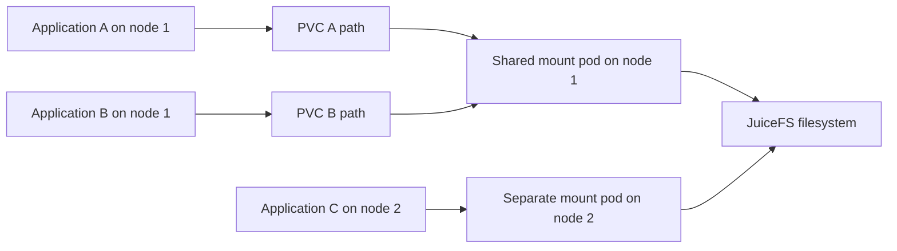

# Reduce JuiceFS CSI Overhead with Shared Mounts and Measured Resource Requests

Author: [nawazdhandala](https://www.github.com/nawazdhandala)

Tags: JuiceFS, Kubernetes, Performance

Description: Reduce JuiceFS mount-pod overhead by choosing a sharing boundary, measuring combined demand, and verifying resource settings before a staged rollout.

A node can have plenty of idle CPU and still refuse another workload because its scheduled resource requests already fill the node. JuiceFS mount pods can contribute to that gap, especially when many small applications use separate volumes. Reducing the number of mount pods can help, but it also combines their workloads and failure paths.

Treat this as a capacity change with a recovery test. First identify which mounts can safely share a process. Then measure the combined workload and choose resource requests that represent it. Finally, verify that the driver actually creates the intended pods.

## Understand what you are sharing

The Container Storage Interface (CSI) driver connects Kubernetes volumes to JuiceFS. In mount-pod mode, a separate pod runs the filesystem client on the node where applications need it. A PersistentVolume (PV) identifies storage; a PersistentVolumeClaim (PVC) requests that storage for an application.

The sharing choices in CSI driver **v0.34.0** have different boundaries:

| Mode | Eligible volumes on one node | Tradeoff |
| --- | --- | --- |
| Default | Applications referencing the same PV | More separate clients for separate PVs |
| StorageClass sharing | Dynamically provisioned PVs from one StorageClass | One busy or failed client can affect several claims |
| Filesystem sharing | Compatible PVs pointing to the same filesystem, including static PVs | Broader reuse requires closer review of configuration and isolation |

A StorageClass describes how Kubernetes provisions storage. Sharing a mount does not combine PVC directories into one application directory. It reuses the underlying client while binding the appropriate paths into applications. It also does not share a process across nodes. Different mount options can prevent filesystem-level reuse. These boundaries are documented in the [tagged resource optimization guide](https://github.com/juicedata/juicefs-csi-driver/blob/v0.34.0/docs/en/guide/resource-optimization.md#share-mount-pod-for-the-same-file-system).



The two nodes still need separate clients. A failure of the shared mount on node 1 can interrupt both applications there, even though their directories are different.

## Measure reservations and real demand separately

A CPU request is a scheduling reservation; it is not a CPU usage measurement. CPU limits can throttle execution, and memory limits can lead to out-of-memory termination. Kubernetes explains these distinctions in its [resource management documentation](https://kubernetes.io/docs/concepts/configuration/manage-resources-containers/).

With permission to read pods and an installed Metrics Server, inspect current mount pods:

```bash
kubectl -n kube-system get pods \
  -l app.kubernetes.io/name=juicefs-mount -o wide
kubectl -n kube-system top pod \
  -l app.kubernetes.io/name=juicefs-mount --containers
```

The first command maps pods to nodes. The second shows recent CPU and memory usage. These are read-only checks, and `top` requires working resource metrics. Record longer histories during startup, large reads, small-file bursts, and recovery; one quiet sample is insufficient.

Build a per-node worksheet containing mount count, summed requests, observed peaks, application latency, and restart events. For illustration, six clients requesting 500Mi each reserve 3000Mi. Two shared clients requesting 1Gi each reserve 2048Mi. That arithmetic reduces reservations by 952Mi, but proves nothing about peak memory or throughput. Shared clients must support the simultaneous demand of their consumers.

Include client buffers and metadata working sets in memory planning. Disk cache capacity is a separate concern: lowering a memory request does not shrink local cache usage or protect a node from disk pressure.

## Render an explicit sharing and resource policy

The following overlay targets the **juicefs-csi-driver chart 0.34.0**, mount-pod mode, and a staging cluster using Kubernetes 1.34. It selects StorageClass sharing, leaving broader filesystem sharing disabled. The StorageClass name `juicefs-rwx` is an example to replace with your existing class.

Save this as `mount-sizing.yaml`:

```yaml
node:
  storageClassShareMount: true
  fsShareMount: false

globalConfig:
  enabled: true
  manageByHelm: true
  mountPodPatch:
    - pvcSelector:
        matchStorageClassName: juicefs-rwx
      resources:
        requests:
          cpu: "500m"
          memory: 1Gi
        limits:
          cpu: "4"
          memory: 4Gi
```

These are **illustrative staging values**, not recommended production sizing. A half-core request and four-core limit allow bursts, but a busy shared client may need a larger request. Choose memory headroom from measured concurrent activity and recovery behavior.

The resource patch is selected by StorageClass, whereas `storageClassShareMount` enables the driver's sharing policy across eligible classes. Do not mistake this overlay for a sharing switch limited to `juicefs-rwx`. Evaluate every affected class before deployment.

Use your complete existing configuration as `cluster-values.yaml`, including the intended client image, kubelet path, security settings, and other patches. Helm replaces lists when merging values, so preserve other `mountPodPatch` entries in the overlay rather than accidentally discarding them. Also reconcile any manually maintained ConfigMap before enabling Helm ownership.

```bash
helm repo add juicefs https://juicedata.github.io/charts/
helm repo update juicefs
helm template juicefs-csi-driver juicefs/juicefs-csi-driver \
  --version 0.34.0 --namespace kube-system \
  --kube-version 1.34.0 \
  -f cluster-values.yaml -f mount-sizing.yaml \
  > rendered-sizing.yaml
```

This renders manifests without installing them. Use your actual release name when comparing with an existing installation. The [chart release](https://github.com/juicedata/charts/releases/tag/helm-chart-juicefs-csi-driver-0.34.0) and [driver configuration guide](https://github.com/juicedata/juicefs-csi-driver/blob/v0.34.0/docs/en/guide/configurations.md#configmap) define these settings.

Inspect the node DaemonSet for `STORAGE_CLASS_SHARE_MOUNT=true`, and confirm it does not enable `FS_SHARE_MOUNT`. Inspect the ConfigMap's embedded `config.yaml` for the selector and all four resource quantities. This is mount-client configuration; changing only the CSI node plugin's own container resources would solve a different problem.

## Roll out without disrupting every consumer

Start in a staging cluster with two claims in the same class and workloads placed on one node. Compare that with a second node and with an unrelated class. Observe the actual mount pods and their resources after creation. Helm renders the driver configuration, not these dynamically created pods, so a successful template render cannot prove runtime sharing.

Existing mount pods do not become correctly sized merely because a ConfigMap changed. Plan a supported client update or controlled workload recreation, accounting for every consumer of a shared mount. Do not delete all mount pods as a convenient rollout shortcut.

Version 0.34.0 includes smooth recovery behavior introduced in earlier releases. The documentation still recommends `mountPropagation: HostToContainer` on application volume mounts as a safeguard. Verify this against application security policy and test recovery with real open-file workloads; a successful pod restart alone does not prove applications resumed correctly. See the [automatic recovery guidance](https://github.com/juicedata/juicefs-csi-driver/blob/v0.34.0/docs/en/guide/configurations.md#automatic-mount-point-recovery).

## Keep the change only if applications improve

Run the same workload mix before and after the change. Require fewer eligible mount pods, lower total reservations, acceptable startup and I/O latency, no new memory kills, and successful recovery of all consumers. Include a burst from both applications at once; testing each separately hides contention.

If latency rises, investigate throttling and shared concurrency before cutting requests further. If memory kills appear, restore headroom and examine buffers and workload size. If mount count stays unchanged, check node placement, provisioning mode, and configuration compatibility before assuming the switch failed.

Keep the previous values and a controlled recreation plan. Reverting configuration still requires verifying newly created mounts and affected applications. The useful outcome is sustainable node capacity with predictable failures, rather than the smallest possible pod count.
