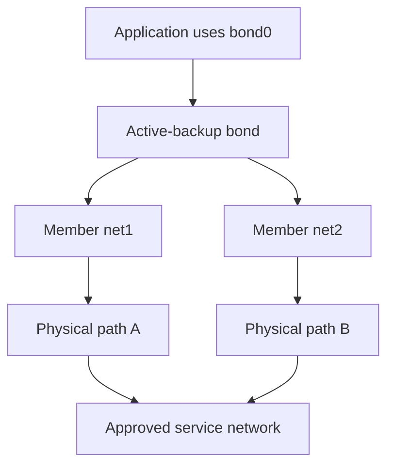

# Build Redundant Pod Network Paths with Multus and Bond CNI

Author: [nawazdhandala](https://www.github.com/nawazdhandala)

Tags: Multus, Kubernetes, Networking

Description: Build a scoped active-backup bond from two prepared Pod interfaces, match resource pools and attachment order, and test actual failover rather than assuming two links mean redundancy.

Two network interfaces do not automatically provide a redundant application path. They can share the same physical adapter, switch, or failed upstream route. Even with independent hardware, the application may continue sending through the interface that failed unless a suitable mechanism selects another path.

Linux bonding combines member interfaces into one logical interface. With Multus and Bond CNI, the member attachments can be created first and then assembled into a bond inside the Pod. This guide uses an active-backup design: one member carries traffic while another is available for takeover.

The configuration follows **Bond CNI commit `709b4a474cc543eba3652da2d0206c35620bd82a`**, reviewed alongside Multus v4.3.1. Examples were parsed and cross-checked locally; no Linux bond, SR-IOV hardware or live failover was tested. Pin an approved build and validate your platform's compatibility before deployment.

## Design independent paths before bonding them

For this staging example, assume two prepared SR-IOV network definitions named `path-a` and `path-b` in namespace `bond-lab`. They allocate kernel-driver virtual functions from separate resource pools: `example.com/path_a_vf` and `example.com/path_b_vf`. Each pool must map to the intended independent physical path.

The member definitions should provide the interfaces without assigning the application's IP address. IPAM belongs on the bond in this example. Verify that the two networks lead to the same intended Layer 2 service network and that the switching design permits the selected failover behavior.



Do not count two virtual functions from the same failed physical function as two independent paths. Document the failure domains you intend to survive: cable, port, adapter, switch, or upstream connectivity. Bond CNI's SR-IOV example is specifically for kernel-driver interfaces; userspace DPDK devices are a different design. [Bond CNI integration reference](https://github.com/k8snetworkplumbingwg/bond-cni/blob/709b4a474cc543eba3652da2d0206c35620bd82a/README.md).

## Configure the bond after its members

Assume the node has the approved `bond`, `sriov`, and `static` CNI binaries, the kernel bonding support, and both allocatable device pools. Reserve one staging address exclusively for the bond. Replace the documentation address below before use.

```yaml
apiVersion: k8s.cni.cncf.io/v1
kind: NetworkAttachmentDefinition
metadata:
  name: redundant-net
  namespace: bond-lab
spec:
  config: |
    {
      "cniVersion": "0.3.1",
      "name": "redundant-net",
      "type": "bond",
      "mode": "active-backup",
      "failOverMac": 1,
      "linksInContainer": true,
      "miimon": "100",
      "mtu": 1500,
      "links": [
        {"name": "net1"},
        {"name": "net2"}
      ],
      "ipam": {
        "type": "static",
        "addresses": [{"address": "192.0.2.50/24"}]
      }
    }
```

`linksInContainer: true` tells Bond CNI to find the members in the Pod namespace. Omitting it changes where the plugin looks. `links` must match the interface names created by the preceding attachments. In the reviewed source, `miimon` is a JSON string, which is why `"100"` is quoted; do not silently convert it to an integer based on a prose description. [Pinned configuration parser](https://github.com/k8snetworkplumbingwg/bond-cni/blob/709b4a474cc543eba3652da2d0206c35620bd82a/bond/bond.go).

MII monitoring checks reported link state at the configured interval. It is not ARP monitoring and does not prove an upstream application path works. Active-backup with `failOverMac: 1` changes the bond's MAC behavior as the active member changes, so validate switch learning, neighbor updates and hardware restrictions. [Linux bonding options](https://docs.kernel.org/networking/bonding.html).

The MTU must fit both members and the complete network path. The example has no added default route, so it does not intentionally replace the Pod's primary route. Static IPAM is only suitable here because there is one exclusively reserved test address; it is not a cluster-wide allocation service. [Static IPAM](https://www.cni.dev/plugins/current/ipam/static/).

## Request both resources and preserve attachment order

Use an approved image with `sleep` and iproute2, replacing the image placeholder with an immutable digest:

```yaml
apiVersion: v1
kind: Pod
metadata:
  name: bond-check
  namespace: bond-lab
  annotations:
    k8s.v1.cni.cncf.io/networks: |
      [
        {"name":"path-a","interface":"net1"},
        {"name":"path-b","interface":"net2"},
        {"name":"redundant-net","interface":"bond0"}
      ]
spec:
  restartPolicy: Never
  containers:
    - name: check
      image: REPLACE_APPROVED_DIAGNOSTIC_IMAGE_DIGEST
      command: ["sleep", "3600"]
      resources:
        requests:
          example.com/path_a_vf: "1"
          example.com/path_b_vf: "1"
        limits:
          example.com/path_a_vf: "1"
          example.com/path_b_vf: "1"
```

The member networks come before `redundant-net`. Their NetworkAttachmentDefinition resource annotations must match the two requested extended resources. Requesting two devices from one generic pool does not guarantee independent physical paths; use verified pool selectors and resource identities. [Kubernetes device resource requests](https://kubernetes.io/docs/concepts/extend-kubernetes/compute-storage-net/device-plugins/).

Before applying this staging workload, validate all three network definitions and confirm node capacity, allocation rules and the absence of address conflicts. This Pod manifest assumes the two prepared member definitions; it is not a complete SR-IOV installation.

## Inspect the bond before testing failure

Inside the running Pod:

```bash
kubectl -n bond-lab exec bond-check -- ip -d link show bond0
kubectl -n bond-lab exec bond-check -- ip address show dev bond0
kubectl -n bond-lab exec bond-check -- cat /proc/net/bonding/bond0
```

Expect the intended mode, both member interfaces, one active member, and the reserved IP on the bond. Check the member addresses as well; they should not carry competing application addresses from an accidental IPAM configuration.

Send low-rate application traffic to an approved peer on the secondary network and record the active member, latency, failures, and peer observations. Verify primary-network DNS and Service access separately. A healthy bond should not be accepted at the cost of breaking the primary interface.

## Test the failure you actually intend to survive

In an approved staging maintenance window, have the network owner interrupt one isolated test path, observe takeover, restore it, and repeat for the other path. Do not disable a shared node uplink merely because it is part of the diagram.

Measure application interruption, not only the active-member field. A member change can still leave stale neighbor information, filtering, or an unreachable upstream path. Test a link-down event separately from a failure beyond the local link. If carrier remains up, MII monitoring may not detect the latter; a different health mechanism or application-level failover design may be required.

Record whether recovery returns to the original path, whether sessions survive as required, and whether both members can independently reach the peer. Two entries in `/proc/net/bonding/bond0` prove configuration, not resilience.

Finally, delete the disposable Pod through Kubernetes and confirm both device allocations and the bond address are released. Recreate it on another eligible node and repeat the baseline. Production readiness depends on consistent node preparation, correct allocation boundaries, and observed behavior under the specific failures your service must tolerate.
