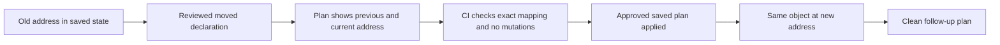

# Refactor Terraform State in CI with Auditable Moved Blocks

Author: [nawazdhandala](https://www.github.com/nawazdhandala)

Tags: Terraform, CI/CD, Infrastructure as Code

Description: Refactor resource addresses without recreating objects, gate the migration plan in CI, and preserve moved-block history for environments that upgrade later.

Renaming a Terraform resource block looks like a code cleanup. Terraform, however, uses the resource address to connect configuration to state. Without a migration declaration, a new address can look like a new resource while the old address looks like something to destroy.

A `moved` block records the address transition in code. CI can review that transition, check that it does not also change resources, and apply the saved plan as a controlled state migration.

The migration happens once per affected state, but the declaration can remain in the repository for environments that have not upgraded yet. Treat those as separate lifecycles: a completed execution is not a reason to discard compatibility history.

## Establish the migration boundary

Start with one state and one explicit mapping from old addresses to new addresses. Keep resource settings, provider versions, and application behavior unchanged in the same pull request. That makes the expected plan easy to recognize: address moves, with no resource creation, update, or deletion.



A moved block operates on addresses within the configuration's state. Moving an object between separate backends is an ownership transfer with additional coordination, not the same procedure. Do not point two states at the same cloud object and assume a moved block will resolve ownership.

HashiCorp documents moves for renaming resources, changing instance addressing, and reorganizing modules. Match the feature to the Terraform version you actually deploy. This tutorial pins **Terraform 1.11.4**. [Module refactoring guidance](https://developer.hashicorp.com/terraform/language/modules/develop/refactoring).

## Rehearse the change with a disposable local object

The following lab uses the built-in `terraform_data` resource. It stores data in Terraform state and creates no cloud service. Run it in a new empty temporary directory, never in a production working directory. [Terraform data resource](https://developer.hashicorp.com/terraform/language/resources/terraform-data).

First save this as `main.tf`:

```hcl
terraform {
  required_version = "= 1.11.4"
}
resource "terraform_data" "worker" {
  input = { service = "worker" }
}
```

Initialize and apply this local baseline, reviewing the single proposed state-only resource:

```bash
terraform init
terraform apply
```

Then replace `main.tf` with this refactor. It renames the resource and introduces a `for_each` instance key without changing the stored input:

```hcl
terraform {
  required_version = "= 1.11.4"
}
resource "terraform_data" "runtime" {
  for_each = toset(["primary"])
  input    = { service = "worker" }
}
moved {
  from = terraform_data.worker
  to   = terraform_data.runtime["primary"]
}
```

The `from` address identifies the previously managed resource. The `to` address identifies the destination instance. These are Terraform address expressions, not strings containing a CLI command. The key `primary` is part of the destination identity and must match exactly. [Moved block syntax](https://developer.hashicorp.com/terraform/language/block/moved).

For a cloud resource, use its actual old and new addresses and matching configuration. Do not transplant the lab's data object into a cloud module as a workaround. The lab exists to demonstrate state behavior independently of provider permissions and cloud costs.

## Inspect the plan before changing state

Create a saved plan and inspect its structured representation:

```bash
umask 077
terraform plan -input=false -lock-timeout=60s -out=migration.tfplan
terraform show -json migration.tfplan > migration-plan.json
```

The relevant resource change should contain `previous_address = terraform_data.worker`, the new keyed address, and `actions = ["no-op"]`. The old and new state bindings refer to the same stored resource identity.

A no-op action does not mean the apply is pointless: applying records the address move in state. Conversely, seeing a moved-address message does not prove the plan contains only a move. Other resources may still have changes. Review the entire plan. [Terraform plan JSON](https://developer.hashicorp.com/terraform/internals/json-format).

Keep the binary and JSON plans restricted. They can contain sensitive resource values even when a console view conceals them. [Show command output](https://developer.hashicorp.com/terraform/cli/commands/show).

## Gate the one-time migration in CI

For the lab, save this as `review_move.py`. In a real migration, replace `EXPECTED` with the reviewed mapping and retain the version contract. This deliberately strict gate rejects additional resource actions, including deferred data reads, so move-only reviews stay small.

```python
import json
import sys

EXPECTED = {'terraform_data.worker': 'terraform_data.runtime["primary"]'}


def review(plan):
    if (plan.get('terraform_version') != '1.11.4'
            or plan.get('format_version') != '1.2'
            or plan.get('errored') is not False
            or plan.get('complete') is not True
            or plan.get('applyable') is not True):
        raise ValueError('Require the reviewed version and a complete valid plan')
    if plan.get('resource_drift') or plan.get('deferred_changes'):
        raise ValueError('Resolve drift or deferred work separately')
    moves = {}
    for resource in plan.get('resource_changes', []):
        change = resource['change']
        if change['actions'] != ['no-op'] or 'importing' in change:
            raise ValueError('Migration contains an additional resource action')
        if 'previous_address' in resource:
            old = resource['previous_address']
            if old in moves:
                raise ValueError('Duplicate source address')
            moves[old] = resource['address']
    if moves != EXPECTED:
        raise ValueError('Planned moves do not match the reviewed migration')
    if any(c['actions'] != ['no-op'] for c in plan.get('output_changes', {}).values()):
        raise ValueError('Output changes require separate review')
    if any(c.get('status') != 'pass' for c in plan.get('checks', [])):
        raise ValueError('Unresolved or failed checks')
    return moves


if __name__ == '__main__':
    with open(sys.argv[1]) as stream:
        moves = review(json.load(stream))
    print(json.dumps({'approved_moves': moves}, indent=2))
```

Run it on the exact saved plan JSON:

```bash
python3 review_move.py migration-plan.json
```

A passing report identifies the approved address mapping. A failure must stop the migration job. Do not catch the exception and continue to apply, or run an unconditional apply step after a failed gate.

The gate does not prove that the selected backend belongs to the intended environment. CI must also verify the backend/workspace, source commit, provider lockfile, variable revision, and run identity. Preserve those with the approved plan digest and the migration record.

Hold per-state coordination around the migration. Pause older queued deployments that still use the old addresses, and prevent a workstation or another repository from writing the same state during the change. Backend locking remains necessary even when the CI queue is serialized.

## Apply and record completion per state

After the plan passes review and the CI approval, apply that same saved artifact:

```bash
terraform apply -input=false -lock-timeout=60s migration.tfplan
```

Passing a saved plan executes its approved operations without another interactive confirmation. Do not replace the file with a freshly generated plan after approval. If state changes while waiting, regenerate, recheck, and reapprove. [Saved-plan apply](https://developer.hashicorp.com/terraform/cli/commands/apply).

Verify that the old address is absent, the new address exists, and the underlying object ID is unchanged. Run a fresh plan with the refactored configuration and require no unexpected resource changes. Record completion against the state identity, not just the pull request: one merged module release can be applied to many environments at different times.

The strict one-time gate expects a pending move. After migration, subsequent plans normally omit that previous-address transition. Use the normal deployment gate afterward rather than weakening this gate until it accepts any plan.

## Preserve history and plan reversals explicitly

Keep moved declarations while supported consumers might still have the old addresses. Removing them can break upgrades from older module versions. If an address moves again, preserve a valid chain of declarations so earlier states can follow the migration path. [Refactoring compatibility guidance](https://developer.hashicorp.com/terraform/language/modules/develop/refactoring#remove-a-move-block).

A Git revert restores old configuration text; it does not restore old state addresses. Once the move has been applied, reverting to the old resource declaration without a reviewed reverse migration can propose creating the old resource and destroying the new binding. Review a reversal as a new migration with its own plan, rather than uploading an older state backup over current state.

For exceptional imperative migrations, `terraform state mv -dry-run` can show what a proposed CLI move would match. For example, before the lab migration:

```bash
terraform state mv -dry-run \
  'terraform_data.worker' 'terraform_data.runtime["primary"]'
```

The shell quotes protect the keyed address. Dry-run does not change state, but it also does not review the destination configuration or replace coordination. An actual imperative move needs a separate approved runbook, recorded source/destination, backups, and verification. [State move command](https://developer.hashicorp.com/terraform/cli/commands/state/mv).

In local tests, Terraform 1.11.4 preserved the data object's ID through the moved-block apply, and its follow-up plan was clean. Omitting the moved block produced create/delete actions, and a later code-only revert also proposed create/delete. Nine negative JSON fixtures tested the review gate. No cloud resources or remote backends were changed during validation.
