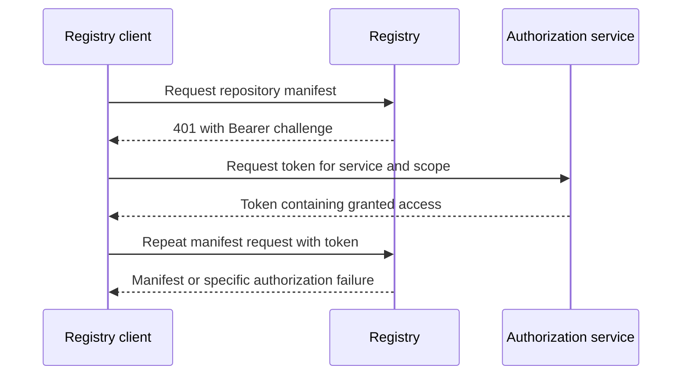

# Debug Registry Unauthorized and Insufficient-Scope Token Errors

Author: [nawazdhandala](https://www.github.com/nawazdhandala)

Tags: Container Registry, Authentication, Troubleshooting

Description: Trace a registry bearer-token exchange, distinguish an expected challenge from invalid credentials or missing scope, and inspect failures without exposing tokens.

An image pull returns `unauthorized`, so you reset the password. The next attempt fails with `insufficient_scope`. These messages describe different points in a registry authentication flow; neither should be treated as a universal instruction to log in again.

This walkthrough follows the Distribution Registry bearer-token protocol and checks implementation details against **Distribution3.1.2**. Other registry products can wrap these errors differently. Identify which endpoint returned the response before deciding what it means.

## Follow the exchange instead of the final message

A bearer token is a credential whose possession allows its holder to exercise the access granted inside it. Protect it like a password. In a typical exchange, the registry first asks the client to obtain a token from a separate authorization service.



The initial401 is expected when no usable token was supplied. Its `WWW-Authenticate` header describes the next step. The [Distribution authentication specification](https://distribution.github.io/distribution/spec/auth/token/) documents this challenge-and-retry exchange.

A login success does not prove permission to pull every repository. A successful token-service response also does not guarantee that it granted every requested action.

## Read the challenge fields precisely

An example challenge for a private repository is:

```text
WWW-Authenticate: Bearer realm="https://auth.example.internal/token",service="registry.example.internal",scope="repository:team/widget:pull"
```

`realm` identifies the token endpoint. `service` identifies the intended registry service, not necessarily a URL to call. `scope` names a resource and requested actions. Here the resource is the repository `team/widget`, and the action is `pull`.

Do not shorten the repository to `widget`, add the registry hostname to its name, or substitute a different service value because it looks equivalent. These identifiers must match the registry and authorization service's configuration.

| Observation | Next investigation |
| --- | --- |
| Registry401 without an existing token | Follow its expected challenge |
| Token endpoint rejects credentials | Identity, password/token validity, and provider login policy |
| Registry reports `invalid_token` | Signature trust, issuer, audience, expiry, and time checks |
| Registry reports `insufficient_scope` | Granted repository name and actions |
| TLS or DNS failure | Connectivity and trust before authentication |

In [Distribution3.1.2's access controller](https://github.com/distribution/distribution/blob/v3.1.2/registry/auth/token/accesscontroller.go), token verification happens before required resource actions are checked. Missing actions lead to the insufficient-scope error. Preserve response headers and the responding host; a generic client summary can hide that distinction.

## Capture a challenge without credentials

Use an approved test repository and an existing test tag. The following command needs curl with the listed standard options and a trusted CA bundle:

```bash
umask 077
mkdir token-review
curl --silent --show-error \
  --cacert /protected/registry-ca.pem \
  --dump-header token-review/challenge.headers \
  --output token-review/challenge-body.json \
  https://registry.example.internal/v2/team/widget/manifests/test
```

Inspect the local header file. A Bearer challenge should identify the authorization service. This command deliberately does not follow redirects or send credentials. If a gateway returns an HTML login page, a Basic challenge, or a rewritten hostname, investigate that layer before trying to decode registry tokens.

Confirm that the advertised HTTPS realm belongs to the expected authorization service before sending a password. Do not build a script that forwards credentials blindly to an arbitrary realm extracted from an untrusted response.

## Request only the approved scope

For a service that supports username/password authentication at its token endpoint, replace the example values below with those from the reviewed challenge:

```bash
curl --fail --silent --show-error --get \
  --cacert /protected/auth-ca.pem \
  --user registry-user \
  --data-urlencode 'service=registry.example.internal' \
  --data-urlencode 'scope=repository:team/widget:pull' \
  --output token-review/token-response.json \
  https://auth.example.internal/token
```

curl prompts for the password because it is not present in the argument. Use your provider's documented credential type; some services expect a personal or robot token rather than an account password. The response file contains a bearer credential and must remain private.

The token service can issue a token containing the intersection of requested actions and actions actually allowed. A request for `pull,push` can therefore yield only `pull`, or no access at all. That behavior is described in the [token implementation specification](https://distribution.github.io/distribution/spec/auth/jwt/). Requesting a broader scope does not grant a missing permission.

## Retry without putting the bearer value in process arguments

With jq1.6 and curl8.7.1, this example converts a token response into a protected header file and retries the same manifest request:

```bash
set -e
umask 077
jq -er '
  (.token // .access_token) as $t
  | if ($t | type) != "string" then error("No string token")
    elif ($t | length) == 0 then error("Empty token")
    elif ($t | test("[\\r\\n]")) then error("Invalid header value")
    else "Authorization: Bearer \($t)" end
' token-review/token-response.json > token-review/bearer.header

curl --fail --silent --show-error \
  --cacert /protected/registry-ca.pem \
  --header @token-review/bearer.header \
  --header 'Accept: application/vnd.oci.image.manifest.v1+json, application/vnd.oci.image.index.v1+json, application/vnd.docker.distribution.manifest.v2+json, application/vnd.docker.distribution.manifest.list.v2+json' \
  --dump-header token-review/retry.headers \
  --output token-review/manifest.json \
  https://registry.example.internal/v2/team/widget/manifests/test
```

The token stays in protected files rather than an expanded command-line header. Avoid shell tracing, verbose HTTP logs, and uploading these files into a support ticket. Remove the token-bearing files through your normal credential-handling process when the investigation ends. The [curl manual](https://curl.se/docs/manpage.html) documents header-file input and request options.

A successful manifest request proves access to that operation. Complete the actual image pull as well; blob transfers and any additional endpoints still need to work.

## Resolve the underlying mismatch

For insufficient scope, compare the exact repository and action required by the failed operation with the authorization service's policy decision. Push workflows can require more than a basic read check, and cross-repository operations can involve multiple repositories. Fix the intended permission narrowly instead of granting broad administrator access to make the error disappear.

For invalid tokens, inspect registry-side verification errors and the service's signing configuration. HTTPS trust and token-signature trust are different: trusting the token endpoint's TLS certificate does not automatically trust its token signing key. Check issuer, audience, validity times, and key rotation together.

If the token is a JSON Web Token, decoding its payload is not signature verification. Use approved local diagnostics and avoid public token-decoding sites. The security properties of bearer credentials are described in [RFC6750](https://www.rfc-editor.org/rfc/rfc6750).

Local validation ran Distribution3.1.2's token package tests, including missing-token, untrusted-signature, insufficient-access, and accepted-access cases. The header-building filter was tested with synthetic responses. No live identity service, registry login, or production token was used.
