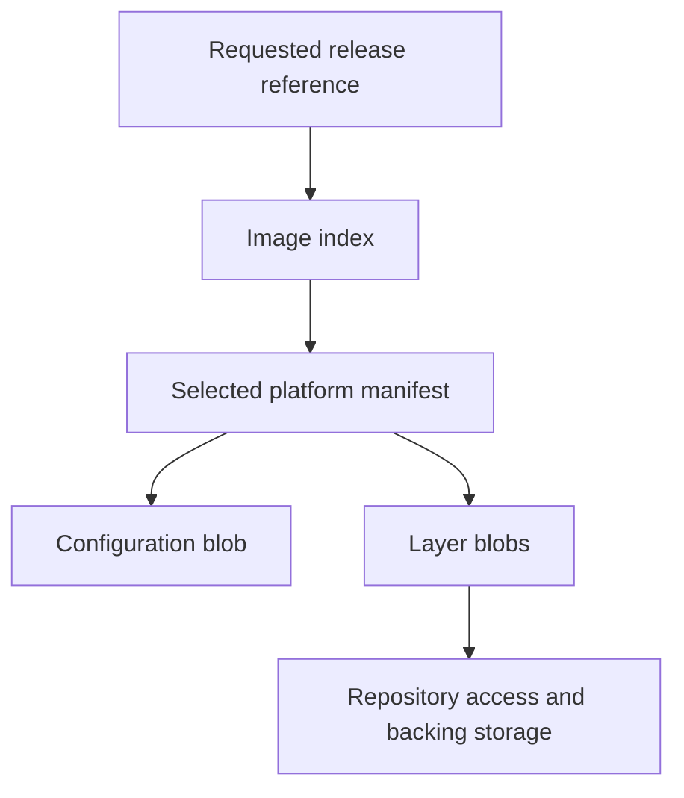

# Registry Push Succeeds but Pull Fails with blob unknown

Author: [nawazdhandala](https://www.github.com/nawazdhandala)

Tags: Container Registry, Troubleshooting, Storage

Description: Trace missing registry blobs through upload completion, repository mounts, storage routing, and garbage collection without damaging recovery evidence.

A build reports that an image was pushed successfully. Minutes later, a new node cannot pull it because a blob is unknown. Repeating the build may hide the symptom, but it does not explain whether the registry lost data, published an incomplete replica, or served a different repository than the one the build used.

Start with the exact failing reference, repository, digest, and HTTP response. A container image is a graph of objects: an index can select a platform manifest, and that manifest references a configuration blob and layer blobs. A successful request for one object does not prove that every descendant is readable.

This investigation uses the **OCI Distribution specification v1.1.1** and **Distribution 3.1.2** implementation tests. The inspection commands use **crane 0.20.6**, **jq 1.6**, and **curl 8.7.1**. They do not delete registry data or attempt repairs.

## Identify which object is missing

Preserve the failing client's detailed error, including the responding host and object digest. Compare it with the push's final repository, tag, and digest. Do not assume that a progress line saying a layer already exists means the entire image was published successfully.



A `MANIFEST_UNKNOWN` error is different from `BLOB_UNKNOWN`. A missing platform manifest is not a missing filesystem layer, and an expired token is not proof of missing storage. Gateways and clients sometimes compress these details into a generic pull failure; retain the actual API error where possible. [OCI error definitions](https://github.com/opencontainers/distribution-spec/blob/v1.1.1/spec.md#error-codes).

## Inspect the published graph by digest

Use approved read credentials and registry CA trust. Run this Bash example in a fresh working directory, replacing the repository and tag:

```bash
set -eu
repo='registry.example.internal/team/api'
tag='incident-release'
release_digest=$(crane digest --platform all "$repo:$tag")
crane manifest --platform all "$repo@$release_digest" > release.json
jq '{mediaType, manifests, config, layers}' release.json
```

The saved document tells you whether the release reference is an index or a single manifest. If it is an index, choose the child matching the failed node's operating system, architecture, and variant. Do not automatically choose its first entry; that can be another platform or an attestation.

Fetch that selected manifest explicitly:

```bash
platform_digest='sha256:REPLACE_WITH_REVIEWED_PLATFORM_DIGEST'
crane manifest "$repo@$platform_digest" > platform.json
jq -r '[.config.digest, .layers[].digest] | .[]' platform.json
```

For a single-manifest release, inspect the already saved `release.json` instead. The listed values are the objects to check, not commands to delete them. The config object is a blob too, so do not restrict the investigation to large layers. [crane manifest command](https://github.com/google/go-containerregistry/blob/v0.20.6/cmd/crane/doc/crane_manifest.md).

With an approved, protected header file containing a short-lived pull token, inspect the failing blob endpoint. Replace the digest placeholder:

```bash
blob_digest='sha256:REPLACE_WITH_FAILING_BLOB_DIGEST'
curl --silent --show-error --head \
  --cacert /protected/registry-ca.pem \
  --header @/protected/registry-read.header \
  --dump-header blob-head.headers \
  --output /dev/null \
  "https://registry.example.internal/v2/team/api/blobs/$blob_digest"
```

Read the status and headers. `401` or `403` calls for an access investigation. A confirmed `404` narrows the investigation toward availability in that repository. A redirect requires checking the approved storage destination and its accessibility. Do not forward credentials to an unreviewed redirect target.

A successful HEAD is only an existence check. Follow with an approved digest-aware download to prove the bytes are readable and correct. Metadata caches or storage failures can make HEAD and GET behave differently. The OCI specification distinguishes existence checks from content retrieval and digest verification. [Blob and existence endpoints](https://github.com/opencontainers/distribution-spec/blob/v1.1.1/spec.md#checking-if-content-exists-in-the-registry).

## Reconstruct the upload timeline

Correlate the client log with registry requests using timestamps and request identifiers. Separate these stages:

| Stage | Evidence to seek |
|---|---|
| Upload session opened | Accepted upload location, not a completed blob |
| Bytes transferred | Successful chunk operations and consistent upload state |
| Blob finalized | Digest-checked completion response |
| Manifest published | Successful final manifest request for the expected repository |
| Pull attempted | Same destination, exact manifest, and failing child digest |

An upload session response does not mean the blob is committed. Review proxy timeouts, interrupted finalization, and inconsistent backend routing if the log ends before completion.

Distribution 3.1.2 normally verifies referenced dependencies when storing a Docker schema2 manifest, unless the relevant internal verification bypass is used. Its verification checks include the config and layer references, with separate handling for external foreign layers. A completed push followed by failure therefore warrants investigating what changed afterward or whether the same backend served both requests. This is implementation-specific evidence, not a promise for every registry product. [Pinned manifest handler](https://github.com/distribution/distribution/blob/v3.1.2/registry/storage/schema2manifesthandler.go).

## Understand cross-repository mounts

A registry can avoid uploading the same bytes twice by mounting an existing blob from another repository. The mount request names both the destination repository and the source repository.

Under the OCI protocol, a successful mount returns `201`. If the registry cannot mount the blob, it can return `202` to begin a normal upload session. The client must handle that fallback; treating `202` as completed mounting leaves the workflow unfinished. [OCI mount protocol](https://github.com/opencontainers/distribution-spec/blob/v1.1.1/spec.md#mounting-a-blob-from-another-repository).

Check the source repository name, source-read permission, destination-write permission, and whether both names belong to the same registry. Physical blob presence in shared storage does not automatically establish that the destination repository can serve it. Distribution's mount test explicitly checks that the destination cannot find the blob before mounting and can read it afterward. [Distribution 3.1.2 mount tests](https://github.com/distribution/distribution/blob/v3.1.2/registry/storage/blob_test.go).

Do not manufacture repository links directly in storage to bypass a failed mount. Use the supported API after identifying the access or upload problem.

## Check storage consistency and cleanup activity

If publication really completed, compare the registry replicas' storage configuration: bucket, filesystem root, object prefix, credentials, and redirect behavior. A load balancer serving replicas with different data can produce intermittent success. Investigate asynchronous replication before blaming an image's build.

Review storage audit records, lifecycle rules, recent restores, and garbage-collection windows around the failure. An external lifecycle rule can remove an object the registry still references. A partial restore can recover manifests without all of their blobs.

Distribution's garbage collector requires the registry to be stopped or read-only during collection to avoid removing content involved in concurrent uploads. If cleanup overlapped writers, preserve the logs and stop further unsafe cleanup through the normal incident process. Running another collection will not reconstruct missing bytes. [Distribution garbage-collection guidance](https://distribution.github.io/distribution/about/garbage-collection/).

## Recover with verified content

First remove the cause: inconsistent storage routing, incomplete replication, incorrect permissions, or unsafe cleanup. Recover the exact missing content from a trusted backup or verified source using the registry's supported recovery or copy procedure. Keep the approved manifest digest fixed; rebuilding from source can create a different artifact.

Prove recovery from a clean staging client with no cached layers, then check every required platform and the relevant config and layer objects. Preserve evidence that explains why the failure will not recur.

For this article, Distribution 3.1.2's local storage tests passed for blob upload, cross-repository mounting, and manifest config/layer verification. These tests use controlled test storage. The inspection snippets passed syntax and JSON checks, but no production registry, storage corruption, disaster recovery, or actual Kubernetes pull was tested. Treat them as an investigation guide, not a claim that a particular production failure has been reproduced.
