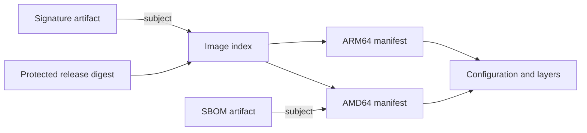

# Retain Multi-Platform Images, Signatures, and SBOMs as a Connected Set

Author: [nawazdhandala](https://www.github.com/nawazdhandala)

Tags: Container Registry, Supply Chain Security, Storage

Description: Build retention decisions from image and artifact relationships so cleanup preserves platform manifests, signatures, SBOMs, and digest-pinned rollback releases.

A retention job keeps the newest release tag and deletes old untagged manifests. The next deployment works on one architecture but fails on another, or the image pulls while its signature and SBOM can no longer be discovered. The tag survived; the release did not survive intact.

A safer policy starts with protected release digests and follows their relationships. This article uses the **OCI Image Specification1.1.1** and **OCI Distribution Specification1.1.1**. OCI means Open Container Initiative. The examples build a read-only retention report, not a deletion script.

## A release is more than its top-level manifest

A multi-platform image index points to manifests for individual operating-system and architecture combinations. Each image manifest references its configuration and layers. The [OCI image-index specification](https://github.com/opencontainers/image-spec/blob/v1.1.1/image-index.md) defines these descriptors and their platform information.

Signatures and SBOMs can be stored as separate artifacts. An SBOM, or software bill of materials, records software components. OCI1.1 manifests can declare a `subject` identifying the content to which an artifact relates. See the [manifest specification](https://github.com/opencontainers/image-spec/blob/v1.1.1/manifest.md).



Notice the direction of the artifact arrows. Starting at the image index and following only its child descriptors does not find artifacts pointing back to it. Retention needs both ordinary content traversal and referrer discovery.

## Define protected roots before applying age rules

Protected roots should include currently deployed digests, supported releases, rollback versions, legal holds, and artifacts needed for verification. Resolve tag-based policies to digests at the start of a controlled inventory window.

Do not use a tag's name or age as proof that a digest is unused. Several tags can point at the same digest, and workloads can refer to an image directly by digest without a tag. Keep the deployment inventory and the registry inventory as separate evidence sources.

For each protected release, state which platforms and verification artifacts must remain usable. If the release promises both AMD64 and ARM64, retaining only the platform used by the cleanup machine is a policy failure.

## Discover referrers completely

The Distribution1.1.1 referrers endpoint is repository-scoped. Its result describes manifests whose `subject` points at the requested digest in that repository. It can be paginated, so follow every `Link` with `rel="next"` before considering the inventory complete.

For an approved registry supporting this API, a read-only inspection has this shape:

```bash
curl --fail --silent --show-error \
  --cacert /protected/registry-ca.pem \
  --header @/protected/registry-authorization.header \
  --dump-header referrers.headers \
  --output referrers.json \
  'https://registry.example.internal/v2/team/widget/referrers/sha256:SUBJECT_DIGEST'
```

Replace the digest and repository, and use an existing protected authorization-header file from your approved authentication workflow. This retrieves one response, not an entire repository inventory. Store the headers with the body so pagination information is not lost.

The [OCI Distribution1.1.1 specification](https://github.com/opencontainers/distribution-spec/blob/v1.1.1/spec.md#listing-referrers) defines the response and fallback behavior. A404 from an unsupported referrers API is not the same as a successful empty referrer list. Some clients use the specified fallback tag schema; older signing tools may use other documented attachment conventions. Inventory the conventions your actual producers use before cleanup.

Avoid an artifact-type filter during the initial safety inventory. It can hide signatures, attestations, or SBOM formats that the filter did not name. Discover associations for child platform manifests as well as the top-level index.

## Compute a conservative retained set

The following Python3 function operates on already collected, validated OCI manifest bodies. `manifests` maps each manifest digest to its JSON object. `referrers` maps each examined digest to a complete list of referring manifest digests, including an empty list when discovery succeeded with no results.

```python
def retained_content(roots, manifests, referrers):
    if not roots:
        raise ValueError("Supply explicitly protected release digests")
    pending = list(roots)
    kept_manifests, kept_blobs = set(), set()

    while pending:
        digest = pending.pop()
        if digest in kept_manifests:
            continue
        if digest not in manifests or digest not in referrers:
            raise ValueError(f"Incomplete inventory for {digest}")
        document = manifests[digest]
        kept_manifests.add(digest)

        pending.extend(item["digest"] for item in document.get("manifests", []))
        pending.extend(referrers[digest])
        if "subject" in document:
            pending.append(document["subject"]["digest"])
        if "config" in document:
            kept_blobs.add(document["config"]["digest"])
        kept_blobs.update(item["digest"] for item in document.get("layers", []))

    return {
        "manifests": sorted(kept_manifests),
        "blobs": sorted(kept_blobs),
    }
```

Call the function with the protected-root list and the two inventory maps. It returns sorted digest lists suitable for a review report. It follows child manifests, referrers, and subjects, while retaining configuration and layer blobs. The visited set prevents repeated work when relationships lead back to already examined manifests.

This conservative example retains all discovered referrers rather than guessing which unfamiliar artifact types are safe to delete. It refuses a missing inventory entry. However, an empty list supplied incorrectly by the collector still looks empty: the function cannot prove that pagination, authorization, legacy attachment discovery, or concurrent publication was handled correctly.

The function assumes the manifest bodies have already passed media-type, schema, and digest validation. It is not a registry client, a signature verifier, or a complete policy engine. It also works within one repository; a multi-repository report must retain repository identity alongside each digest rather than conflating different registry references.

## Turn the set into a reviewable policy

Use the retained set as a protection boundary. Only consider candidates outside it, then apply age, grace-period, owner, and legal-hold rules. Unknown inventory states should block deletion for the affected scope.

A useful report explains why each manifest is retained: deployed root, rollback root, child platform, referrer, or subject. Record the inventory timestamp and configuration revision. Prevent publishers and cleanup jobs from racing the final inventory and deletion decision, or use a registry's supported transactional retention mechanism.

Do not equate bytes present with discoverability. Deleting a fallback referrer-list tag can make an artifact harder to find even if its manifest remains stored. Conversely, discovering a signature does not establish that its identity and cryptographic verification satisfy your release policy.

## Rehearse deletion and garbage collection separately

Create a staging release containing at least two platform manifests, a shared layer, a signature, and an SBOM attached to a child manifest. Include an unrelated old image and a rollback digest with no tag. Verify that the report protects the complete release and rollback graph while identifying the unrelated image as a possible candidate.

After applying an approved retention policy to that staging registry, pull each required platform and run the same signature and SBOM checks used in production. Then rehearse the registry's garbage collector under its documented write-quiescence requirements and repeat verification.

Local tests exercised the function with synthetic graphs, including shared blobs, subject/referrer cycles, missing inventory entries, and an unrelated manifest. They did not contact a registry or verify a real signature. The operational success criterion is that retained releases remain pullable and verifiable after both logical cleanup and physical reclamation.
