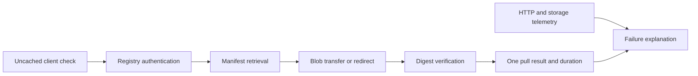

# Registry SLOs That Detect Real Image Pull Failures

Author: [nawazdhandala](https://www.github.com/nawazdhandala)

Tags: Container Registry, SLO, Monitoring

Description: Combine registry HTTP metrics with complete pull checks to measure availability, manifest latency, blob transfer, and storage failures accurately.

The registry health endpoint returns `200`, but a deployment cannot fetch its image layers. A dashboard showing only server availability misses the user's actual task: obtaining a complete, usable image.

A service-level objective, or SLO, defines the reliability you intend to provide. For a registry, begin with successful image retrieval, then use HTTP, latency, transfer, and storage measurements to explain failures. A low `5xx` rate alone is not a complete pull-success SLO.

The examples below use metrics observed from **Distribution 3.1.2** and PromQL checked with **Prometheus promtool 3.7.3**. Metric names and labels vary by registry product and version; inspect your own endpoint before importing queries.

## Define an eligible pull attempt

Write the objective in terms of a known artifact and a known client path. For example: “99.9% of scheduled pulls of the approved canary image complete within 30 seconds over 30 days.” Those numbers are an example policy, not a universal registry target.

Define completion as retrieving the selected platform manifest, configuration, and all required layers with digest verification. Include authentication and redirects if production clients use them. Decide whether client-side extraction belongs in this objective or a separate node-readiness objective.

Do not count deliberate requests for nonexistent images as availability failures. Do count a missing blob for an approved retained release. Distinguish a cached client start from a genuine pull: a local cache can bypass the system being measured.



Keep the synthetic image small enough for the check cadence, but representative of required architectures and authorization. A tiny canary is useful for availability; it is not a throughput benchmark for a multi-gigabyte release.

## Enable metrics without exposing the debug server

For Distribution 3.1.2, this fragment enables Prometheus output on a loopback debug listener:

```yaml
http:
  debug:
    addr: 127.0.0.1:5001
    prometheus:
      enabled: true
      path: /metrics
```

Merge it into the existing HTTP configuration and apply through the usual restart or rollout process. A scraper must share the appropriate network context or use an approved protected access path. Inside a container, loopback is that container's network namespace, not automatically the host's loopback. Do not expose the debug listener publicly just to make scraping easier. [Pinned Distribution configuration](https://github.com/distribution/distribution/blob/v3.1.2/docs/content/about/configuration.md#prometheus).

For this article, a temporary registry process exposed these actual series after test requests:

```text
registry_http_requests_total{code="404",handler="manifest",method="get"}
registry_http_request_duration_seconds_bucket{handler="manifest",method="get",le="0.1"}
registry_http_response_size_bytes_sum{handler="blob"}
```

The route label is `handler`, the HTTP method is lowercase, and response-size metrics do not have the same labels as request counters. Distribution instruments handlers using its configured metrics wrapper. [Pinned handler instrumentation](https://github.com/distribution/distribution/blob/v3.1.2/registry/handlers/app.go).

## Use the 5xx rate as a diagnostic signal

Assume your Prometheus scrape job is named `registry` and represents one registry service. This query computes the fraction of manifest and blob GET requests that returned a server error over five minutes:

```promql
(
  sum(rate(registry_http_requests_total{
    job="registry", handler=~"manifest|blob", method="get", code=~"5.."
  }[5m])) or vector(0)
)
/
sum(rate(registry_http_requests_total{
  job="registry", handler=~"manifest|blob", method="get"
}[5m]))
```

The zero fallback covers the case where no server-error series has appeared yet. It does not turn missing traffic into successful traffic: a zero denominator is undefined, and absent telemetry still needs its own alert. Apply `rate` to individual counters before aggregating so resets are handled correctly. [Prometheus rate documentation](https://prometheus.io/docs/prometheus/latest/querying/functions/#rate).

The result is a fraction, so `0.01` means 1%. Scope the query separately per environment or service if the scrape job spans several registries; do not let a busy healthy registry hide a failing quiet one.

Expected authentication challenges can generate `401` responses during successful pulls. Excluding all `4xx` from the diagnostic numerator avoids treating every challenge as an outage, but it also misses denied final requests and missing retained content. The complete pull check must capture those user-visible failures.

## Measure manifest latency separately

Manifest responses are small and frequently sit on the critical path before blob downloads. For the observed classic histogram, compute a service-wide 95th percentile like this:

```promql
histogram_quantile(0.95,
  sum by (le) (
    rate(registry_http_request_duration_seconds_bucket{
      job="registry", handler="manifest", method="get"
    }[5m])
  )
)
```

Keep the `le` bucket boundary label while aggregating classic histogram buckets. Do not average per-instance percentiles. Histogram quantiles are estimates whose accuracy depends on bucket placement and observations. [Prometheus histogram guidance](https://prometheus.io/docs/practices/histograms/).

These observed duration buckets have no response-code label. The query includes errors as well as successes, and quick failures can make latency look deceptively good. Pair latency with outcomes and request volume. Choose a useful threshold after measuring ordinary traffic and validating that a bucket exists near the intended boundary.

## Interpret blob throughput honestly

This query measures bytes per second recorded in responses from the blob handler:

```promql
sum(rate(registry_http_response_size_bytes_sum{
  job="registry", handler="blob"
}[5m]))
```

It is a traffic signal, not the percentage of successful pulls or the download speed experienced by each client. More concurrent downloads can increase aggregate throughput while individual clients slow down.

If the registry redirects blob downloads to object storage, the registry's own response can be only a redirect rather than the image bytes. Measure the object-storage or delivery endpoint and the client-side transfer duration too. Distribution's redirect configuration determines whether the storage driver can offload transfers. [Distribution redirect configuration](https://github.com/distribution/distribution/blob/v3.1.2/docs/content/about/configuration.md#redirect).

For a controlled throughput check, record verified bytes divided by transfer time for a fixed test artifact and network location. Keep that result separate from general production byte rate, and avoid a test schedule that overloads the service it measures.

## Connect storage errors to pull outcomes

Storage failures may surface as registry errors, delayed responses, broken redirects, or unavailable objects. Correlate registry request logs with backend permission errors, throttling, failed reads, disk exhaustion, and latency. Do not assume all backend errors share one metric name across storage drivers.

Track missing approved objects separately from ordinary nonexistent-tag requests. Record the repository and digest in restricted logs or traces rather than putting every digest into metric labels; unbounded label values can make the monitoring system expensive and unreliable.

A complete pull can also fail before the registry sees a request, for example because of DNS, certificate trust, or token-service availability. Place checks along the network paths your deployment systems actually use, and monitor whether the checks themselves are still running.

## Validate the objective before paging on it

Test the monitoring design in staging with controlled missing-content, denied-access, slow-transfer, and unavailable-backend scenarios. Confirm that the pull outcome fails when expected and that the diagnostic panels point toward the cause. Measure error-budget consumption over the agreed reporting window; use shorter windows for timely alerts without confusing them with the entire SLO period.

The local checks for this article started a disposable Distribution 3.1.2 process, issued successful base and missing-object requests, and inspected its metrics. Promtool checked the queries and tested the error ratio with synthetic counters. No production SLO, real object-storage failure, authentication outage, uncached container pull, or throughput benchmark was exercised.

The useful dashboard answers two questions together: whether clients can retrieve approved images, and which stage explains a failure. HTTP success, latency, bytes, and storage health each contribute evidence, but none substitutes for the complete pull result.
