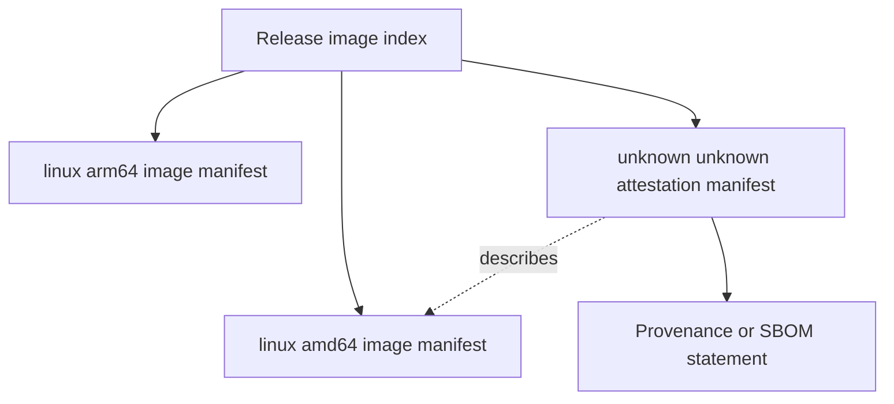

# Registry unknown/unknown: Attestation or Broken Platform Image?

Author: [nawazdhandala](https://www.github.com/nawazdhandala)

Tags: Container Registry, Docker, Supply Chain Security

Description: Inspect unknown/unknown registry entries safely, identify BuildKit attestations, and separate expected metadata from missing or broken platform images.

You push an AMD64 image and the registry displays two entries: `linux/amd64` and `unknown/unknown`. It is tempting to assume that the second entry is a failed build. In a common BuildKit output format, however, that entry is intentional: it carries information about the image rather than an application to execute.

The useful question is what the entry contains and how it relates to the runnable image. Deleting it to tidy the registry interface can remove evidence that a release policy needs.

This guide examines the index-attached attestation format documented in **BuildKit v0.20.2**, using **crane 0.20.6** and **jq 1.6** for read-only inspection. Other artifact formats and registry interfaces can present metadata differently; the label alone is never enough to classify an entry.

## Understand the two kinds of child manifest

An image index is a directory of descriptors. Each descriptor identifies another object by digest and can include platform information. A normal multi-platform index might point to runnable Linux images for AMD64 and ARM64. [OCI image-index specification](https://github.com/opencontainers/image-spec/blob/v1.1.1/image-index.md).

An attestation is a statement about an artifact. Examples include provenance describing how it was built and a software bill of materials, or SBOM, describing its contents. Docker's build tooling can attach such statements to an image. The presence of a statement is separate from a decision to trust its author or accept its claims. [Docker build attestations](https://docs.docker.com/build/metadata/attestations/).

In the pinned BuildKit format, an attestation manifest is another child of the image index. Its platform uses `unknown` for both operating system and architecture so runtimes do not select it as a normal runnable image. Descriptor annotations identify its role and the manifest it describes. [BuildKit v0.20.2 storage format](https://github.com/moby/buildkit/blob/v0.20.2/docs/attestations/attestation-storage.md).



Here the third entry is not a third execution platform. A registry interface that lists every child under a platform heading can make this relationship harder to see.

## Save the exact index behind the label

Use a workstation with approved registry credentials and CA trust. Replace the repository and release tag below. Run the examples in a new inspection directory so previous evidence is not overwritten.

```bash
set -eu
repo='registry.example.internal/team/api'
release_tag='reviewed-release'
resolved=$(crane digest --platform all "$repo:$release_tag")
crane manifest --platform all "$repo@$resolved" > index.json
jq -e '(.manifests | type == "array") and
       (.manifests | length > 0)' index.json >/dev/null
```

Resolving once prevents a tag move from mixing two releases during the investigation. The guard checks that the response has a nonempty child-manifest list. If it fails, stop: the reference may be a single image manifest, or the returned document needs further inspection. Do not pretend that a missing list means there are no problems.

The crane manifest command retrieves the manifest associated with a reference; selecting all platforms avoids reducing an index to one platform during this inspection. [Pinned manifest command](https://github.com/google/go-containerregistry/blob/v0.20.6/cmd/crane/doc/crane_manifest.md).

Print a compact inventory:

```bash
jq -r '.manifests[] | [
  .digest,
  (.platform.os // "missing"),
  (.platform.architecture // "missing"),
  (.annotations["vnd.docker.reference.type"] // "unclassified"),
  (.annotations["vnd.docker.reference.digest"] // "no target")
] | @tsv' index.json
```

Each output row contains the child digest, operating system, architecture, declared role, and target digest. A BuildKit attestation candidate normally has the role `attestation-manifest` and names the image manifest it describes. Treat these fields as evidence to investigate, not as an authenticated guarantee.

## Check the relationship before dismissing the warning

Save this filter as `attestation-targets.jq` and run it against the saved index:

```jq
.manifests as $entries |
$entries[] |
select(.annotations["vnd.docker.reference.type"] == "attestation-manifest") |
.annotations["vnd.docker.reference.digest"] as $target |
{
  attestation: .digest,
  target: $target,
  targetPresent: ($target != null and
    any($entries[]; .digest == $target))
}
```

```bash
jq -f attestation-targets.jq index.json
```

This reports whether each declared target is present among the index's direct children. A false result needs investigation: the relationship might be missing, the index might have been edited incorrectly, or the artifact might use a different convention. A true result only confirms a link. It does not prove that the target is runnable or that the attestation is valid.

Next, choose one candidate digest from the inventory and inspect its manifest. Replace the entire digest placeholder:

```bash
candidate='sha256:REPLACE_WITH_REVIEWED_CHILD_DIGEST'
crane manifest "$repo@$candidate" > candidate.json
jq '{mediaType, config,
     layers: [.layers[]? | {mediaType, digest, annotations}]}' candidate.json
```

For the documented format, the manifest's layers describe attestation blobs, commonly with media type `application/vnd.in-toto+json`. A predicate-type annotation helps identify what kind of statement a blob contains. Inspect the actual statement through your approved artifact tooling when validating its subject and policy; descriptor metadata alone is insufficient. [Docker attestation storage documentation](https://docs.docker.com/build/metadata/attestations/attestation-storage/).

## Distinguish expected metadata from a release failure

Use the combined evidence rather than the interface label:

| Observation | Interpretation and next step |
|---|---|
| Attestation role, matching target, expected statement layers | Likely intentional metadata; verify it under the release policy |
| Unknown platform without recognizable annotations | Unclassified object; inspect its manifest, config, and producer |
| Required ARM64 image absent | Platform coverage failure even if AMD64 and attestations are healthy |
| Runnable descriptor points to an unavailable manifest | Incomplete publication, replication, retention, or permissions issue |
| Target exists but its layers cannot be fetched | Artifact availability failure; metadata presence does not repair it |
| Index and children are healthy but interface looks wrong | Investigate registry display support separately from image usability |

For a runnable candidate, inspect its image configuration and compare the declared operating system and architecture with the descriptor. Then exercise a pull and application startup on the intended architecture in staging. Configuration metadata can be wrong, so matching strings do not replace execution evidence.

Likewise, absence of attestations inside the index is not proof that none exist. Publishers may store associated artifacts through other conventions, including repository referrers. Use the producer's documented discovery mechanism. [OCI Distribution referrers API](https://github.com/opencontainers/distribution-spec/blob/v1.1.1/spec.md#listing-referrers).

## Fix the producer or consumer, not just the display

If the object is legitimate metadata, preserve it and update the registry interface or downstream tooling to recognize the format. If a required platform image is broken, repair the build or publication path and issue a newly verified release.

Removing descriptors or rewriting platform fields changes the index content and therefore its digest. It can also disconnect attestations from their targets. Do not silently rewrite an already approved release just to remove an unfamiliar row. Disabling provenance globally to hide a display issue similarly changes what evidence future releases provide.

The filters in this article were checked locally with synthetic indexes containing valid links, missing targets, and unclassified unknown-platform descriptors. Their shell syntax and expected JSON outputs were tested. No real registry UI, BuildKit build, signature verification, container execution, or registry mutation was performed.

Keep the saved index, child-manifest evidence, required-platform list, and actual pull results together in the investigation. That makes the conclusion specific: expected attestation metadata, an interface limitation, or a demonstrated release defect. An `unknown/unknown` label by itself establishes none of those outcomes.
