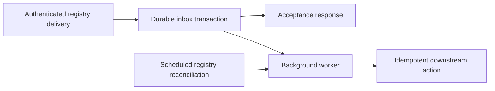

# Reliable Registry Webhooks: Deduplication, Retries, and Ordering

Author: [nawazdhandala](https://www.github.com/nawazdhandala)

Tags: Container Registry, Webhook, Reliability

Description: Build a durable registry event inbox, handle duplicate delivery and out-of-order events, and reconcile missed notifications without repeating side effects.

A registry webhook consumer receives a push event, starts a vulnerability scan, and times out before returning a response. The registry retries. Without a durable record of the first delivery, the consumer starts another scan. If the consumer instead acknowledges immediately and then crashes, the scan may never start at all.

Reliable consumption requires separating receipt from business processing. Acknowledge after durable acceptance, process work asynchronously, and make repeated processing safe.

This guide grounds the delivery behavior in **Distribution 3.1.2**. Other registries have different retry policies and event schemas, so verify their contracts before adapting the design. The example inbox uses **Python 3.11** and SQLite to demonstrate transaction boundaries; it is not a complete HTTP service.

## Start with the actual delivery guarantees

Distribution sends event envelopes to configured endpoints through per-instance queues. Those queues are in memory, and event order is not guaranteed. Retries help with temporary endpoint failures, but they do not turn the notification system into a durable audit log that survives every registry failure. [Distribution notification documentation](https://distribution.github.io/distribution/about/notifications/).

The pinned HTTP sender treats responses from `200` through `399` as accepted. A redirect or login page therefore must not stand in for a successful inbox commit. Configure a direct authenticated receiver endpoint that intentionally returns its acceptance response. [Distribution 3.1.2 HTTP sender](https://github.com/distribution/distribution/blob/v3.1.2/notifications/http.go).

Design for these cases:

| Failure | Required consumer behavior |
|---|---|
| Response lost after commit | Duplicate receipt returns success without adding duplicate work |
| Inbox unavailable | Do not acknowledge acceptance; allow delivery retry |
| Worker crashes after side effect | Retry through a stable idempotency key or reconcile the result |
| Events arrive out of order | Re-read authoritative state before changing a current-state view |
| Registry loses queued events | Scheduled reconciliation discovers missing work |

An idempotent operation produces the intended result when repeated, rather than multiplying the result. For example, submitting a scan with the same task key should return the existing scan instead of creating a second one.



## Use the event identity, not the tag, for receipt deduplication

Distribution events include an event `id`, an action, and target information. Keep the event ID distinct from the originating HTTP request ID and the registry process instance ID. The latter can change after a registry restart. [Pinned event schema](https://github.com/distribution/distribution/blob/v3.1.2/notifications/event.go).

A useful inbox key is `(trusted registry identity, event id)`. Derive the registry identity from the authenticated route or credential configuration, not an untrusted payload field. Keep the full event for investigation and later processing.

Do not deduplicate receipts by tag. Two legitimate pushes can update the same tag. Do not deduplicate only by digest either: the same digest can appear in multiple repositories or trigger different actions.

Business-task deduplication is a separate decision. A scan might use `(registry, repository, digest, scanner-policy-version)` as its task key, while a release notification might require a release identifier and destination too.

## Commit the inbox before returning success

Use SQLite 3.24.0 or newer for the targeted `ON CONFLICT` clause; the local checks used SQLite 3.54.1. [SQLite UPSERT documentation](https://www.sqlite.org/lang_upsert.html).

Save this as `inbox.py`. It accepts an already authenticated, bounded, decoded envelope. The surrounding HTTP service must enforce request-size limits and validate the provider's envelope before calling it.

```python
import json
import sqlite3


def open_inbox(path):
    db = sqlite3.connect(path, isolation_level="DEFERRED")
    db.execute("""
        CREATE TABLE IF NOT EXISTS inbox (
            registry TEXT NOT NULL,
            event_id TEXT NOT NULL,
            payload TEXT NOT NULL,
            state TEXT NOT NULL DEFAULT 'pending',
            PRIMARY KEY (registry, event_id)
        )
    """)
    db.commit()
    return db


def accept_events(db, registry, events):
    if not isinstance(registry, str) or not registry:
        raise ValueError("trusted registry identity required")
    if not isinstance(events, list):
        raise ValueError("events must be a list")
    inserted = 0
    with db:
        for event in events:
            if not isinstance(event, dict):
                raise ValueError("event must be an object")
            event_id = event.get("id")
            if not isinstance(event_id, str) or not event_id:
                raise ValueError("event id required")
            payload = json.dumps(event, sort_keys=True,
                                 separators=(",", ":"), allow_nan=False)
            cursor = db.execute("""
                INSERT INTO inbox (registry, event_id, payload)
                VALUES (?, ?, ?)
                ON CONFLICT (registry, event_id) DO NOTHING
            """, (registry, event_id, payload))
            stored = db.execute("""
                SELECT payload FROM inbox
                WHERE registry = ? AND event_id = ?
            """, (registry, event_id)).fetchone()[0]
            if stored != payload:
                raise ValueError("event id reused with different payload")
            inserted += cursor.rowcount
    return inserted
```

Use an on-disk database on durable storage and a connection owned by the handling thread. Do not switch this example to autocommit mode: the transaction is what prevents half an envelope from being accepted. Python's connection context manager commits on success and rolls back on an exception. Parameter binding keeps event values separate from SQL syntax. [Python 3.11 SQLite transactions](https://docs.python.org/3.11/library/sqlite3.html#transaction-control).

After `accept_events` returns successfully, the HTTP handler can return `202`. Returning zero means all supplied events already exist; that is still an accepted retry. If storage fails, do not return success. The function deliberately raises on conflicting payloads under the same identity; quarantine and investigate such conflicts rather than silently overwriting history.

This table is both the receipt record and the pending-work source. Adding a separate queue later requires an atomic outbox or another reliable handoff, otherwise a crash between the database commit and queue publish can lose work.

## Make worker retries safe

A production worker needs atomic claiming, a lease or recovery mechanism for abandoned tasks, attempt counts, and a next-attempt time. Process only actions and media types relevant to the task: a blob push is not necessarily a completed release manifest, and a pull notification should not start a deployment.

Use bounded exponential backoff with jitter for temporary downstream failures. Keep persistent failures visible in a quarantine or failed-work queue with replay controls. Do not mark the task complete before the downstream action succeeds.

There remains a crash window after an external action succeeds but before the inbox is marked done. Close it with the downstream service's idempotency mechanism or a reconciliation query keyed by the stable task identity. An inbox uniqueness constraint alone cannot provide exactly-once external effects.

## Treat events as triggers, not an ordered ledger

Suppose a tag moves from digest A to digest B, but the B event arrives first. Applying the later-arriving A event directly to a current-state database moves that view backward.

For current tag state, treat either event as a request to read the registry's present value. Serialize or otherwise coordinate updates for that registry/repository/tag, and reconcile again if it changes during processing. An event timestamp is not a registry-wide sequence number and cannot establish a total order across replicas.

For immutable artifact work, retain the event's digest. Scan that artifact rather than resolving a mutable tag and accidentally scanning something else. This distinction lets one consumer maintain a current inventory while another processes every approved artifact identity.

## Reconcile and measure the gaps

Periodically enumerate the repositories and tags your service is responsible for, resolve their digests, and compare them with durable task records. Include required untagged release digests from the release inventory. Do not assume tag enumeration reconstructs deleted history or every past event.

Monitor the age of the oldest pending task, acceptance failures, duplicate rate, retry counts, conflicts, and reconciliation discoveries. On the registry side, watch endpoint failures and queued events. Alert on growing delay, not just whether the receiver returns HTTP responses.

The exact inbox helper was tested locally for duplicate replay, reordered events, separate registry namespaces, conflicting payloads, transaction rollback, and persistence after reopening. These checks did not test a production HTTP receiver, authentication, worker leases, external side effects, or registry failover. Validate those boundaries with controlled failure tests before relying on the consumer for release automation.
