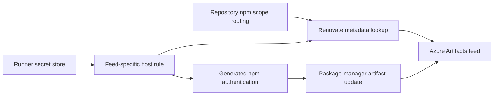

# Authenticate Renovate to Azure Artifacts npm with hostRules

Author: [nawazdhandala](https://www.github.com/nawazdhandala)

Tags: Renovate, Azure, npm

Description: Configure feed-specific credentials for self-hosted Renovate, distinguish raw PATs from npm encoding, and test lookup and lockfile authentication separately.

Renovate discovers an update to a private npm package, then fails while updating the lockfile. Or it can clone the Azure DevOps repository but cannot read its package feed. Both symptoms are possible because repository access, package metadata access, and package-manager downloads are separate operations.

Use a self-hosted `hostRules` entry for the Azure Artifacts feed and keep registry routing in the repository’s npm configuration. This guide uses Renovate 44.257.6, with local configuration and credential-matching tests. It does not claim a successful login to a real Azure organization.

## Identify the exact feed URL

Open Azure Artifacts, select the feed, and use **Connect to feed** to obtain its npm registry URL. A project-scoped feed commonly includes both organization and project:

```text
https://pkgs.dev.azure.com/example-org/example-project/_packaging/example-feed/npm/registry/
```

An organization-scoped feed omits the project segment. Copy the actual URL rather than guessing which scope your feed uses. Microsoft’s [npm connection guide](https://learn.microsoft.com/en-us/azure/devops/artifacts/npm/npmrc?tabs=other&view=azure-devops) shows the connection snippets.

All names in this article are placeholders. The trailing slash is intentional. A rule matching only `pkgs.dev.azure.com` covers a much broader destination than one specific feed path.

## Route the package scope without storing credentials

For a repository whose private packages use the `@example` npm scope, a project `.npmrc` can contain:

```ini
registry=https://registry.npmjs.org/
@example:registry=https://pkgs.dev.azure.com/example-org/example-project/_packaging/example-feed/npm/registry/
```

Replace the scope and feed URL. This sends that scope to Azure while leaving ordinary public packages on npm’s public registry. If your organization intentionally routes all dependencies through an Azure feed with upstream sources, use its approved default-registry configuration instead.

This file describes routing, not authentication. It is suitable for source control because it contains no token. The [npm configuration reference](https://docs.npmjs.com/cli/v11/configuring-npm/npmrc/) explains registry scopes and why authentication settings must be associated with the intended registry.

Check for another `.npmrc` nearer the package file or a self-hosted Renovate `npmrc` override. A correct credential rule cannot repair routing to the wrong registry.

## Supply the raw secret through runner configuration

Save this as an administrator-controlled `config.cjs`, or merge the rule into the bot’s existing CommonJS configuration. Keep platform settings and repository selection from the existing bot setup.

```javascript
const password = process.env.AZURE_NPM_TOKEN;
if (!password) throw new Error('AZURE_NPM_TOKEN is required');

module.exports = {
  hostRules: [
    {
      hostType: 'npm',
      matchHost: 'https://pkgs.dev.azure.com/example-org/example-project/_packaging/example-feed/npm/registry/',
      username: 'VssSessionToken',
      password,
    },
  ],
};
```

Inject `AZURE_NPM_TOKEN` from your CI secret store into the Renovate process. The startup guard fails when the secret is absent instead of silently attempting anonymous access. The file contains a variable reference; do not replace it with a literal credential and commit it.

This uses the Azure npm username/password form documented in Renovate’s [private-package guide](https://docs.renovatebot.com/getting-started/private-packages/#add-hostrule-to-self-hosted-config). Here the password is the raw personal access token, or PAT. `VssSessionToken` is the nonsecret username label from that example.

Do not base64-encode the PAT before assigning it to `password`. Microsoft’s manual user-level `.npmrc` examples use an encoded `_password` field, which is a different representation. Renovate’s [44.257.6 npm artifact code](https://github.com/renovatebot/renovate/blob/44.257.6/lib/modules/manager/npm/post-update/rules.ts) converts a host-rule password to base64 when constructing that npm setting. Pre-encoding would encode it twice.

Base64 is not encryption. Generated package-manager authentication files remain sensitive even if the secret is not immediately readable.

## Understand the two package access paths



Renovate needs registry credentials when finding versions and when invoking a package manager to update artifacts such as a lockfile. Verify both paths. A successful metadata lookup is not sufficient evidence that every tarball URL in a lockfile will authenticate correctly.

Compare the registry URL, the rule’s `matchHost`, and the package’s resolved download URLs. Azure connection instructions can include authentication scopes for both `/npm/registry/` and `/npm/`. If a real download requires a sibling path outside your narrow rule, add the explicitly required feed-specific scope after inspection; do not immediately broaden credentials to the entire host.

Also distinguish the bot’s repository-platform token. A credential that permits cloning or creating a pull request does not by itself establish feed access. Renovate’s [Azure platform guide](https://docs.renovatebot.com/modules/platform/azure/) discusses these separate configuration concerns.

## Check permissions as well as syntax

The identity behind the PAT must have access to the organization, project where applicable, and feed. Token scope cannot grant permissions that the identity lacks. Use the permissions required by your actual read and artifact-update workflow rather than assuming publishing rights are necessary for every lookup.

Microsoft distinguishes **Feed Reader**, which can download packages, from **Feed and Upstream Reader**, which can also save packages from upstream sources. That distinction matters when a dependency has not yet been saved into a feed. Consult the [feed-permissions table](https://learn.microsoft.com/en-us/azure/devops/artifacts/feeds/feed-permissions?view=azure-devops) when diagnosing an upstream-package failure.

Keep token expiry and ownership visible to the bot operators. A configuration that works today can fail when the token expires or its owning identity loses feed access. Rotate the secret through the runner’s secret store, then verify a fresh run rather than relying on an already-running process.

## Validate without exposing the secret

With a supported Node.js runtime, test the configuration file using the pinned validator. The environment variable must already be injected securely:

```bash
npx --yes --package renovate@44.257.6 -- \
  renovate-config-validator --strict config.cjs
```

Do not print `process.env`, the exported configuration, or generated `.npmrc` content to confirm that the secret exists. The guard already checks absence. Configuration validation checks structure; it does not authenticate to Azure or prove feed permission.

For this article, I used a synthetic value and the actual Renovate 44.257.6 host-rule functions. The intended npm feed URL matched. Another project, another feed, npmjs.org, and a different host type did not receive that rule’s password. The npm artifact helper produced a feed-scoped `_password` whose single base64 decoding matched the synthetic input.

The exact configuration passed strict validation on Node 24.11.0. Native RE2 was unavailable locally, so Renovate emitted its JavaScript regex fallback warning. No real credential, Azure request, package installation from a private feed, or lockfile update was used in these checks.

## Diagnose the failing operation

For a 401, inspect token presence, expiration, raw-versus-encoded handling, and the matched URL. For a 403, inspect identity and feed permissions. For a 404, also confirm project/feed scope and package routing; do not assume it proves the package never existed.

If only artifact updates fail, inspect the package manager’s registry and download URL configuration. If only one repository fails, compare its local npm configuration and lockfile endpoints with a working repository. Use redacted diagnostics that retain host, path, stage, and status without credentials or authorization headers.

Finish with a controlled private-package update in a test repository: metadata lookup, lockfile regeneration, and dependency resolution must all succeed. Keep the feed-specific rule and secret injection intact as you move to normal operation, and retain the negative matching checks when adding more feeds.
