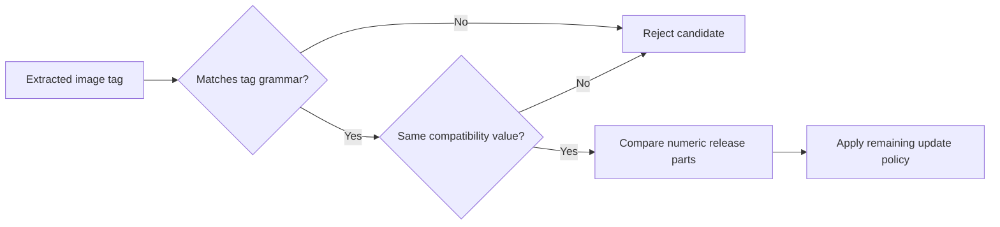

# Handle Date and Vendor Docker Tags with Renovate Regex Versioning

Author: [nawazdhandala](https://www.github.com/nawazdhandala)

Tags: Renovate, Docker, DevOps

Description: Teach Renovate to order calendar-based image tags and vendor rebuilds while keeping incompatible image variants on separate update paths.

An image publisher uses tags such as `release-2026.11.20-vendora-debian12-r9`. The next rebuild is `r10`, another vendor publishes a newer date, and an Alpine variant appears alongside both. You want the newest compatible image, not whichever string sorts last.

Renovate needs a rule that separates release order from compatibility. Regex versioning lets you describe those parts explicitly. This guide uses a fictional image and tag contract, checked against Renovate 44.257.6; replace them with the publisher’s documented conventions before using the rule.

## Decide what each part means

A regular expression describes the shape of a tag. Named capture groups tell Renovate which parts to compare. Do not start by writing a permissive expression that accepts every string in the registry.

For this example, the publisher guarantees this format:

| Tag component | Example | Intended meaning |
| --- | --- | --- |
| Fixed prefix | `release-` | Identifies this release family |
| Year, month, day | `2026.11.20` | Calendar-based release order |
| Vendor and base OS | `vendora-debian12` | Compatibility boundary |
| Rebuild counter | `r9` | Later packaging revision for that date |

The same day’s `r10` should supersede `r9`. Tomorrow’s `r0` should supersede today’s `r99`. Switching `vendora` to `vendorb` is a separate migration, even when the latter has a newer date.

These are example business rules, not universal Docker semantics. A different publisher might use a date as build metadata or a suffix as a release channel. Check its policy first.

## Understand why default Docker versioning may differ

Docker tags are labels rather than a mandatory semantic-version format. Renovate’s [Docker versioning documentation](https://docs.renovatebot.com/modules/versioning/docker/) explains its compatibility-preserving treatment of suffixes. That works well for many images but may not represent a publisher’s rebuild counter as an incrementing component.

Do not replace the default for every Docker dependency. Scope the override to the specific image and Docker datasource. Other images in the repository may rely on the existing behavior.

A versioning override also does not discover dependencies. The relevant manager must already extract the image reference from your Dockerfile, Compose file, or another supported file. Debug extraction separately if the dependency never appears in Renovate’s output.

## Apply a narrow package rule

Merge this object into the repository’s Renovate configuration. `registry.example.com/team/report-worker` is a placeholder package name, not a registry used in the tests.

```json
{
  "$schema": "https://docs.renovatebot.com/renovate-schema.json",
  "packageRules": [
    {
      "matchDatasources": ["docker"],
      "matchPackageNames": ["registry.example.com/team/report-worker"],
      "versioning": "regex:^release-(?<major>[0-9]{4})\\.(?<minor>[0-9]{2})\\.(?<patch>[0-9]{2})-(?<compatibility>vendor[ab]-debian12)-r(?<build>[0-9]+)$",
      "automerge": false
    }
  ]
}
```

The expression is anchored with `^` and `$`, so unrelated prefixes or trailing release markers are rejected. The year is `major`, month is `minor`, and day is `patch`. The rebuild’s digits are `build`; its literal `r` stays outside the capture.

`compatibility` contains both vendor and base operating system. The example accepts two named vendors but never proposes a transition between their compatibility values. It intentionally excludes other operating systems and prerelease forms.

In JSON, `\\.` produces `\.` in the regular expression, meaning a literal dot. The `[0-9]` notation avoids another layer of backslash escaping for digits. Do not paste the JSON-escaped string unchanged into a regex tester expecting a raw expression.

The [regex versioning reference](https://docs.renovatebot.com/modules/versioning/regex/) describes numeric release groups, the additional build component, and compatibility matching. Numeric groups must capture numbers; text-bearing compatibility is a different purpose.

## Inspect both ordering and compatibility



A candidate can parse correctly and still be incompatible. Likewise, a compatible candidate can be older. Testing just whether the regex matches misses both distinctions.

Starting from `release-2026.11.20-vendora-debian12-r9`, expect:

| Candidate change | Result under this version model |
| --- | --- |
| Same date, rebuild `r10` | Newer and compatible |
| Next day, rebuild `r0` | Newer and compatible |
| Next month or year | Newer and compatible |
| Next day from `vendorb-debian12` | Parses, but incompatible |
| Previous day, rebuild `r99` | Compatible, but older |
| Alpine suffix | Outside the accepted grammar |
| `latest` or a trailing `-rc1` | Outside the accepted grammar |

I tested these cases using the actual `RegExpVersioningApi` from Renovate 44.257.6. The [tagged implementation](https://github.com/renovatebot/renovate/blob/44.257.6/lib/modules/versioning/regex/index.ts) converts release captures to numbers and compares compatibility values separately. This prevents the lexical mistake of treating `r10` as older than `r9`.

## Validate the rule before requesting updates

Use a disposable working directory with a copy of your configuration and a supported Node.js runtime. The package’s engine requirement for Renovate 44.257.6 includes Node 24.11.0, which was used for these checks.

```bash
npx --yes --package renovate@44.257.6 -- \
  renovate-config-validator --strict renovate.json
```

This installs or uses the pinned tool and checks the file. It does not create a pull request or prove that your registry credentials and dependency extraction work. Review the output for warnings as well as the exit code. The [configuration-validation guide](https://docs.renovatebot.com/config-validation/) explains strict mode and explicit filenames.

My local configuration validation passed. Native RE2 was unavailable in the isolated install, so Renovate warned that it used JavaScript RegExp instead. The nine parser/comparison cases passed with that fallback. This is a limitation, not a claim that native RE2 or a hosted Renovate run was tested. The pattern avoids lookaround and backreferences; still validate in your deployment’s runtime.

Next, run the adapted configuration through your normal non-writing review workflow against a test repository. Confirm the extracted package name, selected versioning rule, candidate list, and proposed image string before enabling any automatic merge policy.

## Do not confuse calendar order with release risk

Mapping year to `major` makes a year boundary a major update in this model. That does not prove the publisher introduced breaking changes. Conversely, a same-day packaging rebuild can contain a security fix or behavior change even though Renovate treats the extra build component like a patch-level update.

Review package rules that match update types, approvals, schedules, and automerge. A rule intended for semantic versions may produce surprising workflow behavior for calendar releases. This example explicitly leaves automerge disabled while you inspect that behavior.

The regex is also not a calendar validator. A synthetic tag containing `2026.99.99` matches the shape, which the local test confirmed. If the publisher can emit malformed dates, validate its tag contract upstream or add suitable candidate restrictions. Matching a tag does not certify its provenance, image contents, or runtime compatibility.

Keep a small fixture table of real tags with every rule change. When the vendor changes its naming scheme, update the grammar and expectations together. A deliberately narrow rule makes unexpected tags visible instead of silently converting a packaging change into an unintended migration.
