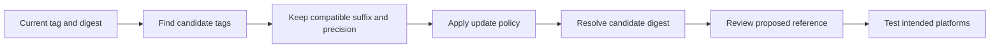

# Pin Docker Tags and Digests with Renovate Without Variant Changes

Author: [nawazdhandala](https://www.github.com/nawazdhandala)

Tags: Renovate, Docker, DevOps

Description: Keep readable image tags and immutable digests together, preserve suffix compatibility, and review digest updates separately from image migrations.

A Dockerfile can name a familiar release while still resolving to different image content tomorrow. Tags are useful labels, but publishers can move them. A digest identifies the referenced content, giving a reviewed dependency change a stable artifact to build against.

Renovate can keep the tag for readability and add a digest for reproducibility. That does not automatically define which image variants are acceptable. Treat artifact pinning and version compatibility as two separate policies.

The configuration and extraction examples here were checked with Renovate 44.257.6. Image names, tags, and hashes are synthetic fixtures, not recommendations to install a particular release.

## Retain both the human label and content identity

A combined reference has this shape:

```text
registry.example.com/team/runtime:3.4.5-bookworm-slim@sha256:<64-hex-character-digest>
```

The angle-bracket field is a placeholder and must be replaced with an actual registry digest before use. The `bookworm-slim` suffix expresses the chosen image family. The digest fixes the referenced manifest or index instead of leaving the tag free to move underneath the build.

Docker documents pulling by an [immutable digest](https://docs.docker.com/reference/cli/docker/image/pull/#pull-an-image-by-digest-immutable-identifier). Pinning does not establish that the artifact is trustworthy or vulnerability-free; retain your normal provenance, scanning, and application checks.

Avoid converting a readable tag-and-digest reference to digest-only merely to achieve immutability. The tag helps reviewers understand the intended release family and gives Renovate a version to track.

## Enable pinning for the intended image

Merge this rule into your repository’s Renovate configuration. Replace the package name with the exact dependency Renovate extracts, including the registry when present.

```json
{
  "$schema": "https://docs.renovatebot.com/renovate-schema.json",
  "packageRules": [
    {
      "matchDatasources": ["docker"],
      "matchPackageNames": ["registry.example.com/team/runtime"],
      "versioning": "docker",
      "pinDigests": true,
      "automerge": false
    }
  ]
}
```

`pinDigests` requests digest pinning. The explicit Docker versioning preserves the ordinary Docker tag model for this image, and disabling automerge leaves the initial policy review visible. Keep the override narrow, especially if another dependency needs a custom versioning scheme.

Renovate distinguishes the initial pin from later digest updates and tag upgrades. Its [Docker guide](https://docs.renovatebot.com/docker/#digest-pinning) describes how the tag remains alongside the digest and how subsequent changes are proposed.

Do not assume a digest-only update is automatically safe. A publisher can rebuild the same tag with different operating-system packages or application contents. Review the change and run the workload checks that matter for that image.

## Keep the compatibility suffix intact

For a starting tag of `3.4.5-bookworm-slim`, the default Docker versioning treats the suffix as a compatibility boundary. A later version ending in `bookworm-slim` is compatible under that model; a switch to `alpine`, `bookworm`, or `trixie-slim` is not.

The [Docker versioning documentation](https://docs.renovatebot.com/modules/versioning/docker/) also describes preserving version precision. A three-component version and a two-component version are different tag conventions, not interchangeable ranges.



Compatibility here means matching the versioning rule, not proof of application compatibility. A new major release with the same suffix can still require code changes. Likewise, retaining `bookworm-slim` does not certify unchanged libraries or security posture.

If a vendor embeds rebuild counters or release channels in the suffix, first test whether Docker versioning models that contract correctly. Use a targeted regex versioning rule when necessary rather than stripping the suffix to make more updates appear.

## Review three distinct change types

Keep these examples conceptually separate. `OLD_DIGEST` and `NEW_DIGEST` are explanatory labels, not valid image hashes.

| Change | What the reviewer should establish |
| --- | --- |
| Tag-only to tag plus digest | Digest belongs to the intended tag and artifact type |
| Same tag, new digest | Why the publisher changed the artifact and whether tests pass |
| New compatible tag and digest | Release changes, variant continuity, and new artifact identity |

A base-system migration, such as Bookworm to another Debian release, deserves its own explicit change. Do not weaken the compatibility rule simply because a desired migration is currently excluded. Change the selected variant intentionally, test it, and then let routine updates continue within that new family.

Also inspect the complete reference, not just the shortened hash displayed in a pull-request title. The repository name, registry, tag, and digest must all agree with the intended dependency.

## Check multi-platform artifacts carefully

A multi-platform image can have an index or manifest list that points to separate platform manifests. Its top-level digest and the digest for one architecture are different identities. Docker’s [multi-platform explanation](https://docs.docker.com/build/building/multi-platform/#difference-between-single-platform-and-multi-platform-images) describes that structure.

With Docker Buildx installed and registry access available, inspect your real reference:

```bash
docker buildx imagetools inspect \
  registry.example.com/team/runtime:3.4.5-bookworm-slim
```

The command is read-only. Replace the example name with an accessible image and inspect the reported digest, media type, and platform entries. The [imagetools reference](https://docs.docker.com/reference/cli/docker/buildx/imagetools/inspect/) documents its output. This command was source-reviewed, not executed against the fictional registry.

Do not substitute a single-platform child digest when the build needs multiple platforms. Conversely, the existence of a top-level index does not guarantee it includes every architecture you deploy. Test the required platforms and retain the intended platform-selection policy in the build system.

## Validate what Renovate actually extracts

Run configuration validation with a supported Node.js runtime and the pinned tool:

```bash
npx --yes --package renovate@44.257.6 -- \
  renovate-config-validator --strict renovate.json
```

Then inspect the dependency extracted from a representative Dockerfile in a non-writing test workflow. You should see the package name, complete tag including suffix, and digest as separate fields. If the tag is hidden in an unsupported variable expression, digest pinning cannot repair extraction that never succeeded.

I tested the actual Renovate 44.257.6 Dockerfile extractor with tag-only and tag-plus-synthetic-digest `FROM` lines. It retained the package name and `3.4.5-bookworm-slim` tag and extracted the digest separately. The [tagged extractor source](https://github.com/renovatebot/renovate/blob/44.257.6/lib/modules/manager/dockerfile/extract.ts) shows that split.

Seven version-compatibility cases also passed: same-suffix patch, minor, and major candidates were compatible; Alpine, nonslim Bookworm, another Debian suffix, and reduced version precision were not. These checks used the actual versioning implementation, with a JavaScript regex fallback because native RE2 was unavailable locally. Configuration validation passed with that documented warning.

No registry lookup, digest resolution, image pull, multi-platform build, or pull-request update was performed in these tests. Add those checks using your own registry and workload before enabling automatic merges.

## Preserve an auditable update path

Keep the tag, digest, compatibility rule, and platform expectations visible in review. Investigate an unexpected suffix change before merging, and investigate a quiet dependency before assuming it is current: extraction, authentication, schedules, and policy can all suppress updates.

Digest pinning gives each accepted change a precise artifact. A narrow versioning rule keeps routine updates within the intended image family. Together they make image updates easier to reproduce and review, while leaving migrations as deliberate engineering decisions.
