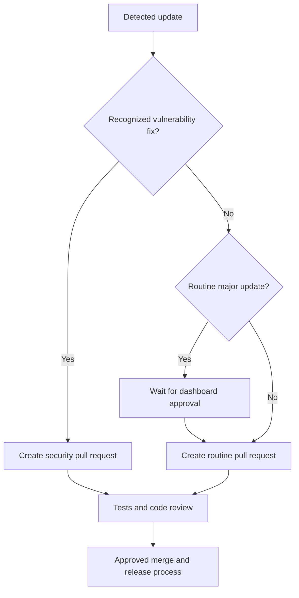

# Gate Renovate Major Updates Without Delaying Security Fixes

Author: [nawazdhandala](https://www.github.com/nawazdhandala)

Tags: Renovate, Security, DevOps

Description: Require dashboard approval for routine major upgrades while letting recognized vulnerability fixes create pull requests without that extra gate.

A team may want to choose when to start a framework migration without leaving a vulnerable dependency waiting in the same approval queue. Renovate can support both decisions: hold routine major updates before branch creation, while giving recognized vulnerability fixes a separate route to a pull request.

The distinction matters. A patch release is not automatically a security fix, and a major release is not automatically unrelated to security. Base the exception on vulnerability information that Renovate actually receives, rather than assuming a version number describes the risk.

This guide uses Renovate 44.257.6 and GitHub's vulnerability-alert integration. The configuration and rule behavior were checked locally. No live GitHub alert or pull request was created.

## Put the approval at the right stage

The Dependency Dashboard is a repository issue maintained by Renovate. Its checkboxes can authorize creation of selected updates. A dashboard approval starts work on an update; it does not approve the resulting code for merging. Renovate's [dashboard guide](https://docs.renovatebot.com/key-concepts/dashboard/) describes this workflow and the platform requirement for editable issue checkboxes.



The final step remains your normal release process. A security change may require a breaking upgrade, database migration, or deployment coordination. Removing a preliminary checkbox reduces waiting time without pretending those obligations disappear.

## Use a narrow major-update rule

Add this repository configuration as `renovate.json`, or merge the corresponding fields into your existing configuration after reviewing inherited presets:

```json
{
  "dependencyDashboard": { "enabled": true },
  "automerge": false,
  "packageRules": [
    {
      "matchUpdateTypes": ["major"],
      "dependencyDashboardApproval": true
    }
  ],
  "vulnerabilityAlerts": {
    "enabled": true,
    "dependencyDashboardApproval": false,
    "prCreation": "immediate",
    "automerge": false
  }
}
```

The dashboard uses the object form supported by the pinned release. The package rule asks for approval only when Renovate classifies a routine update as major. Minor and patch updates do not acquire an additional approval requirement from this rule. They can still be constrained by other settings in your repository.

The security object explicitly keeps dashboard approval off and requests immediate pull-request creation. It also keeps automatic merging off. “Immediate” means the PR-creation policy does not add a waiting gate once Renovate processes an eligible fix; it does not make a scheduled runner execute continuously. The [configuration reference](https://docs.renovatebot.com/configuration-options/#vulnerabilityalerts) documents these vulnerability defaults and their GitHub support.

Avoid combining this approach with a blanket rule that disables major updates. Disabled updates and updates awaiting approval are different states. If a fix requires a major release, a disabling rule may prevent the candidate from reaching the review process at all.

## Make sure Renovate receives the alert

Enable GitHub's dependency graph and Dependabot alerts for the repository. Give the Renovate identity the necessary access to read those alerts. For an app installation, review its Dependabot-alert permission rather than assuming repository write permission includes every security endpoint.

GitHub explains how it generates alerts from dependency information and advisories in [About Dependabot alerts](https://docs.github.com/en/code-security/dependabot/dependabot-alerts/about-dependabot-alerts). Coverage depends on the dependencies and information the platform can identify. A security fix mentioned only in a project's release notes is not necessarily a recognized vulnerability update in Renovate.

During onboarding, ask the repository owner to identify an existing actionable alert and its affected package. Confirm that the bot can see it and that a fixed version exists. Do not deliberately introduce a vulnerable dependency into production to manufacture a test.

This example is not a claim of identical alert ingestion on every Git hosting platform. Keep the major-update rule where supported, but verify the vulnerability source and manager coverage before promising the same exception on another platform.

## Check what the merged rules actually do

Repository presets and later package rules can change the effective policy. Review the complete configuration, especially rules that set `enabled`, `automerge`, or approval requirements. A standalone snippet passing validation does not establish how a large organization preset will interact with it.

For this article, local tests loaded the actual 44.257.6 defaults and package-rule implementation. Synthetic major, minor, and patch updates produced these outcomes:

| Candidate supplied to the local rule test | Dashboard approval | Automatic merge |
|---|---|---|
| Routine major | Required | Off |
| Routine minor | Not required | Off |
| Routine patch | Not required | Off |
| Major with the source-shaped vulnerability override | Not required | Off |

The last case used the override shape produced by the pinned [vulnerability processing source](https://github.com/renovatebot/renovate/blob/44.257.6/lib/workers/repository/process/vulnerabilities.ts). This verifies configuration precedence for a recognized candidate, not GitHub's delivery of an alert. Keep that distinction in your own acceptance evidence.

With Renovate 44.257.6 installed, validate the repository file:

```bash
renovate-config-validator --strict renovate.json
```

A successful result establishes that the configuration is accepted by that release. Then trial the policy in one repository whose maintainers can inspect the dashboard and PRs. Confirm a routine major remains pending, approve one selected update, and verify that approval creates work on a subsequent bot run.

## Define “security fixes immediately” operationally

Record the time an alert becomes actionable, the next bot execution, creation of the fix PR, completion of tests, and deployment. These timestamps reveal whether delay is caused by bot scheduling, permission failures, review capacity, or the release process.

Recognized vulnerability PRs normally bypass Renovate's ordinary schedule and rate controls, but an unavailable runner or hosting API still stops progress. A long-running queue of jobs is not repaired by changing the dashboard checkbox. Keep capacity for security runs and assign a maintainer to failed artifact updates.

Do not enable automatic merging simply to make the timing chart look better. Renovate's [automerge guidance](https://docs.renovatebot.com/key-concepts/automerge/) treats merging as a separate capability with its own checks. If your organization later enables it, define that policy independently and retain required tests and repository protections.

## Troubleshoot the stalled path

When a security update remains blocked, first confirm that Renovate recognized it as a vulnerability fix. A routine update to the same package may correctly appear in the major approval queue while a separate security candidate is unavailable or failing.

Next check for missing alert permissions, no known fixed version, unsupported dependency coverage, disabled package rules, and artifact-generation errors. If the PR exists but cannot merge, inspect tests and branch protections instead of changing dashboard approval.

The local tests here passed, as did strict configuration validation on Node 24.11.0. Native RE2 was unavailable, so the validator reported its JavaScript regular-expression fallback. Real alert ingestion, checkbox interactions, branch creation, test execution, and deployment remain environment-specific acceptance checks. The useful outcome is a clear queue: planned migrations wait for scheduling, while recognized fixes reach engineering review without an unnecessary preliminary approval.
