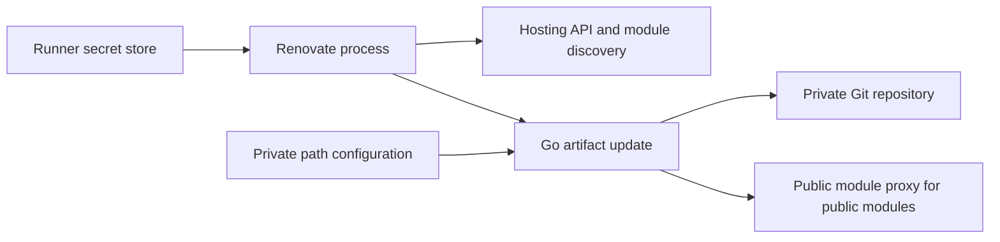

# Configure Renovate for Private Go Modules Without Exposing Tokens

Author: [nawazdhandala](https://www.github.com/nawazdhandala)

Tags: Renovate, Go, Security

Description: Separate Go module discovery from Git downloads, scope GitHub and GitLab credentials, and keep private dependency tokens out of repository configuration.

A Renovate job can open pull requests successfully and still fail to update a private Go dependency. The job needs access to two repositories: the application being updated and the module being downloaded. It may also make an HTTP discovery request before it knows which Git repository contains that module.

Treat those as separate access paths. This guide uses self-hosted Renovate 44.257.6 and a GitHub example, then explains the additional GitLab discovery requirement. Configuration and credential routing were checked locally with synthetic credentials; no private hosting service was contacted.

## Draw the requests before adding a token

A Go module is a versioned collection of packages identified by a path such as `github.com/example-org/shared`. Renovate reads that path from `go.mod`, finds available versions, and later runs Go commands to update module files. The [Go manager documentation](https://docs.renovatebot.com/modules/manager/gomod/) describes the artifact-update stage.



An API token that works for version lookup does not prove that the Go subprocess can download the source. Likewise, a warm module cache can hide missing download credentials. Plan to test both paths with a disposable checkout and an empty module cache.

## Prevent private module paths from reaching public services

`GOPRIVATE` identifies private module path prefixes. Go uses it as the default for `GONOPROXY`, which bypasses module proxies, and `GONOSUMDB`, which bypasses the public checksum database. These settings control routing and privacy; they do not authenticate requests. Public modules can still use the normal proxy and checksum verification. See the [Go private-module reference](https://go.dev/ref/mod#private-modules).

In the example below all three values are explicit to make inherited runner configuration easier to audit. Replace `example-org` with your actual organization. Include every private prefix, separated by commas. If your organization requires an internal module proxy, design those settings for that proxy instead of copying this direct-Git setup.

## Keep the GitHub credential in runner configuration

Mount this as the self-hosted runner's administrative `config.cjs`, outside application repositories. Inject `PRIVATE_GO_GITHUB_TOKEN` from the runner's secret store. It should grant read access only to the dependency repositories. Configure Renovate's platform identity and repository selection separately; this fragment does not grant permission to create pull requests.

```javascript
const token = process.env.PRIVATE_GO_GITHUB_TOKEN;
if (!token) throw new Error('Missing private Go dependency credential');
module.exports = {
  hostRules: [
    { hostType: 'go', matchHost: 'https://github.com/example-org/', token },
    { hostType: 'github', matchHost: 'https://api.github.com/repos/example-org/', token }
  ],
  customEnvVariables: {
    GOPRIVATE: 'github.com/example-org',
    GONOPROXY: 'github.com/example-org',
    GONOSUMDB: 'github.com/example-org'
  },
  postUpdateOptions: ['gomodTidy']
};
```

The `go` rule covers the module-facing path. The `github` rule covers GitHub API requests under the organization. `gomodTidy` requests Go's tidy operation after updates; inspect its resulting `go.mod` and `go.sum` changes during rollout. Renovate's [private-package examples](https://docs.renovatebot.com/getting-started/private-packages/) distinguish dependency lookup from artifact authentication.

Do not put the token in `renovate.json`, a module URL, or a command argument. The JavaScript configuration reads it at runtime and throws a generic error when absent, without printing its value.

### Do not confuse matching with permission enforcement

Local tests confirmed that the HTTP rules above exclude another organization and the similarly named `example-org-other`. However, Renovate 44.257.6's [Git authentication helper](https://github.com/renovatebot/renovate/blob/44.257.6/lib/util/git/auth.ts) generates Git `insteadOf` rewrites and removes the trailing slash in this case. The resulting prefix can also match a similarly named organization during Git operations.

Consequently, a narrow-looking rule is not sufficient permission isolation. Limit the token at the hosting provider, keep destination repositories trusted, and inspect generated behavior when changing Renovate versions. These rewrites carry credentials in subprocess environment configuration. Do not dump the process environment or Git configuration into logs. They avoid committing credentials, but do not make a privileged runner incapable of reading them.

## Add GitLab discovery authentication deliberately

GitLab private modules can require an authenticated `?go-get=1` request to discover the repository path. Renovate documents HTTP Basic authentication for that request. Basic authentication sends a username and password over HTTPS; a `token` field that produces a Bearer header is not an equivalent configuration here. See [Renovate's GitLab guidance](https://docs.renovatebot.com/golang/#private-go-modules-hosted-on-gitlab).

For a GitLab-only variant, replace the GitHub rules with the following entries inside the same administrative configuration. Provision the environment variable through the secret store and reject a missing value as in the GitHub example.

```javascript
hostRules: [
  {
    hostType: 'go',
    matchHost: 'https://gitlab.example.com/',
    username: 'renovate-bot',
    password: process.env.PRIVATE_GO_GITLAB_TOKEN
  },
  {
    hostType: 'gitlab',
    matchHost: 'https://gitlab.example.com/',
    token: process.env.PRIVATE_GO_GITLAB_TOKEN
  }
]
```

Set the private prefixes to your GitLab namespace too. The second rule supports GitLab API access where an existing platform identity does not already provide it. This host-wide example assumes a dedicated trusted GitLab instance; reduce access through the token's actual permissions.

The Go subprocess has its own HTTP discovery behavior. Arrange its authenticated discovery separately, using GitLab's documented `.netrc` or supported `GOAUTH` approach. For example, a secret-mounted `.netrc` belongs in the effective home directory of the user executing Go, with restrictive permissions, and must be available inside any artifact container. Do not assume that Renovate's HTTP host rule automatically becomes a `.netrc` file.

GitLab's [Go package documentation](https://docs.gitlab.com/user/project/use_project_as_go_package/) describes HTTPS, `read_api` for the documented personal-token path, and newer alternatives. Confirm Git repository read access as well. Invalid discovery credentials can appear as a 404, so a “not found” response does not prove the repository is missing.

## Validate without printing credentials

With the exact Renovate release installed in an isolated runner environment, validate the administrative configuration:

```bash
renovate-config-validator --strict /runner/config.cjs
```

This checks configuration structure; it does not contact your private module or prove authorization. Run it where the required environment variable is already injected, rather than pasting a token into the command.

Then use a disposable application repository with a known private dependency update. Confirm version lookup succeeds, the artifact phase updates the module files, and the resulting diff contains no credential-bearing URLs. Repeat on a clean runner. Review logs through the normal redacted logging path; avoid shell tracing, verbose HTTP dumps, and environment exports.

If lookup succeeds but downloads fail, investigate Go discovery and Git access separately. If only warm runs succeed, investigate cached modules. If a token works for unrelated repositories, correct provider permissions before expanding the rollout.

The local checks here exercised actual Renovate host matching and Git environment generation, including the prefix limitation above. The strict validator passed on Node 24.11.0 with a warning that native RE2 was unavailable and JavaScript regular expressions were used instead. Real token permissions, private downloads, container secret mounts, and pull-request creation still require testing in your environment.
