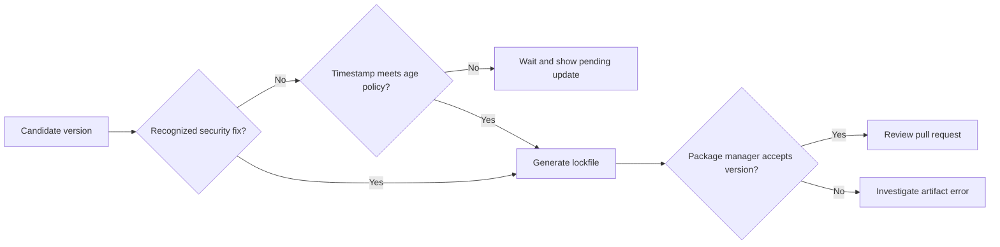

# Delay Renovate Releases Without Blocking Vulnerability Fixes

Author: [nawazdhandala](https://www.github.com/nawazdhandala)

Tags: Renovate, Security, DevOps

Description: Add a release-age waiting period for routine Renovate updates, handle missing timestamps, and diagnose security fixes blocked during lockfile generation.

A newly published dependency may need time for its maintainers and users to discover a broken release. A release-age policy gives your team that waiting period. However, applying the same delay to a known vulnerability fix can prolong exposure, and configuring Renovate alone does not necessarily control what the package manager installs.

Use separate checks for candidate selection and lockfile generation. This tutorial uses Renovate 44.257.6, a three-day example policy, and locally tested age-calculation helpers. It does not claim that three days establishes trust or that a real security update was installed.

## Choose what should wait

A minimum release age measures time since publication of a particular version. It is different from waiting three days after Renovate first discovers the version, and different from running the bot only on Mondays. Decide whether your goal is fewer early-release regressions, a dependency review window, or less PR noise. The first two may justify an age gate; the last may be better addressed through grouping and scheduling.

Start with one repository where package publication timestamps are available and someone can review deferred updates. Record the release-age policy alongside the intended exception for recognized vulnerability fixes. Without an owner, a missing timestamp can become an indefinite silent delay.



The two decision points explain why a security PR can appear promptly and still have an artifact error: Renovate allowed the candidate, but the package manager rejected the version during resolution.

## Configure an explicit waiting policy

For Renovate 44.257.6, use this repository `renovate.json` example:

```json
{
  "dependencyDashboard": { "enabled": true },
  "minimumReleaseAge": "3 days",
  "minimumReleaseAgeBehaviour": "timestamp-required",
  "internalChecksFilter": "strict",
  "automerge": false,
  "vulnerabilityAlerts": {
    "minimumReleaseAge": null,
    "dependencyDashboardApproval": false,
    "prCreation": "immediate",
    "automerge": false
  }
}
```

`minimumReleaseAge` sets the duration. `timestamp-required` keeps an update pending when publication time cannot be established. `strict` prevents an ineligible candidate from proceeding to branch creation. The dashboard gives maintainers a place to see waiting work. Automatic merging remains disabled.

The vulnerability object removes the Renovate age delay for recognized fixes. On GitHub, configure dependency alerts and the bot's access to them; a release containing a security change does not automatically become a recognized vulnerability candidate. The [configuration reference](https://docs.renovatebot.com/configuration-options/#vulnerabilityalerts) describes this integration and its defaults.

Use this as an example policy, not an instruction to erase your existing presets. Merge it deliberately, then inspect package-specific overrides and organization settings. A later exception for an entire ecosystem may undermine the waiting period you intended.

## Test timestamps, including the missing case

The local checks used the pinned release's actual [minimum-release-age helper](https://github.com/renovatebot/renovate/blob/44.257.6/lib/util/minimum-release-age.ts), with timestamps calculated relative to the test run:

| Input to the helper | Expected and observed result |
|---|---|
| Routine version published 24 hours ago | Pending |
| Routine version published 96 hours ago | Age check passed |
| Routine version with no timestamp | Pending under `timestamp-required` |
| No timestamp with `timestamp-optional` | Age check passed |
| Recognized security override, one-hour-old version | Age check passed |
| Recognized security override, missing timestamp | Age check passed |

These are calculation tests, not evidence that a specific registry supplies reliable timestamps. During rollout, inspect the registry metadata used for a real dependency. If an internal mirror strips publication times, adding more waiting days will not repair that missing field.

Do not globally switch to `timestamp-optional` just to remove a pending entry. First establish which source lacks timestamps and whether the package can be excluded through a documented narrow policy. Otherwise “three days old” quietly becomes “three days old when convenient.”

## Understand when the PR appears

With strict internal checks, a young candidate does not get a new branch just because `prCreation` is set to `immediate`. The earlier age decision still applies. Renovate's [release-age guide](https://docs.renovatebot.com/key-concepts/minimum-release-age/) describes the pending state and how the dashboard exposes it.

A later release also has its own age. Suppose version 2.8.1 is four days old while 2.8.2 was published this morning. A three-day policy can allow the older eligible version while the newer one waits. It does not necessarily wait until the publisher stops releasing versions for three days.

The bot must run again to act on newly eligible work. Monitor its execution schedule and failures separately from the age calculation. A version becoming old enough at noon does not create a PR if the next successful run is tomorrow.

## Check the package manager's own policy

A package manager may enforce publication cutoffs while generating the lockfile. For example, npm's [`before` setting](https://docs.npmjs.com/cli/v11/using-npm/config/#before) limits installation to versions available before a specified date. Such a restriction can still apply even when Renovate chooses a security fix immediately.

Review repository configuration, runner environment, and command output together. If the fixed version is rejected, decide whether your incident policy permits a narrowly reviewed exception or requires waiting. Do not remove all supply-chain checks from every project to fix one urgent update.

Renovate 44.257.6 also has package-manager age synchronization. The local helper tests confirmed that a configured five-day package-manager lower bound wins over a three-day repository value when synchronization is enabled, while a recognized security update produces a zero synchronized age. That does not erase age restrictions already configured independently in the package manager.

Keep these helper results in perspective: they verify the value Renovate calculates, not a real npm installation. Test the package-manager version and repository settings used by your runner. A lockfile diff should be reviewable even when the PR title says security.

## Do not assume every dependency received the same gate

The versions Renovate proposes directly and the transitive dependencies resolved by a package manager are different sets. A dependency of your dependency can change during lockfile generation. Review those changes instead of assuming that an old direct dependency guarantees every newly resolved package is old too.

Likewise, update types do not all carry comparable publication timestamps. Lockfile maintenance is not publication of one new version. Before applying a repository-wide age rule, observe its effect on your maintenance branches and digest updates as well as normal version bumps. Document exceptions according to the actual manager behavior, rather than inventing timestamps for work that has none.

## Accept the policy with evidence

With the pinned Renovate version installed, run:

```bash
renovate-config-validator --strict renovate.json
```

Then inspect one young routine candidate, one eligible routine candidate, and one existing actionable security alert in a test repository. Capture the selected version, publication timestamp, reason for deferral, artifact result, and eventual PR. Do not add a vulnerable dependency to production just to obtain a test case.

The exact JSON here passed strict validation on Node 24.11.0. Eight local assertions covered age checks and synchronized package-manager calculations. Native RE2 was unavailable and the validator used its reported JavaScript regular-expression fallback. No live registry lookup, security-alert ingestion, lockfile generation, or PR creation was performed.

A useful waiting policy makes its reasons visible. Routine releases wait for the chosen interval, missing metadata receives investigation, and urgent fixes have an explicit path through both Renovate and the package manager.
