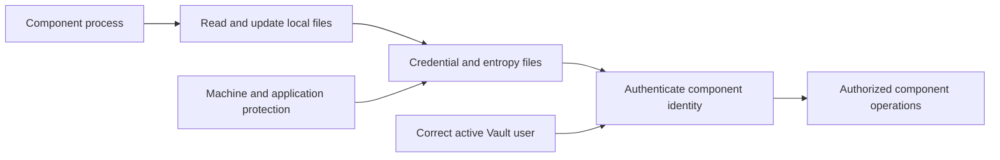

# Repair CyberArk PVWA and CPM Component Credential Files

Author: [nawazdhandala](https://www.github.com/nawazdhandala)

Tags: CyberArk, Security, Troubleshooting

Description: Recover PVWA or CPM Vault connectivity by diagnosing file access, host protection, and account mismatches before following version-specific credential repair.

A restored server can have every expected CyberArk file and still fail to connect to the Vault. The local credential file may no longer match its Vault user, its protection may depend on the original machine, or the service may be unable to read or update it. These failures require different repairs.

A component credential file authenticates software such as Password Vault Web Access (PVWA) or Central Policy Manager (CPM). It is not the managed password of a Linux server or database account. Resetting managed target accounts will not repair the component's own connection.

This guide uses the current CreateCredFile documentation labeled PAM Self-Hosted 15.2 and explicitly identifies the older version boundaries in the vendor's recovery procedures. Its PowerShell examples inspect files without printing their contents. They received syntax checks, but no live component credential was reset.

## Separate the file, the machine, and the Vault user

A useful diagnostic model has three dependencies:



The [CreateCredFile reference](https://docs.cyberark.com/pam-self-hosted/latest/en/content/pasimp/createcredfile-utility.htm) describes encrypted logon information and restrictions based on the application, machine, and operating-system identity. Windows Data Protection API, or DPAPI, can provide machine or user protection. A copy of a protected file is therefore not necessarily usable on a replacement server.

Treat credential files and their associated entropy material as sensitive. Entropy is additional material used in protecting the secret, not an optional text note. Do not attach either file to an ordinary incident ticket or commit it to configuration source control.

## Classify the failure before changing an identity

Capture the exact component message, timestamp, node name, recent infrastructure changes, and first failed operation. Then separate these possibilities:

| Evidence | Investigation |
|---|---|
| File missing or path points at a directory | Installation path and component configuration |
| File access or locking error | Actual file permissions, process identity, file availability |
| Decryption or verifier error after host replacement | Protection restrictions and matching supporting files |
| Vault rejects the component user | Correct username, current credential, suspension and station state |
| Component connects but cannot perform its task | Safe permissions, component assignment, or another dependency |

The table is a triage aid, not an error-code decoder. A generic startup message can wrap a more specific cause. Read the inner error before deciding that the secret is wrong.

For example, the vendor documents a PVWA [configuration-load failure caused by credential-file permissions](https://knowledgebase.paloaltonetworks.com/KCSArticleDetail?id=kA1hj00000018jXCAQ&lang=en_US). Its correction concerns the files themselves and the application-pool identity, not a blanket grant on every CyberArk directory. Check the deployed identity and release requirements instead of copying an unrelated server's access list.

## Inspect the affected files safely

On the affected Windows host, use an authorized administrator session and replace the path below with the actual file named in the error. This example uses the customary PVWA application file location as a placeholder path:

```powershell
$ErrorActionPreference = 'Stop'
$credentialPath = 'C:\REPLACE_INSTALL_PATH\CredFiles\appuser.ini'
Get-Item -LiteralPath $credentialPath |
    Select-Object FullName, Length, LastWriteTimeUtc, Attributes
Get-Acl -LiteralPath $credentialPath |
    Format-List Owner, AccessToString
```

The output shows file metadata and the access control list, or ACL. It does not display encrypted secret fields. Microsoft documents [Get-Item](https://learn.microsoft.com/en-us/powershell/module/Microsoft.PowerShell.Management/Get-Item?view=powershell-5.1) and [Get-Acl](https://learn.microsoft.com/en-us/powershell/module/Microsoft.PowerShell.Security/get-acl?view=powershell-5.1) for these inspections.

A missing file should terminate the example. A nonzero size and a recent timestamp do not prove cryptographic validity. Inspect the associated entropy files through the approved procedure and check their access controls too. Compare the inventory with the known installation record, not a newly copied directory from another node.

Before using the installed creation utility, record its file version:

```powershell
$ErrorActionPreference = 'Stop'
$toolPath = 'C:\REPLACE_COMPONENT_DIRECTORY\CreateCredFile.exe'
(Get-Item -LiteralPath $toolPath).VersionInfo |
    Select-Object FileVersion, ProductVersion
```

Use the component's supported utility. A newer executable copied from a different product is not a justified repair merely because it accepts similar flags.

## Choose the correct component procedure

The vendor publishes separate procedures for [PVWA 12.1.1 and later](https://live.paloaltonetworks.com/t5/pam-self-hosted-articles/pvwa-how-can-i-create-or-update-the-credential-files-credfile/ta-p/1428053) and [CPM 12.1 and later](https://live.paloaltonetworks.com/t5/pam-self-hosted-articles/cpm-how-can-i-create-or-update-the-credential-files-credfile-for/ta-p/1428529). Their version boundaries differ. For an earlier installation, use its matching procedure rather than mixing old interactive prompts with newer flags.

Key distinctions in those documented procedures are:

| Component | Identity and files | Documented protection settings |
|---|---|---|
| PVWA | Separate application and gateway users; `appuser.ini` and `gwuser.ini` | `PVWAApp`, the IIS worker executable path, entropy file, machine DPAPI |
| CPM | The specific PasswordManager user; `user.ini` | `CPM`, entropy file, machine DPAPI |

These are procedure identifiers, not a universal command to paste. Confirm the exact user on this installation; suffixes matter when several components exist. PVWA's procedure also moves the generated credential **and entropy** files into the configured credential directory. Omitting the supporting files produces an incomplete repair.

The published commands include a password argument. Execute the approved recovery process in the controlled administrative environment required by your organization. Do not put a real recovery password into a shared script, chat message, shell transcript, or ticket. Do not invent a stdin or secure-string flag that the utility does not document.

## Perform a controlled recovery, not repeated resets

Arrange a maintenance window for the affected node. For PVWA, account for load-balancer routing and the impact of stopping IIS on that server. For CPM, account for scheduled password work and any operations already in progress. Preserve evidence and a protected recovery inventory first.

The documented recovery sequence stops the consuming component, identifies the matching Vault user, resets that user's credential through an authorized Vault administrator, generates the replacement files on the component host, and then resumes the component. Confirm the user's required active state and do not leave another process using the old credential during the change.

Do not reset every similarly named component user. Map the failing process to its actual identity and file before approving the change. A second successful node may use a different identity and should not be modified merely because it belongs to the same farm.

Keep the required application and machine protections. The general utility reference explicitly labels its less-protected remote creation examples unsuitable for production. An unrestricted file that starts the service is not an equivalent recovery.

## Verify more than service startup

First verify fresh component authentication in the relevant logs. Then exercise a small approved function. For PVWA, confirm an authorized user can sign in and perform the intended account operation. For CPM, confirm connectivity and a controlled verification task before resuming the normal workload. A green process status alone is too weak an acceptance criterion.

Check scanner functionality separately if used. The vendor's [credential-reset article index](https://live.paloaltonetworks.com/t5/pam-self-hosted-articles/cred-file-reset-article-list/ta-p/1428472) calls out an additional CPM Scanner API-credential synchronization procedure. Do not assume repairing `user.ini` automatically repairs every scanner dependency.

Finally, record which identity changed, which files were regenerated, their protected locations, and the successful functional check. Keep secrets out of that record. If recovery fails after the Vault credential was changed, restoring an old local file alone may reintroduce the mismatch. Pause the consuming component and reconcile the current Vault state with the supported recovery procedure rather than alternating snapshots and password resets.
