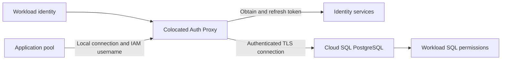

# Replace Shared Database Passwords with Short-Lived Identity Tokens

Author: [nawazdhandala](https://www.github.com/nawazdhandala)

Tags: PostgreSQL, Cloud, Security

Description: Move Cloud SQL workloads from shared passwords to IAM tokens, with automatic refresh, distinct identities, and a migration test that opens new connections.

A shared database password makes every application look like the same user. Rotating it requires finding every consumer, and an abandoned copy can remain useful long after its original deployment disappears. Identity-based database login replaces that shared credential with a token issued for an approved identity.

There is one important correction to the phrase “one-hour sessions”: a token's lifetime is not automatically the lifetime of an established database session. Design the migration around short-lived **login credentials**, and define session termination separately if your requirements demand it.

This guide uses **Cloud SQL for PostgreSQL** and **Cloud SQL Auth Proxy 2.28.0**. Cloud SQL documents one-hour OAuth access tokens for IAM database login. Automatic authentication lets a connector obtain and refresh them for new connections. IAM stands for Identity and Access Management. See [Cloud SQL IAM authentication](https://docs.cloud.google.com/sql/docs/postgres/iam-authentication).

## Separate three lifetimes

A migration plan should distinguish these objects:

| Object | What it controls | What expiration or replacement does not prove |
| --- | --- | --- |
| Workload identity credentials | Whether the workload can request cloud access | That every existing database connection has closed |
| Database login token | Whether a new login can authenticate using that token | That an already authenticated session ends at the same moment |
| Database connection | The session carrying queries and transactions | That the next connection can authenticate successfully |

A pool can keep returning an existing connection while token refresh is broken. A health check that runs `SELECT 1` through that pool may therefore pass until traffic grows or the database closes a connection.

Also avoid carrying Google's one-hour value into another provider's implementation. For example, RDS IAM database tokens have a **15-minute** lifetime, and AWS explicitly states that the token does not affect the session after establishment. Consult the actual provider's [authentication contract](https://docs.aws.amazon.com/AmazonRDS/latest/UserGuide/UsingWithRDS.IAMDBAuth.html).

## Give each workload a recognizable identity

Inventory the consumers of the shared login before changing it. Include scheduled reports, migration jobs, emergency scripts, and old deployments that still run occasionally. Record the database, required operations, deployment owner, and replacement identity for each consumer.

A useful boundary is one identity per workload and privilege set. A reporting worker should not share its identity with a schema migration job merely because both connect to PostgreSQL. That separation lets you reason about access and retire one consumer without disabling the other.

Prefer an attached workload identity or an approved federation arrangement over distributing service-account key files. Otherwise the migration can replace one long-lived secret with another. Google's [service-account key guidance](https://docs.cloud.google.com/iam/docs/best-practices-for-managing-service-account-keys) recommends avoiding user-managed keys where alternatives are available.

Check which credentials the runtime actually selects. Application Default Credentials, or ADC, searches configured environment credentials, a local ADC file, and then an attached service account. An engineer's cached credentials can make a laptop demonstration succeed while the production identity remains unconfigured. The [ADC documentation](https://docs.cloud.google.com/docs/authentication/application-default-credentials) describes that search order.

## Establish the database side before switching traffic

For Cloud SQL, enable IAM database authentication, register the intended IAM database user, and grant the required cloud login permissions. A proxy-based path also needs the connection permission. Separately assign the PostgreSQL object privileges the workload requires.

For a service account, Cloud SQL PostgreSQL omits `.gserviceaccount.com` from the database username. A service account such as `orders-worker@example-project.iam.gserviceaccount.com` therefore uses `orders-worker@example-project.iam` as its database login. Follow the official [user-management procedure](https://docs.cloud.google.com/sql/docs/postgres/add-manage-iam-users), rather than creating an unrelated local password user with a similar name.

Keep the old login during the initial staging rehearsal. Removing it before proving the new path makes diagnosis harder and can unnecessarily disrupt consumers you have not yet migrated. Define a retirement date and owner so this temporary overlap does not become permanent.



## Enable automatic login for the chosen identity

This staging example assumes the official 2.28.0 proxy binary is installed locally, ADC resolves to the intended service account, private network reachability already exists, and the Cloud SQL Admin API and database IAM prerequisites are configured. Replace the instance connection name:

```bash
./cloud-sql-proxy --version

./cloud-sql-proxy \
  --private-ip \
  --address 127.0.0.1 \
  --port 15432 \
  --auto-iam-authn \
  'PROJECT_ID:REGION:INSTANCE_ID'
```

The proxy starts in the foreground and listens on local port 15432. Configure the application for that local endpoint, its database name, and the IAM database username matching the proxy's identity. Automatic authentication supplies the token; do not add a copied token to the application's permanent password configuration.

The flag and identity requirements are documented in the [tagged proxy README](https://github.com/GoogleCloudPlatform/cloud-sql-proxy/blob/v2.28.0/README.md). The proxy is not a connection pool, so preserve sensible application connection limits.

Protect the listener as part of the credential boundary. The application-to-proxy hop is local and unencrypted; only trusted processes should reach it. Do not bind it to a shared remote interface to serve unrelated workloads. Google's [IAM login instructions](https://docs.cloud.google.com/sql/docs/postgres/iam-logins) warn that the proxy requests tokens on applications' behalf. Also review documented compatibility restrictions, such as context-aware access, before choosing this path.

## Prove renewal with fresh connections

Use a staging deployment with ordinary traffic and an identifiable test account. Record timestamps and connection outcomes without logging tokens.

First, open a new connection and verify the database identity and an approved query. Then keep the process running beyond the initial token lifetime. During that interval, continue normal pool activity, but also create a small number of genuinely new database connections through the configured connector. Borrowing an idle connection is not this test.

After renewal, repeat the approved query on a new connection. Confirm an unauthorized operation remains denied. Restart one staging application instance to prove a cold process can discover credentials without an operator's intervention.

The acceptance evidence should distinguish existing-session success, new-login success, and correct SQL permissions. A single green endpoint cannot establish all three. Run the rehearsal long enough to cross the documented token lifetime, with clock times recorded, rather than guessing from the application's uptime display.

## Retire the shared password deliberately

Move production consumers in small groups and monitor new-login failures and connection creation rates. Once every consumer has moved, disable the old login through your reviewed database access procedure and confirm it cannot establish a fresh connection. Review remaining old sessions separately; credential retirement is not proof that all authenticated sessions disappeared.

If policy requires a maximum session age, implement and test that as an additional control. PostgreSQL's `idle_session_timeout` limits idle time, not total age, while `idle_in_transaction_session_timeout` addresses idle transactions. Neither is a universal one-hour session limit; the [PostgreSQL 17 settings documentation](https://www.postgresql.org/docs/17/runtime-config-client.html) also cautions about unexpected connection closure with pooling software.

The migration is successful when each workload has a known identity, new connections renew credentials reliably, and the shared login is no longer needed. The examples here were source-reviewed and syntax-checked; only the proxy's local version and help commands were executed, with no live authentication rehearsal.
