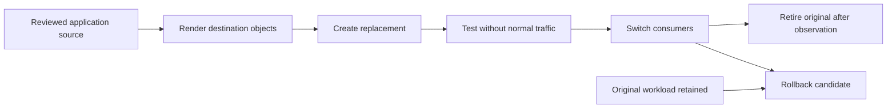

# Replace a Workload When a Webhook Cannot Change Its Namespace

Author: [nawazdhandala](https://www.github.com/nawazdhandala)

Tags: Kubernetes, DevOps

Description: Build a replacement workflow for namespace changes, with a checked Kustomize example and explicit identity, storage, traffic, and rollback decisions.

A workload arrives in `team-blue`, but your platform policy says it belongs in `team-green`. Changing `/metadata/namespace` in a mutating webhook looks like a convenient redirect. It is the wrong place to implement this move.

A namespace is part of the API request's destination. Changing the object does not reroute that request or authorize a second request elsewhere. Kubernetes' [v1.35 creation path checks that the object's namespace matches the request namespace](https://github.com/kubernetes/apiserver/blob/v0.35.0/pkg/registry/rest/create.go). Updates also treat the namespace as immutable in [object metadata validation](https://github.com/kubernetes/apimachinery/blob/v0.35.0/pkg/api/validation/objectmeta.go).

The useful operation is replacement: create a separate workload in the intended namespace, verify it, switch consumers, and retire the original when safe. This guide develops that workflow around a stateless Deployment. Stateful applications need an additional data transition plan.

## Make the boundary visible

Give the caller an actionable admission error when a namespace violates policy: identify the requested namespace, the permitted destination, and the deployment configuration to correct. Do not silently create another object inside the admission handler. That introduces a separate side effect which is not rolled back with the original request. Kubernetes documents the [side-effect and dry-run responsibilities of admission webhooks](https://kubernetes.io/docs/reference/access-authn-authz/extensible-admission-controllers/#side-effects).

If automatic relocation is a product requirement, implement a separately authorized controller or deployment workflow. It needs explicit source and destination permissions, progress tracking, retries, and a policy for partially completed replacements. Admission remains responsible for accepting or rejecting the incoming object.



The rollback candidate is not automatically safe for a database. Its data may already be behind the replacement.

## Review dependencies before rendering

Namespaces separate names, permissions, and many resource references. A new Deployment with the same name is a different object with a new unique identifier, or UID. Inventory its dependencies before copying configuration.

| Dependency | Replacement decision |
|---|---|
| ServiceAccount and role bindings | Create or select destination identities and grant only required access. |
| Secrets and ConfigMaps | Provision destination copies through their owning configuration or secret-management system. |
| Registry credentials | Confirm the replacement Pods can pull images in the destination namespace. |
| Resource quotas and admission | Check destination limits and policies before scheduling the replacement. |
| NetworkPolicy and DNS names | Recheck incoming traffic, outbound dependencies, and namespace-qualified addresses. |
| Storage claims | Plan data availability independently from deployment YAML. |
| Routes and consumers | Identify exactly which configuration moves traffic to the new Service. |

A ServiceAccount is a [namespaced identity](https://kubernetes.io/docs/concepts/security/service-accounts/); reproducing its short name does not preserve its identity. Likewise, network rules that selected the old namespace may not admit the new one. Review the actual [NetworkPolicy selectors and allowed connections](https://kubernetes.io/docs/concepts/services-networking/network-policies/), including DNS access.

Start from maintained declarative source. Avoid treating `kubectl get -o yaml` as a portable installation bundle: live objects contain server-assigned fields and references that need individual review. Cross-namespace owner references between namespaced objects are [not allowed](https://kubernetes.io/docs/concepts/architecture/garbage-collection/#owners-and-dependents). A copied owner UID is not a migration plan.

## Render a small replacement

This example uses standalone **Kustomize v5.7.1**, whose [release is available upstream](https://github.com/kubernetes-sigs/kustomize/releases/tag/kustomize%2Fv5.7.1). It does not assume that your installed kubectl embeds that version. Kustomize's [namespace transformation](https://kubernetes.io/docs/tasks/manage-kubernetes-objects/kustomization/) lets one reviewed base produce destination objects.

Create `base/workload.yaml`. Replace the example image with your approved application image before any deployment. The application must actually listen on port 8080. This minimal rendering fixture deliberately omits application-specific probes, resource settings, and credentials; add those from your maintained application configuration before using it operationally.

```yaml
apiVersion: apps/v1
kind: Deployment
metadata:
  name: report-api
spec:
  replicas: 1
  selector:
    matchLabels:
      app: report-api
  template:
    metadata:
      labels:
        app: report-api
    spec:
      automountServiceAccountToken: false
      containers:
        - name: app
          image: registry.example.internal/report-api:APPROVED_VERSION
          ports:
            - containerPort: 8080
---
apiVersion: v1
kind: Service
metadata:
  name: report-api
spec:
  selector:
    app: report-api
  ports:
    - port: 80
      targetPort: 8080
```

Token mounting is disabled because this fixture assumes the application does not call the Kubernetes API. Revisit that assumption for your application.

Save this as `base/kustomization.yaml`:

```yaml
apiVersion: kustomize.config.k8s.io/v1beta1
kind: Kustomization
resources:
  - workload.yaml
```

Save the destination overlay as `overlays/green/kustomization.yaml`:

```yaml
apiVersion: kustomize.config.k8s.io/v1beta1
kind: Kustomization
namespace: team-green
resources:
  - ../../base
```

From the directory containing `base` and `overlays`, render a local file:

```bash
kustomize version
kustomize build overlays/green > rendered-green.yaml
```

Expect v5.7.1 from the first command. The second produces a Deployment and Service with `metadata.namespace: team-green`; it does not create the namespace or contact a cluster. Inspect every rendered document, especially if your real base includes cluster-scoped resources or custom resource definitions.

## Validate the destination, then create deliberately

Provision the destination namespace and its prerequisites through your normal platform process. With an approved staging context selected and permission to submit these objects, preview the rendered file:

```bash
kubectl apply --dry-run=server -f rendered-green.yaml
```

[Server-side dry run](https://kubernetes.io/docs/reference/kubectl/generated/kubectl_apply/) submits the request without persisting the resulting objects. It can expose authorization, validation, and admission failures. It does not prove that images can be pulled, Pods will become ready, or the application can reach its database. It also does not run a Deployment controller to create child Pods.

After reviewing that result, use your normal deployment mechanism to create the replacement. Record the destination object's UID and verify the replacement's actual Pods, configuration, logs, and dependency access. Keep production consumers on the original until representative requests succeed against the destination.

## Treat traffic and data as separate transitions

A selector-based Service selects Pods in its own namespace. Keeping identical labels does not make the old Service select the replacement across namespaces. Consult the [Service model](https://kubernetes.io/docs/concepts/services-networking/service/) and update the actual routing layer or consumers. Depending on your platform, that can mean a destination route, an approved cross-namespace backend reference, or a configuration change to a namespace-qualified DNS name. There is no universal safe routing patch.

PersistentVolumeClaims are namespaced, and their binding to PersistentVolumes is exclusive. Reusing a claim name in another namespace does not relocate its data. The [storage binding documentation](https://kubernetes.io/docs/concepts/storage/persistent-volumes/#binding) explains that relationship. Choose an application-supported backup and restore, replication, or storage migration procedure. Establish when writers stop, which copy becomes authoritative, and how consistency is checked before allowing new writes.

## Define the retirement gate

Keep a short evidence record: destination identity, image version, health checks, dependency tests, traffic switch time, and error-rate comparison. For stateful applications, add the recovery point and writer handover evidence.

If the replacement fails before serving writes, returning traffic may be straightforward. After it accepts writes, returning to an older database can lose those changes. Require an explicit data reconciliation decision rather than calling that situation a Deployment rollback.

Retire the original only after the observation period and recovery decision pass review. Namespace deletion is particularly broad: it is not a shortcut for removing one application. A successful replacement leaves a clear record of which objects, traffic, identities, and data became authoritative in the destination.
