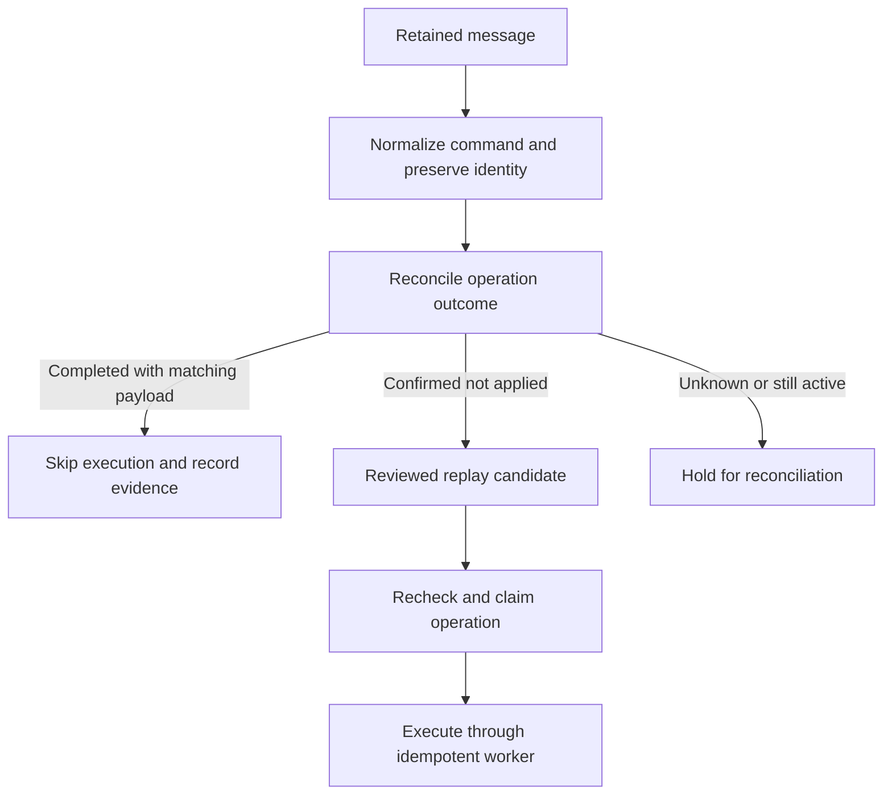

# Replay a Cloud Automation DLQ Without Duplicating Completed Work

Author: [nawazdhandala](https://www.github.com/nawazdhandala)

Tags: Cloud Automation, AWS SQS, Troubleshooting

Description: Build a reviewed replay plan that separates completed, unapplied, and uncertain operations before moving failed automation messages back into service.

A worker requests a disk resize. The provider accepts it, but the worker loses its connection before recording success. After several retries, the message reaches a dead-letter queue. Replaying it blindly can repeat the resize request, create another resource, or run later steps against an unexpected state.

A dead-letter queue, or DLQ, says processing failed according to a transport or worker policy. It does not prove that every external side effect failed. Safe replay starts with an inventory of outcomes, not a command that empties the queue.

This guide uses AWS queue examples, but the assessment applies to other cloud automation systems. The local Python example prepares review decisions; it does not send messages or execute cloud operations.

## Identify what the queue contains

Before reading messages, establish which component wrote them and what format the recovery consumer expects.

| Source of retained work | Replay concern |
|---|---|
| SQS source queue's DLQ | Original message may have been partially processed |
| EventBridge target DLQ | Event failed delivery at that target boundary |
| Lambda asynchronous failure destination | Message contains an invocation record, not just the original command |

Do not send a Lambda destination record directly to a handler that expects the original command. Its `requestPayload` needs an explicitly reviewed conversion, including any earlier EventBridge transformation. Preserve the original record separately for investigation. AWS documents these formats in [Lambda retained records](https://docs.aws.amazon.com/lambda/latest/dg/invocation-async-retain-records.html) and [EventBridge DLQs](https://docs.aws.amazon.com/eventbridge/latest/userguide/eb-rule-dlq.html).

Managed SQS redrive is also narrower than “move anything out of any queue.” `StartMessageMoveTask` supports DLQs whose sources are other SQS queues; it does not support non-SQS sources such as Lambda. Check eligibility before choosing that mechanism. [StartMessageMoveTask reference](https://docs.aws.amazon.com/AWSSimpleQueueService/latest/APIReference/API_StartMessageMoveTask.html).

## Preserve identity across the replay

Use a business operation ID assigned before the original attempt. For example, `tenant-a/resize-request-42` should identify the intended resize across worker retries, queue transfers, and manual recovery. Add a separate replay batch ID for auditing. Do not substitute the new transport message ID for the business ID.

SQS redrive assigns new message IDs and enqueue times, resets retention, and can interleave replayed work with new traffic. These properties make message IDs and queue order poor substitutes for business identity or business deadlines. [SQS redrive behavior](https://docs.aws.amazon.com/AWSSimpleQueueService/latest/SQSDeveloperGuide/sqs-configure-dead-letter-queue-redrive.html).

A useful replay manifest records the operation ID, tenant, command digest, original timestamp, source location, intended destination, evidence of outcome, and reviewer decision. A digest is a fingerprint of the command. It helps detect the dangerous case where the same identity now carries different parameters. It does not authenticate the manifest; store the review and approved artifact in an access-controlled location.

## Reconcile before classifying

Pause competing recovery consumers or coordinate them with the existing worker. Set a clear scope: one incident, command type, tenant, and time interval. Do not turn a targeted repair into a replay of unrelated historical failures.

For each operation, compare the durable application ledger with authoritative provider state or operation status. A worker log saying “request sent” is not completion evidence. An expired worker lease is not proof that the remote API stopped working.



For multi-step automation, record outcomes per step. If a snapshot exists but tagging failed, resume tagging after verifying snapshot ownership and identity. Re-running the whole workflow is a different operation and may create another snapshot.

The hardest state is uncertain: the provider might have succeeded while your ledger still says `IN_PROGRESS`. Hold that operation until you can reconcile it or use the provider's documented idempotency mechanism. A conditional ledger write prevents two claimants from owning the same record; it cannot make an unrelated provider API call part of the same transaction. [DynamoDB conditional writes](https://docs.aws.amazon.com/amazondynamodb/latest/developerguide/Expressions.ConditionExpressions.html) explain the record-level guarantee.

## Produce decisions locally before executing anything

This Python 3.11 example accepts an already normalized, application-specific command. All four fields are nonempty strings. The evidence dictionary represents reviewed authoritative outcomes, not a guess based on a missing log line. Save it as `plan.py`.

```python
import hashlib
import json


def payload_digest(command):
    encoded = json.dumps(command, sort_keys=True, separators=(',', ':'),
                         allow_nan=False).encode('utf-8')
    return hashlib.sha256(encoded).hexdigest()


def assess(command, evidence):
    # Application-specific schema: extend deliberately before using it elsewhere.
    required = {'operation_id', 'tenant', 'action', 'resource'}
    if set(command) != required or any(
            not isinstance(command[k], str) or not command[k] for k in required):
        raise ValueError('Expected four nonempty command fields')
    key = (command['tenant'], command['operation_id'])
    record = evidence.get(key)
    if record is None:
        return 'RECONCILE', 'No authoritative outcome recorded'
    if record.get('digest') != payload_digest(command):
        return 'HOLD', 'Operation identity has a different payload'
    status = record.get('status')
    if status == 'COMPLETED':
        return 'SKIP', 'Matching operation already completed'
    if status == 'CONFIRMED_NOT_APPLIED':
        return 'CANDIDATE', 'Recheck and claim before execution'
    return 'RECONCILE', 'Outcome is uncertain or execution may still be active'
```

The function produces `SKIP`, `CANDIDATE`, `HOLD`, or `RECONCILE`. It deliberately treats missing evidence and unknown statuses as uncertain. Only a matching payload with confirmed non-application becomes a candidate, and even that decision is not authorization to execute from a stale snapshot.

For a quick local example, save this next to `plan.py` as `example.py`:

```python
from plan import assess, payload_digest

command = {
    "operation_id": "resize-42",
    "tenant": "team-a",
    "action": "resize",
    "resource": "vm-7",
}
evidence = {
    ("team-a", "resize-42"): {
        "digest": payload_digest(command),
        "status": "COMPLETED",
    }
}
print(assess(command, evidence)[0])
```

Run `python3 example.py`; it prints `SKIP`. Removing the evidence prints `RECONCILE`, not a green light to retry. Fourteen local cases checked decisions, tenant separation, changed payloads, field validation, and deterministic hashing. No cloud operation was executed.

The digest uses Python's documented [JSON serialization](https://docs.python.org/3.11/library/json.html) and [SHA-256 implementation](https://docs.python.org/3.11/library/hashlib.html). This exact serialization is a local contract, not a universal cross-language canonical JSON format. Extend the schema and digest version deliberately when adding parameters; do not silently ignore fields such as desired disk size.

## Execute through the normal safety controls

Before each candidate runs, re-read its state and acquire an atomic claim using the same mechanism as the live worker. Retain the original operation ID and payload digest. Reuse a provider idempotency token only according to that API's documented scope and retention window. If its protection has expired, reconcile again rather than assuming the old token remains protective.

Start with a small canary group and bounded concurrency. Measure business completions, duplicate suppression, unresolved outcomes, provider throttling, and queue age. The rate at which messages leave the DLQ is not a success metric by itself. Keep new production traffic in the capacity calculation.

A replay consumer must treat receiving a message as a stateful operation. SQS reception temporarily hides a message and gives you a receipt handle; it is not a read-only peek. Use a visibility interval appropriate to processing, extend it while legitimate work continues, and remain tolerant of duplicates. See [ReceiveMessage](https://docs.aws.amazon.com/AWSSimpleQueueService/latest/APIReference/API_ReceiveMessage.html) and [visibility timeouts](https://docs.aws.amazon.com/AWSSimpleQueueService/latest/SQSDeveloperGuide/sqs-visibility-timeout.html).

Delete the source message only after durable completion or durable, acknowledged handoff to the recovery path. A crash after publishing but before deletion can create a duplicate, so the destination must still enforce operation identity. SQS deletion uses the latest receipt handle, not the message ID. [DeleteMessage reference](https://docs.aws.amazon.com/AWSSimpleQueueService/latest/APIReference/API_DeleteMessage.html).

## Rehearse the ambiguous cases

Before a large replay, test a duplicate completed operation, a changed payload using the same ID, two competing claimants, a crash after the provider succeeds, and a crash after publishing recovery work but before source deletion. The expected result is one intended business effect and a durable explanation of each duplicate or hold.

The local planner does not test those distributed failure scenarios. It gives reviewers a conservative decision model; your worker and downstream API must supply the execution guarantees. Preserve uncertain messages and their evidence, stop the canary when outcomes disagree, and expand only after business records confirm the intended result.
