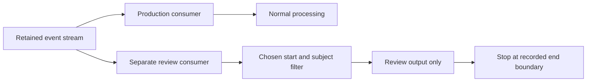

# Replay JetStream by Sequence or Time Without Moving Production

Author: [nawazdhandala](https://www.github.com/nawazdhandala)

Tags: NATS, Messaging, Go, Troubleshooting

Description: Create an isolated JetStream replay consumer with a sequence or timestamp start, capture an end boundary, and preserve production delivery progress.

During an incident, you may need to inspect messages around a failure without making the production worker run those operations again. The useful unit is a separate replay consumer, not a restarted production worker and not a changed production cursor.

A safe replay has four explicit choices: which retained stream to read, which subjects to include, where to begin, and where to stop. It also has a destination that cannot accidentally repeat production side effects.

This guide uses **NATS Server 2.11.4** and **nats.go 1.42.0**. The helper below was tested against a disposable local server. Sequence and stored-timestamp starts selected the expected message, and the existing consumer's progress did not change. This was not a production replay or a retention-race test.

## Define the investigation window

Use a stream sequence when you have a precise message reference from logs. Use a timestamp when the incident window is known in time but the message sequence is not. A stream sequence is scoped to its stream; sequence 500 in one stream has no relationship to sequence 500 in another.

For time-based delivery, the boundary concerns the message's stored timestamp, not an arbitrary `event_time` field inside its JSON payload. Delayed publishers can produce a large difference between those times. Record which clock your incident timeline uses, and inspect actual message metadata around the boundary.

A subject filter narrows which messages the consumer receives. It does not search message bodies. The [filtering guide](https://docs.nats.io/learn/jetstream/filtering) explains exact subjects and wildcard patterns. If you need only `orders.failed`, do not replay all of `orders.>` and hope downstream code discards unrelated events safely.



Keep the production consumer's name, filter, and acknowledgment state untouched throughout the investigation.

## Check retention before creating anything

This procedure deliberately uses a Limits-retention event log. Limits retention keeps messages until configured age, count, or size limits remove them; acknowledgments do not remove them by themselves.

An Interest-retention stream or WorkQueue-retention stream needs a different review. Their retention depends on consumer interest or acknowledgments, and WorkQueue also restricts overlapping consumers. A replay consumer is therefore not automatically harmless on every stream. Review the [retention rules](https://docs.nats.io/learn/jetstream/retention-policies) first.

Capture stream information: first and last retained sequence, message count, age and size limits, storage policy, and the production consumer's current state. A requested starting sequence may already be gone, and there can be holes between the first and last sequences. Starting earlier cannot restore removed records.

For a small investigation, retrieve one known message by sequence through the client’s `GetMsg` API rather than creating a consumer. The [stream API](https://github.com/nats-io/nats.go/blob/v1.42.0/jetstream/stream.go) returns its subject, sequence, payload, headers, and stored time. Handle that content according to its sensitivity.

## Create a new consumer with one starting boundary

The following Go function belongs in an existing application with a connected `jetstream.JetStream` client and a bounded context. It requires `context`, `fmt`, `time`, and `github.com/nats-io/nats.go/jetstream` imports. Install the pinned client in your project with:

```bash
go get github.com/nats-io/nats.go@v1.42.0
```

Replace `EVENTS` and `lab.events` with your approved stream and subject. Pass a new, investigation-specific consumer name; never pass the production consumer's name.

```go
func newReview(ctx context.Context, js jetstream.JetStream, name string,
    startSeq uint64, startTime *time.Time) (jetstream.Consumer, uint64, error) {
    if (startSeq == 0) == (startTime == nil) {
        return nil, 0, fmt.Errorf("choose exactly one start boundary")
    }
    stream, err := js.Stream(ctx, "EVENTS")
    if err != nil { return nil, 0, err }
    info, err := stream.Info(ctx)
    if err != nil { return nil, 0, err }
    if info.Config.Retention != jetstream.LimitsPolicy || info.State.Msgs == 0 {
        return nil, 0, fmt.Errorf("requires a nonempty Limits stream")
    }
    cfg := jetstream.ConsumerConfig{
        Durable: name, FilterSubject: "lab.events",
        AckPolicy: jetstream.AckExplicitPolicy,
        ReplayPolicy: jetstream.ReplayInstantPolicy,
    }
    if startTime != nil {
        cfg.DeliverPolicy = jetstream.DeliverByStartTimePolicy
        cfg.OptStartTime = startTime
    } else {
        cfg.DeliverPolicy = jetstream.DeliverByStartSequencePolicy
        cfg.OptStartSeq = startSeq
    }
    consumer, err := stream.CreateConsumer(ctx, cfg)
    return consumer, info.State.LastSeq, err
}
```

The function returns the new consumer and the stream's last sequence observed before creation. It rejects both missing and conflicting starting boundaries. Check the returned error before using either result.

For a sequence-based review, pass a positive sequence and `nil` for the time. For a time-based review, pass zero for the sequence and a parsed `time.Time` with an explicit timezone, preferably UTC. Use distinct names for the two trials. Reusing an existing review consumer does not create a fresh replay history.

The [consumer types](https://github.com/nats-io/nats.go/blob/v1.42.0/jetstream/consumer_config.go) pair `OptStartSeq` with `DeliverByStartSequencePolicy` and `OptStartTime` with `DeliverByStartTimePolicy`. `ReplayInstantPolicy` delivers available messages without reproducing their original time spacing; it is not a throughput limit.

## Enforce the end boundary in the reader

The returned last sequence is a ceiling for your review, not a server-enforced end policy. This helper does not fetch messages and does not configure the consumer to stop automatically.

In your pull reader, inspect each message's stream sequence before writing output or invoking any handler. Process only messages at or below the captured ceiling. Once you encounter a higher sequence, stop the review. If you receive the ceiling itself, you can stop after successfully recording and acknowledging it.

A filtered consumer might never receive that exact ceiling because the final stream message belongs to another subject. Use bounded pulls and an overall review deadline so the reader cannot wait forever. Record why the review ended: upper boundary, no further matching retained messages observed, deadline, or error. An idle timeout alone is not proof that historical data was never present.

Retention can change while the reader runs. The captured ceiling does not freeze the stream or create a transactional snapshot. If you require immutable evidence, use an approved backup or export procedure and document its consistency guarantees.

## Keep replay output isolated

Use a review-specific output file, table, or analysis service. Do not point a replay handler at the normal payment, email, or provisioning path merely because it accepts the same payload format.

Acknowledge after the review output has been safely recorded. If the reader retries, use the stream identity and sequence to recognize repeated output records. Business-level deduplication may require an operation ID as well, because the same business event can have been published more than once.

Limit batch size and request rate. A separate consumer preserves the production cursor, but it still consumes server, network, and storage resources. Watch production latency and backlog while the review runs. Use appropriately scoped credentials for the review consumer and subjects rather than distributing administrative credentials to an analysis tool.

## Verify isolation and clean up deliberately

Before and after the replay, compare the production consumer's delivered and acknowledgment state while accounting for normal production progress. In a quiet staging fixture, they should remain unchanged by the review itself.

Our local fixture retained three messages, then started independent reviews from sequence 2 and the stored timestamp of message 2. Both selected message 2. Publishing message 4 afterward did not change the captured ceiling of 3, and the original consumer's progress remained unchanged. The test did not implement a complete export reader or simulate concurrent retention deletion.

When the investigation finishes, stop its reader, retain the boundary and result metadata, and remove only the temporary review consumer through your approved management workflow. Never purge the source stream as cleanup. A replay is easiest to audit when its scope, stopping reason, and output destination are as explicit as its starting point.
