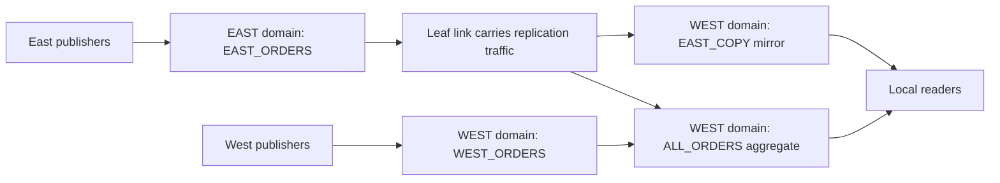

# Replicate JetStream Across Regions with Mirrors and Sources

Author: [nawazdhandala](https://www.github.com/nawazdhandala)

Tags: NATS, Messaging, Cross-Region Replication, Python

Description: Choose mirrors or sources for regional JetStream copies, distinguish gateways from leaf links, and test domain routing and catch-up after a destination restart.

Connecting two NATS regions does not automatically create a second durable copy of every stream. A gateway or leaf connection moves messages between deployments. A mirror or source relationship tells JetStream which stored records to copy.

Treat connectivity, storage replication, and application failover as separate decisions. That keeps a healthy network connection from being mistaken for a recoverable copy of your data.

This guide demonstrates the distinction with NATS Server 2.11.4 and nats-py 2.10.0. Two loopback servers stand in for regions. They are useful for checking configuration and message behavior, but they do not simulate geographic latency or production availability.

## Choose the data relationship first

| Need | Mirror | Sourced stream |
| --- | --- | --- |
| Copy one upstream while retaining its sequence numbers | Appropriate | Assigns destination sequence numbers |
| Combine records from several upstreams | One upstream only | Appropriate |
| Accept direct publications into the destination | Not supported by a mirror | Possible when destination subjects are configured |
| Choose destination retention limits | Independent destination limits | Independent destination limits |

A mirror follows one upstream. Sources gather records into a destination with its own sequence space. Do not use an aggregate's sequence number as a globally ordered business-event identifier. Preserve an operation ID and origin in the event itself. The [mirrors and sources guide](https://docs.nats.io/learn/jetstream/mirrors-and-sources) explains the basic choices.

Keep each region's required local availability separate from copying between regions. For example, an upstream stream can have three local replicas while a remote mirror also has three local replicas. The asynchronous relationship between those streams is not a single six-member RAFT group.

## Choose how the deployments connect

Gateways connect clusters into a super-cluster. They route traffic according to interest and support regional routing behavior. They do not instruct JetStream to create a mirror. The [super-cluster documentation](https://docs.nats.io/learn/topologies/super-clusters) describes that network layer.

Leaf nodes connect a server or deployment outward to another deployment, often across an edge or administrative boundary. Account mapping, permissions, TLS, and available subjects still determine what can cross the connection. A [leaf connection](https://docs.nats.io/learn/topologies/leaf-nodes) is also not a durable message queue by itself.

For this lab, WEST initiates a leaf connection to EAST. Each has its own JetStream domain, a name that distinguishes its API subjects. WEST explicitly addresses EAST's API when creating the remote replication relationship.



The arrows show data movement. WEST establishes the underlying outbound leaf connection, even though EAST's copied records travel back toward WEST.

## Build two disposable domains

Use a new empty working directory, two terminals in that directory, and the pinned server binary available as `nats-server`. Save this as `east.conf`:

```text
listen: "127.0.0.1:14236"
server_name: east
jetstream {
  store_dir: "./east-store"
  domain: EAST
}
leafnodes {
  listen: "127.0.0.1:17436"
}
```

Save this as `west.conf`:

```text
listen: "127.0.0.1:14237"
server_name: west
jetstream {
  store_dir: "./west-store"
  domain: WEST
}
leafnodes {
  remotes: [{url: "nats://127.0.0.1:17436"}]
}
```

Start `nats-server -c east.conf` in one terminal and `nats-server -c west.conf` in the other. Each server owns a separate store. Stop only these foreground lab processes when finished.

These loopback-only configurations omit authentication and TLS. Do not expose them on a network. A production leaf link requires an authenticated account mapping, trusted peer certificates, and reviewed permissions for both replication requests and returned data.

## Name the remote API explicitly

Install `nats-py==2.10.0` in a Python virtual environment. In an asynchronous Python program, open the two connections and select their domains:

```python
import nats
from nats.js.api import ExternalStream, StorageType, StreamSource

east = await nats.connect("nats://127.0.0.1:14236")
west = await nats.connect("nats://127.0.0.1:14237")
ej = east.jetstream(domain="EAST")
wj = west.jetstream(domain="WEST")
```

These are fragments for an `async` function, not top-level synchronous Python. Close both connections in its `finally` block. The API fields are defined in the [pinned Python client](https://github.com/nats-io/nats.py/blob/v2.10.0/nats/js/api.py).

Create two original streams before configuring copies:

```python
await ej.add_stream(
    name="EAST_ORDERS", subjects=["east.orders"],
    storage=StorageType.FILE, max_msgs=100, max_age=86400,
)
await wj.add_stream(
    name="WEST_ORDERS", subjects=["west.orders"],
    storage=StorageType.FILE, max_msgs=100, max_age=86400,
)
```

The limits are deliberately small: one hundred records or one day. Use fresh stream names in an empty lab, not names belonging to a running application.

Now create the mirror and aggregate in WEST:

```python
remote_east = StreamSource(
    name="EAST_ORDERS",
    external=ExternalStream(api="$JS.EAST.API"),
)
await wj.add_stream(
    name="EAST_COPY", storage=StorageType.FILE,
    max_msgs=100, max_age=86400, mirror=remote_east,
)
await wj.add_stream(
    name="ALL_ORDERS", storage=StorageType.FILE,
    max_msgs=200, max_age=86400,
    sources=[remote_east, StreamSource(name="WEST_ORDERS")],
)
```

`$JS.EAST.API` selects the upstream domain. It is not a hostname and does not create network connectivity. The leaf link must already carry the required subjects. The external-stream model is described in [ADR-59](https://github.com/nats-io/nats-architecture-and-design/blob/main/adr/ADR-59.md); that document includes features newer than this lab, so the executed example uses only fields supported by the pinned versions.

Across different accounts, additional exports/imports and delivery/flow-control permissions are needed. A domain name is not an authorization boundary. Do not solve a failed mirror by granting every application unrestricted JetStream API access.

## Verify the copy, then interrupt the destination

Publish identifiable records through the corresponding JetStream clients:

```python
for number in range(1, 4):
    await ej.publish("east.orders", f"east-{number}".encode())
await wj.publish("west.orders", b"west-1")
```

Wait for replication rather than expecting immediate counts after the last publication. Inspect each destination:

```python
mirror_info = await wj.stream_info("EAST_COPY")
aggregate_info = await wj.stream_info("ALL_ORDERS")
print(mirror_info.state.messages, mirror_info.mirror)
print(aggregate_info.state.messages, aggregate_info.sources)
```

Initially, expect three mirror records and four aggregate records. Inspect source errors, lag, and recent activity as well as message counts. A stale zero-lag observation is insufficient proof of current connectivity.

The local test compared every mirrored payload, subject, sequence number, and original timestamp. It also verified that the aggregate contained all four distinct payloads. WEST was then stopped, EAST accepted a fourth record, and WEST restarted using its original store. The mirror caught up to four records and the aggregate to five, with zero reported replication lag.

## Plan for longer outages and promotion

Catch-up works only while the required upstream records remain available. Size upstream retention for the outage you intend to tolerate, plus the time needed to drain the accumulated backlog. Estimate whether recovery bandwidth exceeds the continuing arrival rate; a link that merely matches new traffic cannot erase an existing backlog.

A remote copy does not automatically transfer application ownership. Before promoting another region, fence the old writer path, identify the accepted recovery point, reconcile operations that may already have affected external systems, and define how consumers resume. Consumer delivery progress is not copied merely because messages are mirrored.

Maintain dated, independently protected backups alongside live replication. Test retention and deletion behavior for your exact versions instead of assuming every source-side administrative operation has an identical remote effect. Avoid cycles in cross-domain source relationships and give each logical event one authoritative origin.

The executed test covered a local leaf link, domain routing, mirror fidelity, aggregation, and catch-up after a destination restart. Gateways, WAN latency, TLS, account restrictions, multi-replica failure, and production promotion were not exercised. Those are the next staging checks before this design becomes a regional recovery plan.
