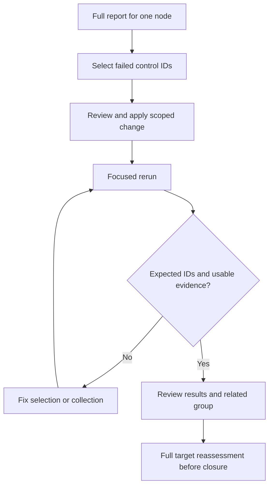

# Rerun Failed kube-bench Checks and Groups During Remediation

Author: [nawazdhandala](https://www.github.com/nawazdhandala)

Tags: Kubernetes, Security, Troubleshooting

Description: Select failed kube-bench controls for focused remediation, verify the checks actually ran, and return to a full assessment before closing the change.

After a full kube-bench assessment, rerunning hundreds of controls after every small configuration change makes feedback harder to follow. A focused rerun can answer a narrower question: did this change correct the specific finding on this node?

The important word is “focused.” A report containing one passing check does not replace the original assessment. It also needs to contain the check you intended to run. An empty selection can look deceptively quiet.

This tutorial uses **kube-bench v0.14.0**, its default JSON report format, and jq for selecting results. The command examples assume an authorized scanner environment with the same host visibility as the original scan. The local validation described below used synthetic controls, not a live Kubernetes node.

## Keep the assessment identity fixed

Before changing anything, save the full report as `before.json`. Keep its stderr log and record the node name and UID, kube-bench release, benchmark, target, configuration revision, and any skip options. A node UID distinguishes a replacement machine from a previous node that happened to use the same name.

For this example, the approved assessment uses `cis-1.11` with the `node` target. Substitute your approved benchmark deliberately. Do not use a failing check ID from one benchmark against a different profile just because the number exists in both.

A comparison is useful only when it has a stable meaning. Changing scanner version, benchmark, mount paths, and kubelet settings together makes it difficult to tell why a result changed. If fixing scanner visibility is necessary, record that as a collection correction before claiming remediation of a cluster setting.

## Choose individual checks or whole groups

A check ID names one control, such as `4.1.1`. A group ID names a collection, such as `4.1`. In v0.14.0, `--check` selects exact check IDs and `--group` selects exact group IDs. Both accept comma-separated lists. They cannot be combined in the same invocation, as enforced by the [run-filter implementation](https://github.com/aquasecurity/kube-bench/blob/v0.14.0/cmd/common.go).

| Selection | Use it when | Important limit |
|---|---|---|
| `--check 4.1.1,4.1.2` | Verifying a small set of specific findings | Related checks outside that list are excluded |
| `--group 4.1` | A shared change could affect several related controls | Passing controls in the group run again too |
| No check/group filter | Refreshing the full selected target assessment | Other targets and nodes still need their own coverage |

Passing `--check 4.1` is not a shorthand for all `4.1.*` controls. The filter compares identifiers rather than expanding prefixes. Confirm the group from the report or control YAML, not by guessing how many dot-separated parts to remove. The [flag definitions](https://github.com/aquasecurity/kube-bench/blob/v0.14.0/cmd/root.go) are the authority for these options.

## Build a failed-check list from one target

The following Bash snippet extracts failed node controls from the saved report. It assumes the default JSON envelope with `Controls`; do not use a report produced with `--nototals`, which has a different root shape.

```bash
set -euo pipefail
jq -e '.Controls | type == "array"' before.json >/dev/null
checks=$(jq -r '
  [.Controls[] | select(.node_type == "node") |
   .tests[] | .results[] | select(.status == "FAIL") | .test_number]
  | unique | join(",")
' before.json)
if [ -z "$checks" ]; then
  printf 'No failed node checks selected; no focused scan started.\n'
  exit 0
fi
printf 'Selected checks: %s\n' "$checks"
```

Run the subsequent scan in the same Bash session or script so `$checks` remains available. Inspect the printed IDs before proceeding. Use a report for one node and the intended benchmark; this query does not establish provenance for you.

The empty-list guard is essential. An empty `--check` value means there is no check filter, so it can run the whole target instead. Conversely, a nonempty but incorrect ID can match nothing. Neither behavior should be used as evidence that the original failure disappeared.

This query intentionally selects FAIL records. Manual WARN results and approved exceptions still require their own assessment process. They are not repaired merely because the failed-check list becomes empty.

## Apply a reviewed change and rerun the selected controls

Review the control's observed value, reason, and remediation text before changing the node. Confirm the evidence concerns the intended file or running component. Stage a change on a suitable test node or controlled maintenance scope, and understand whether the affected component requires a restart.

With `$checks` set above, run the same scanner and configuration against that same node:

```bash
bundle_dir="$PWD"
scan_status=0
./kube-bench run --benchmark cis-1.11 --targets node \
  --config "$bundle_dir/cfg/config.yaml" \
  --config-dir "$bundle_dir/cfg" \
  --check "$checks" --json --exit-code 3 \
  > focused.json 2> focused.log || scan_status=$?
printf 'Focused scan exit: %s\n' "$scan_status"
```

This is a real scan command, not a dry run. It assumes `kube-bench` and the matching `cfg` tree are in the current directory. Retain the scanner's required mounts and permissions when adapting it to a container Job.

The explicit exit code makes remaining FAIL results return 3. Other execution errors must also be investigated. Continue to inspect the JSON: an exit status alone does not establish that the intended controls were evaluated. The [report execution code](https://github.com/aquasecurity/kube-bench/blob/v0.14.0/check/controls.go) shows that only selected results enter the focused report.

## Prove that the expected checks were present

Use a set comparison before reviewing whether the results passed:

```bash
jq -e --arg selected "$checks" '
  ($selected | split(",") | unique) as $expected |
  ([.Controls[] | select(.node_type == "node") |
    .tests[]? | .results[]? | .test_number] | unique) as $actual |
  ($expected == $actual)
' focused.json
```

This returns success only when the reported IDs match the requested IDs. A false result, malformed report, or jq error requires investigation. It does not check that all results passed, nor does it verify node identity; inspect statuses and retain the node evidence separately.

If a requested check is absent, look for a typo, the wrong benchmark or target, or inherited `--scored=false` or `--unscored=false` options. Those flags also participate in filtering. A matching skipped control can appear as INFO, so membership alone is not enough to close a finding.

## Expand the review before closing remediation

When one configuration file or process setting affects several controls, rerun the containing group using `--group` instead of `--check`. For example, replace the check option with `--group 4.1` when that is the relevant group in the approved profile. Keep the remaining command and evidence capture unchanged.



After the change is accepted, remove the selection filter and run the full applicable assessment again. Keep the focused reports as intermediate evidence. Do not replace the original full report with a smaller passing report or compare their percentages as if they covered the same controls.

In local v0.14.0 tests, an exact check selected one synthetic result, a group selected all six group members, and an unknown ID produced no results with exit zero. Combining check and group filters was rejected; an empty check string selected all six. These tests establish selection behavior only. The final proof of remediation must come from your intended nodes, stable assessment scope, and reviewed evidence.
