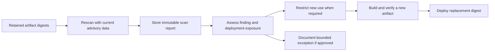

# Rescan Artifacts for New CVEs Without Mutating Their Versions

Author: [nawazdhandala](https://www.github.com/nawazdhandala)

Tags: Artifact Management, Vulnerability Management, Security, Docker

Description: Rescan immutable artifacts with current vulnerability data, preserve evidence, and enforce quarantine through repository and deployment controls.

An image that passed a scan last month can receive a serious finding today without changing a single byte. A new advisory, a better package detector, or a corrected vendor assessment changes what you know about the artifact.

Keep that distinction intact. The image digest identifies the artifact; the scan report records an assessment at a particular time. Do not overwrite an existing version with patched bytes or rewrite its original build evidence to make it look as though the finding never existed.

The practical workflow is to rescan, assess the new evidence, restrict future use where required, and publish a separately identified replacement. This article uses **Trivy 0.76.2** for source-checked command examples and Harbor's **2.14 documentation** to illustrate a repository control.

## Inventory what needs rescanning

Start with currently deployed releases, approved rollback targets, supported customer versions, and artifacts that can still be selected for deployment. A scan-on-push policy does not revisit old artifacts when advisory data changes.

Queue work by immutable identity, with the repository location and required platforms. Tags can move. For an image index, make sure the workflow covers every platform you support rather than treating one successful architecture scan as approval for all of them.

Record the scanner version, vulnerability database metadata, scan time, policy revision, exclusions, and target digest. Keep prior reports so an operator can explain why the decision changed. A scan result should be attributable to a specific run, not stored only as an overwritten `latest.json` file.



## Refresh the data, not the artifact

Trivy's [database documentation](https://github.com/aquasecurity/trivy/blob/v0.76.2/docs/guide/configuration/db.md) distinguishes the vulnerability database from other resources, including the Java package-identification database. Installing the scanner binary does not itself provide current advisory information.

For Trivy 0.76.2, run the following in a fresh scan workspace with approved registry credentials and trusted HTTPS access. `IMAGE_REF` must identify the intended image by digest. `SCAN_CACHE` is a dedicated directory for this scanner workflow:

```bash
set -euo pipefail
: "${IMAGE_REF:?Set repository@sha256:digest for the artifact}"
: "${SCAN_CACHE:?Set a dedicated Trivy cache directory}"
[[ "$IMAGE_REF" =~ @sha256:[0-9a-f]{64}$ ]] || exit 1

trivy --cache-dir "$SCAN_CACHE" image --download-db-only
trivy --cache-dir "$SCAN_CACHE" version --format json > scanner-before.json
trivy --cache-dir "$SCAN_CACHE" image \
  --image-src remote --scanners vuln \
  --format json --output scan.json "$IMAGE_REF"
trivy --cache-dir "$SCAN_CACHE" version --format json > scanner-after.json
```

`--image-src remote` selects registry retrieval rather than relying on a local Docker image. The scan command reads the artifact; it does not patch or republish it. A normal scan can acquire additional data it needs, so preserve the before-and-after scanner metadata and job logs.

Use a managed scanner configuration and inspect inherited environment settings, ignore files, and policy overrides. The example assumes those settings have been reviewed. If database refresh or artifact retrieval fails, record a failed assessment. Do not turn a scanner failure into a clean result.

For isolated environments, use the supported database-transfer process and enforce an explicit freshness deadline. Permanently skipping updates while labeling results “current” defeats the purpose of rescanning.

## Retain findings before filtering them

Trivy's [vulnerability documentation](https://github.com/aquasecurity/trivy/blob/v0.76.2/docs/guide/scanner/vulnerability.md) describes supported package sources and advisory selection. A scanner can only assess what its detection and advisory coverage supports. An empty report does not establish that every component was examined.

Preserve the full JSON report first. This jq 1.6 query creates a review list for high, critical, and unknown-severity findings:

```bash
jq -e '.Results | type == "array"' scan.json >/dev/null
jq '[
  .Results[] |
  .Target as $target |
  (.Vulnerabilities // [])[] |
  select(.Severity == "HIGH" or .Severity == "CRITICAL" or .Severity == "UNKNOWN") |
  {
    target: $target,
    id: .VulnerabilityID,
    package: .PkgName,
    installed: .InstalledVersion,
    fixed: .FixedVersion,
    severity: .Severity
  }
]' scan.json > review-findings.json
```

Run these commands in a shell that stops on errors, as in the earlier block. The first check rejects a missing or incorrectly typed results collection. It is not a full report-schema or coverage validator. The second preserves the affected target and package version so similarly named packages are not collapsed into one ambiguous finding.

An empty review list means only that this filter found no matching entries. Review scanner completion, coverage, unsupported components, database age, and lower-severity policy separately. Do not automatically approve a deployment from this file alone.

Avoid hiding findings just because no fix exists. Trivy's [filter documentation](https://github.com/aquasecurity/trivy/blob/v0.76.2/docs/guide/configuration/filtering.md) explains that `--ignore-unfixed` suppresses several categories without an available fix. Absence of a patch does not establish absence of risk.

## Make quarantine an enforced decision

A label named `quarantined` is useful metadata only if another control consults it. Define what quarantine means operationally: blocked promotion, denied new deployment, restricted download, or a combination. Keep the original artifact available to authorized incident and recovery personnel where policy requires it.

Harbor's [project vulnerability settings](https://goharbor.io/docs/2.14.0/working-with-projects/project-configuration/) include a severity threshold that prevents vulnerable images from being pulled. Despite the interface wording about preventing images from running, the documented mechanism is a pull restriction. It does not stop an already running container or guarantee that a node with cached content cannot start it.

Pair repository restrictions with a deployment or admission policy that evaluates the intended digest and current assessment. Test the control for cached images, alternative registries, and copied artifacts. Restricting one repository path does not revoke every copy of the same bytes elsewhere.

Before applying a broad threshold, assess how it affects emergency rollback and service recovery. Record the intended behavior for existing workloads separately from the decision about new deployments. Replacing or stopping live workloads is an operational change requiring a rollout plan.

## Separate scanner status from the security decision

Harbor's [scan-status documentation](https://goharbor.io/docs/2.14.0/administration/vulnerability-scanning/scan-individual-artifact/) distinguishes unsupported, queued, running, failed, and completed scans. It also describes partial success for image indexes. Preserve those distinctions in automation; “not complete” must not be represented as “no vulnerabilities.”

For each finding, record the affected package, advisory source, deployed exposure, available fix, and owner. If an exception is justified, scope it to the exact artifact and finding, give it an expiration and approver, and retain the rationale. A global permanent allow-list is much harder to reason about than a bounded exception.

A patched build receives a new immutable version and digest, new tests, and new evidence. Rescan the replacement and verify the deployment control accepts it before moving production. Keep the old report and quarantine decision as history instead of editing them into a passing assessment.

## Validate the process before scheduling it broadly

Use owned staging artifacts to test changed advisory results, scanner failures, expired data, unknown severity, partial platform coverage, and an approved exception that expires. Verify both the report and the actual blocked operation. Also verify the intended incident access path remains available.

The local checks for this article verified Trivy 0.76.2's command flags and exercised the jq filter on synthetic reports. No vulnerability database was downloaded, no real image was scanned, and no Harbor or deployment quarantine was applied. The scan and enforcement steps need acceptance testing in your environment before becoming an automated release decision.
