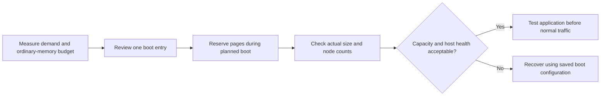

# Reserve 1 GiB HugeTLB Pages at Boot After Runtime Allocation Fails

Author: [nawazdhandala](https://www.github.com/nawazdhandala)

Tags: Linux, HugePages, Memory Management

Description: Plan a 1 GiB HugeTLB pool, add scoped boot parameters, verify actual capacity after restart, and retain a recovery path when runtime allocation is fragmented.

A host can have plenty of unused memory and still fail to grow a pool of 1 GiB huge pages. Each page needs a suitable contiguous physical region. After workloads have allocated and released memory, enough free bytes can exist without the large regions the request needs.

Boot-time reservation moves that allocation earlier, before normal applications fragment memory. It is a capacity-planning change that requires a restart, rather than a promise that any requested count will fit.

This guide uses Linux 6.12 documentation for kernel behavior and a separately scoped **RHEL 9, x86-64, GRUB-managed host** for the boot-entry example. RHEL kernels include distribution-specific changes; this does not imply that RHEL 9 runs the upstream 6.12 kernel. Do not use the boot-management commands unchanged on another distribution or a system with a different boot mechanism.

## Confirm that boot reservation addresses the problem

Record the unsuccessful runtime request and the count that remained afterward. A write requesting eight pages is not evidence that eight were allocated. Check the relevant size directly:

```bash
uname -r
cat /proc/cmdline
pool=/sys/kernel/mm/hugepages/hugepages-1048576kB
if [ -d "$pool" ]; then
    for field in nr_hugepages free_hugepages resv_hugepages surplus_hugepages; do
        printf '%s=' "$field"
        cat "$pool/$field"
    done
else
    printf 'This running kernel does not expose a 1 GiB HugeTLB pool.\n'
fi
```

The directory name uses KiB: 1,048,576 KiB equals 1 GiB. If the directory is absent, investigate processor, hypervisor, architecture, and kernel support before scheduling a reboot. If it exists but the count is below the runtime target, fragmentation is a possibility, not a complete diagnosis. Memory policy and available capacity also matter.

The [Linux HugeTLB guide](https://www.kernel.org/doc/html/v6.12/admin-guide/mm/hugetlbpage.html) describes early reservation as the most reliable allocation approach because memory has not yet fragmented. Red Hat likewise recommends kernel-command-line reservation over a later systemd service for the earliest allocation opportunity. See its [HugeTLB boot configuration procedure](https://docs.redhat.com/en/documentation/red_hat_enterprise_linux/9/html/monitoring_and_managing_system_status_and_performance/configuring-huge-pages_monitoring-and-managing-system-status-and-performance).

## Budget physical memory before writing boot parameters

Suppose a staging workload needs eight 1 GiB pages. The intended pool consumes 8 GiB of physical memory. That capacity is unavailable for ordinary allocations while retained in the HugeTLB pool, and HugeTLB pages cannot be swapped out.

Do not size the pool from the application's steady-state footprint alone. Include startup peaks, overlapping old and new processes during a deployment, and other huge-page consumers. Separately retain enough ordinary memory for the kernel, monitoring agents, filesystem activity, and application allocations that do not use HugeTLB.

Write down the budget rather than copying the example count:

| Budget component | Example decision |
|---|---|
| Explicit 1 GiB pool | Eight pages, totaling 8 GiB |
| Other huge-page pools | Inventory separately before changing anything |
| Ordinary workload memory | Preserve measured peak plus operating headroom |
| Placement | Verify capacity on nodes the workload may use |
| Recovery | Keep a boot entry without the new reservation |

NUMA nodes are groups of processors and nearby memory. A host-wide count alone is insufficient if the application is restricted to one node. This article checks placement after boot; assigning exact per-node reservations should be a separate deliberate configuration change.



## Use an explicit size-and-count pair

For this eight-page example, the intended kernel arguments are:

```text
hugepagesz=1G hugepages=8
```

`hugepagesz` selects the size for the following `hugepages` count. Keep the pair together. The kernel supports one such pair for each supported size; adding repeated pairs for the same size is not a reliable way to override an earlier count.

You do not need `default_hugepagesz=1G` just to create a 1 GiB pool. That option also changes the default used by interfaces that omit a size. Preserve the existing default unless the application design explicitly requires changing it. These meanings are defined in the [Linux 6.12 kernel parameter reference](https://www.kernel.org/doc/html/v6.12/admin-guide/kernel-parameters.html).

Review all existing HugeTLB arguments first. Also check for specialized settings such as `hugetlb_cma`, which changes gigantic-page allocation behavior. A machine already using that mechanism needs its own reviewed plan; do not layer this example over it.

## Update a single reviewed RHEL boot entry

The following commands require administrative access on the RHEL 9 example host. Before running them, arrange console access, retain a known-good boot entry, and schedule a maintenance window with the workload drained.

First inspect the entry for the currently running kernel and save its output in the change record:

```bash
kernel_path="/boot/vmlinuz-$(uname -r)"
sudo grubby --info="$kernel_path"
sudo grubby --info=ALL
```

Confirm that the selected entry exists and is the one you intend to boot. Inspect its complete arguments. **The update below assumes that this entry has no existing HugeTLB size/count arguments and no custom HugeTLB CMA setup.** If it already has them, prepare a complete replacement plan that preserves other pools instead of appending this example.

```bash
kernel_path="/boot/vmlinuz-$(uname -r)"
sudo grubby --update-kernel="$kernel_path" --args="hugepagesz=1G hugepages=8"
sudo grubby --info="$kernel_path"
```

Verify that the resulting entry contains the intended pair exactly once and retains unrelated arguments. This selects a kernel path rather than updating every installed kernel. It does not itself select the next boot entry or reboot the machine. Follow your maintenance procedure to boot the reviewed entry. The command forms are documented in [RHEL kernel command-line management](https://docs.redhat.com/en/documentation/red_hat_enterprise_linux/9/html/managing_monitoring_and_updating_the_kernel/configuring-kernel-command-line-parameters_managing-monitoring-and-updating-the-kernel) and [installed-entry inspection](https://docs.redhat.com/en/documentation/red_hat_enterprise_linux/9/html-single/managing_monitoring_and_updating_the_kernel/index).

## Verify what the kernel actually allocated

After the planned restart, inspect the effective command line and the size-specific pool before starting its consumers:

```bash
cat /proc/cmdline
pool=/sys/kernel/mm/hugepages/hugepages-1048576kB
for field in nr_hugepages free_hugepages resv_hugepages; do
    printf '%s=' "$field"
    cat "$pool/$field"
done
for file in /sys/devices/system/node/node*/hugepages/hugepages-1048576kB/nr_hugepages; do
    [ -r "$file" ] || continue
    printf '%s=' "$file"
    cat "$file"
done
```

For the isolated example with no other configuration changing the pool, expect `nr_hugepages` to be eight. With no consumers or reservations, expect eight free pages and zero reserved pages. If services have already started, free and reserved counts can legitimately differ; compare them with startup timing rather than declaring allocation failure.

Check the per-node distribution against the workload's allowed memory nodes. Do not use the default-size `HugePages_Total` value alone to verify a non-default pool.

Use these acceptance gates:

1. The effective command line matches the reviewed entry.
2. The actual 1 GiB pool count meets the approved budget.
3. Eligible nodes hold the capacity required by the application.
4. The host retains sufficient ordinary memory and remains healthy.
5. A controlled application startup explicitly selects 1 GiB pages and successfully touches its required memory.

A booted host with the right pool count passes the infrastructure check, not the complete application test. Keep the initial traffic controlled until the last gate passes.

## Recover without turning one failure into several changes

If the machine is unstable or cannot boot normally, use the retained known-good entry through the console. If it boots but the pool is too small, capture the effective arguments, counts, and boot diagnostics before deciding whether to reduce the request or change placement.

For the exact clean-entry example, removing the newly added parameter names restores the absence of those options:

```bash
kernel_path="/boot/vmlinuz-$(uname -r)"
sudo grubby --update-kernel="$kernel_path" --remove-args="hugepagesz hugepages"
sudo grubby --info="$kernel_path"
```

Run this only against the entry actually changed; after booting a fallback kernel, substitute the original saved kernel path. If there were pre-existing HugeTLB arguments, restore their saved values instead. A boot-entry edit affects a later boot and does not release the running pool immediately.

The commands and parameter ordering were checked against official documentation, and shell snippets passed syntax checks. No host was rebooted, no boot entry was modified, and no Linux huge-page allocation was executed for this article. Treat the acceptance gates as work to perform on your own staging host before rollout.
