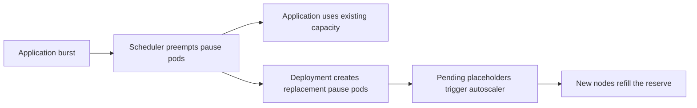

# Reserve Burst Capacity with Low-Priority Pause Pods

Author: [nawazdhandala](https://www.github.com/nawazdhandala)

Tags: Kubernetes, Cluster Autoscaler, Scheduling

Description: Keep Kubernetes capacity ready for bursts with expendable pause pods, correctly sized requests, priority boundaries, and a measurable refill process.

A traffic burst can create application replicas much faster than your cloud provider can create nodes. If every existing node is full, those replicas wait through machine provisioning, startup, networking, and image pulls. One way to shorten the capacity part of that wait is to keep small, disposable pods occupying resource requests ahead of time.

These placeholders run a pause container. They do almost no useful computation, but the scheduler counts their requests when placing other pods. Higher-priority workloads can preempt them, meaning the scheduler removes the placeholders to make room. The reserve is therefore paid-for node capacity that is already available, rather than a promise that nodes will appear quickly.

This guide uses Kubernetes 1.34 and Cluster Autoscaler 1.34.0 as its reference versions. It describes a staging deployment and acceptance procedure, not results from a live cluster test.

## Understand the two separate loops

The scheduler makes room for the incoming application. Cluster Autoscaler subsequently helps replenish the reserve when replacement placeholders cannot fit. The [versioned autoscaler FAQ](https://github.com/kubernetes/autoscaler/blob/cluster-autoscaler-1.34.0/cluster-autoscaler/FAQ.md#how-can-i-configure-overprovisioning-with-cluster-autoscaler) documents this overprovisioning pattern.



There are two clocks to measure: application readiness after the burst, and restoration of the reserve afterward. A successful first burst does not prove the cluster can absorb another burst a minute later. If replacement placeholders remain pending because the node group has reached its limit, the original cushion has been consumed.

Preemption also does not guarantee immediate application readiness. Image downloads, volume attachment, admission processing, and application initialization still take time. Kubernetes documents the gap between victim termination and scheduling in its [priority and preemption guide](https://kubernetes.io/docs/concepts/scheduling-eviction/pod-priority-preemption/#graceful-termination-of-preemption-victims).

## Choose a priority that still permits replenishment

Cluster Autoscaler 1.34.0 defaults its expendable-pod priority cutoff to `-10`. Pods with priority **below** that value do not trigger scale-up. A placeholder at exactly `-10` remains eligible to trigger it. Check your installation's actual setting before adopting this number: a customized cutoff changes the boundary. The comparison is explicit in the [tagged autoscaler implementation](https://github.com/kubernetes/autoscaler/blob/cluster-autoscaler-1.34.0/cluster-autoscaler/core/utils/expendable.go).

Production workloads must have a higher resolved priority and allow preemption to reclaim these placeholders. A production PriorityClass with `preemptionPolicy: Never` will wait instead. Conversely, using `Never` on the placeholder class prevents placeholders from preempting still-lower-priority work; it does not prevent production from evicting them. These are separate directions of protection.

Use a class dedicated to the reserve. Do not make it the cluster default or reuse a system-critical priority.

## Install a small, bounded reserve

Prerequisites are a staging namespace named `capacity-buffer`, permission to create a cluster-scoped PriorityClass, Linux worker nodes, and an autoscaler-managed node group with room to grow. Verify quotas and any policies restricting priority classes. Save this example as `capacity-buffer.yaml`:

```yaml
apiVersion: scheduling.k8s.io/v1
kind: PriorityClass
metadata:
  name: burst-buffer
value: -10
globalDefault: false
preemptionPolicy: Never
description: Disposable capacity reserve for application bursts.
---
apiVersion: apps/v1
kind: Deployment
metadata:
  name: burst-buffer
  namespace: capacity-buffer
spec:
  replicas: 2
  selector:
    matchLabels:
      app: burst-buffer
  template:
    metadata:
      labels:
        app: burst-buffer
    spec:
      priorityClassName: burst-buffer
      automountServiceAccountToken: false
      terminationGracePeriodSeconds: 0
      nodeSelector:
        kubernetes.io/os: linux
      securityContext:
        runAsNonRoot: true
        runAsUser: 65534
        seccompProfile:
          type: RuntimeDefault
      containers:
        - name: pause
          image: registry.k8s.io/pause:3.10.1
          securityContext:
            allowPrivilegeEscalation: false
            readOnlyRootFilesystem: true
            capabilities:
              drop: [ALL]
          resources:
            requests:
              cpu: "1"
              memory: 1Gi
            limits:
              cpu: "1"
              memory: 1Gi
```

The [Kubernetes 1.34 pause build](https://github.com/kubernetes/kubernetes/blob/v1.34.0/build/pause/Makefile) specifies version 3.10.1. For immutable deployment, resolve and approve the registry digest in your release process; the manifest above pins the version tag. Mirror it if nodes cannot access the public registry.

Each replica requests one CPU and 1 GiB of memory, so two running replicas account for two CPUs and 2 GiB in aggregate. Requests reserve scheduling capacity; they do not make pause consume that much CPU or memory. The zero termination grace period is appropriate here because this process has no application state to flush. Do not copy it into a database or request-serving application.

Validate admission before installation:

```bash
kubectl apply --dry-run=server -f capacity-buffer.yaml
kubectl apply -f capacity-buffer.yaml
kubectl -n capacity-buffer rollout status deployment/burst-buffer --timeout=120s
kubectl -n capacity-buffer get pods -l app=burst-buffer -o wide
```

The first command asks the API server to validate without persisting the objects. A successful rollout should show two available placeholders. A timeout means investigate; it is not evidence that capacity has been reserved.

## Reserve the shape your applications need

Two CPUs spread across two nodes cannot necessarily accommodate a single pod requesting two CPUs. A reserve must match the largest burst pod's placement requirements, not just its summed resource budget.

For a zonal application, keep suitable capacity in the required zone. For a tainted worker pool, placeholders need the same intended pool selection and relevant tolerations. Avoid broad tolerations that let your reserve accumulate on unrelated infrastructure nodes. Check memory, pod-count limits, and application-specific scheduling restrictions as well as CPU.

The simple example deliberately selects only Linux nodes. Before production use, restrict it to the node pool serving the intended applications and decide whether separate deployments per zone are necessary. Hard spreading can itself leave placeholders pending; understand that signal before treating it as a shortage of general cluster capacity.

Do not attach an availability requirement to these disposable replicas. A PodDisruptionBudget can affect victim preferences, but it is not a guarantee against scheduler preemption. Protect the applications that matter with appropriate replication and recovery design instead of trying to protect the reserve from being consumed.

## Rehearse one burst and its refill

Use an approved staging application whose requests exceed current unreserved space but fit after removing placeholders from an eligible node. Keep its replicas and node-group maximum bounded. Record the baseline placeholder count and node placement before increasing demand.

Observe both workloads and events:

```bash
kubectl -n capacity-buffer get pods -l app=burst-buffer -w
# In another terminal, inspect recent namespace events.
kubectl -n capacity-buffer get events --sort-by=.metadata.creationTimestamp
```

Correlate pod UIDs and timestamps: a replacement pod can have a similar name without being the original victim. Verify the application becomes ready, the old placeholders disappear through preemption, and replacement placeholders eventually become available. Consult autoscaler logs for the actual scale-up decision rather than inferring it from pod creation alone.

| Observation | Next investigation |
|---|---|
| Application waits while placeholders remain | Effective priorities, non-preempting policy, and incompatible placement constraints |
| Placeholders disappear but application is not ready | Scheduling result, image pulls, storage, and readiness checks |
| Replacement placeholders stay pending | Autoscaler cutoff, node-group maximum, quotas, and feasible node shapes |
| Reserve lands in the wrong pool | Node selectors, tolerations, and zone requirements |

Track available reserve replicas alongside their requested resources, refill duration, and burst-to-ready latency. Alert on prolonged depletion, not the expected brief loss of disposable pods. Finally, compare the steady cost of spare nodes with the latency benefit measured in your rehearsal. The useful reserve is the smallest correctly placed cushion that meets your workload's burst objective and can reliably refill.
