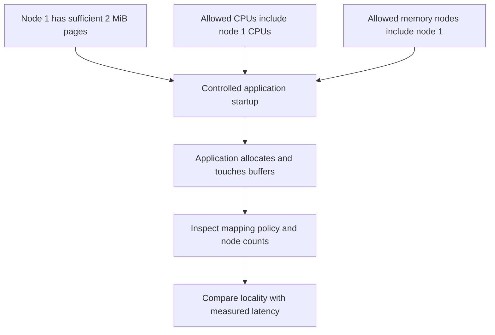

# Reserve Huge Pages on NUMA Nodes and Verify Application Placement

Author: [nawazdhandala](https://www.github.com/nawazdhandala)

Tags: Linux, HugePages, Performance

Description: Allocate HugeTLB pages on selected NUMA nodes, align CPU and memory policy, and verify actual application mappings instead of trusting host-wide counters.

A host-wide huge-page pool can look healthy while a latency-sensitive application uses remote memory or cannot allocate locally. The missing detail is placement: which NUMA node owns the free pages, which nodes the process may use, and where its mappings actually reside after startup.

NUMA means non-uniform memory access. Memory near a processor can have different access cost from memory attached elsewhere. A NUMA node is not necessarily a physical CPU socket: firmware and virtualization can expose several nodes per socket or a topology different from the underlying host.

This walkthrough uses **Linux 6.12** interfaces and checks command behavior against **numactl 2.0.19**. The example targets 256 pages of 2 MiB each on node 1, totaling 512 MiB. Substitute a node and capacity supported by your staging machine; do not resize a production pool while its consumers are active.

## Build a topology and eligibility record

Run these read-only commands on the Linux host:

```bash
numactl --version
numactl --hardware
lscpu --extended=CPU,NODE,SOCKET,ONLINE
```

`numactl --hardware` lists available nodes, their CPUs, memory, and relative distances. The explicit `lscpu` columns connect logical CPUs to nodes and sockets. Check rather than assume that node 1 corresponds to socket 1. In a virtual machine, this describes the guest's exposed topology. See [numactl](https://man7.org/linux/man-pages/man8/numactl.8.html) and [lscpu](https://man7.org/linux/man-pages/man1/lscpu.1.html).

For an already running application, replace `12345` with its host-visible PID:

```bash
app_pid=12345
awk '/^(Name|Cpus_allowed_list|Mems_allowed_list):/' "/proc/$app_pid/status"
cat "/proc/$app_pid/cgroup"
```

The CPU list shows scheduling eligibility; the memory-node list shows allowed memory nodes. Neither proves where an existing allocation resides. These are documented [process status fields](https://man7.org/linux/man-pages/man5/proc_pid_status.5.html).

If a service or container runs inside a cpuset, inspect the effective CPU and memory-node settings in its actual cgroup and ancestors. Cgroup v2 exposes `cpuset.cpus.effective` and `cpuset.mems.effective`; inherited restrictions can narrow what the service configuration requested. Do not simply change the parent policy to make a test pass. See the [cgroup v2 cpuset interface](https://www.kernel.org/doc/html/v6.12/admin-guide/cgroup-v2.html#cpuset).

## Place the pool before placing the workload

Inspect every node's 2 MiB pool:

```bash
for pool in /sys/devices/system/node/node*/hugepages/hugepages-2048kB; do
    [ -d "$pool" ] || continue
    printf '\n%s\n' "$pool"
    for field in nr_hugepages free_hugepages surplus_hugepages; do
        printf '%s=' "$field"
        cat "$pool/$field"
    done
done
```

The per-node interface exposes total, free, and surplus counts. Reservations remain a global quantity for each page size: do not look for a per-node `resv_hugepages` counter and interpret its absence as zero reservations.

On a dedicated staging host, with node 1 online and its ordinary-memory budget approved, this requests a **total** of 256 persistent 2 MiB pages on that node:

```bash
pool=/sys/devices/system/node/node1/hugepages/hugepages-2048kB
current=$(cat "$pool/nr_hugepages")
if [ "$current" -gt 256 ]; then
    printf 'Existing pool exceeds this example; leave it unchanged.\n'
else
    printf '256\n' | sudo tee "$pool/nr_hugepages"
    printf 'Actual total after request: '
    cat "$pool/nr_hugepages"
fi
```

The value is not “add 256.” Read it back: available contiguous memory may prevent the target from being reached. A successful write alone is insufficient. The [HugeTLB per-node interface](https://www.kernel.org/doc/html/v6.12/admin-guide/mm/hugetlbpage.html) applies the request directly to that node, independently of the writer's memory policy.

This is different from wrapping a global `nr_hugepages` write in `numactl` and assuming it will honor placement. The documented policy-aware global interface is `nr_hugepages_mempolicy`; use the direct node path here to keep the intended target explicit.

For persistent reservation, Linux 6.12 also documents the boot fragment `hugepagesz=2M hugepages=1:256`. Integrate it through your distribution's reviewed boot configuration, preserving other pools and avoiding duplicate size arguments. Verify node counts after restarting. Boot reservation and runtime growth are alternative provisioning steps, not two quantities to add together.



## Apply CPU and memory policy deliberately

Run the application's documented staging launch command under `numactl`. The path below is a placeholder; replace it with the actual executable and append its real arguments:

```bash
numactl --cpunodebind=1 --membind=1 -- /path/to/application
```

`--cpunodebind=1` restricts execution to CPUs belonging to node 1. `--membind=1` restricts memory allocation to that node; it can fail if eligible capacity is insufficient. By contrast, a preferred-node policy allows fallback. Those are different operational choices, not interchangeable ways of spelling “local.” The flags are documented in the [numactl 2.0.19 manual](https://github.com/numactl/numactl/blob/v2.0.19/numactl.8).

This command does not make an ordinary allocator use HugeTLB. Configure the application's explicit huge-page mode or hugetlbfs mapping separately. It also does not automatically relocate pages in a shared mapping that another process already populated.

For a supervised service, apply the corresponding policy through its approved launch configuration instead of starting a second unmanaged instance. Verify the final process and worker threads: applications can adjust their own affinity or allocation policy after launch.

## Inspect placement after the application touches its buffers

Wait until the representative working set has been allocated and accessed, then inspect the process's HugeTLB mapping lines:

```bash
app_pid=12345
awk '{for (i=1;i<=NF;i++) if ($i=="huge") {print; break}}' "/proc/$app_pid/numa_maps"
```

The token-based filter avoids selecting an ordinary mapping merely because its filename contains “huge.” A simplified illustrative line might look like:

```text
7f0000000000 bind:1 file=/mnt/hugetlb-2m/buffer huge dirty=32 N1=32 kernelpagesize_kB=2048
```

This is sample output, not a captured benchmark. `bind:1` describes effective policy. `N1=32` reports 32 huge pages currently mapped on node 1, and the reported size makes that 64 MiB. It does not prove the remaining planned 448 MiB has been touched. Linux documents the policy and node-count fields in [numa_maps](https://man7.org/linux/man-pages/man7/numa.7.html); the [Linux 6.12 reporting implementation](https://raw.githubusercontent.com/torvalds/linux/v6.12/fs/proc/task_mmu.c) emits the `huge` marker and page-size field.

Correlate the leading address with `/proc/PID/maps` and the corresponding `/proc/PID/smaps` section. This ties the observation to the intended buffer rather than an unrelated huge mapping. `smaps` reports per-mapping page information and flags; its [documented format](https://man7.org/linux/man-pages/man5/proc_pid_smaps.5.html) helps distinguish the mapping from ordinary memory regions.

An empty node-count result immediately after mapping can mean the application has not faulted pages in yet. Inspect again after its documented warm-up. Shared pages can appear in several processes, so do not sum process observations into a physical-memory total without accounting for sharing.

## Decide whether placement meets the goal

Use the evidence to distinguish four outcomes:

| Observation | Next investigation |
|---|---|
| Node 1 pool never reaches the requested count | Contiguous capacity and provisioning timing |
| Node 1 is excluded from effective allowed nodes | Service or container resource policy |
| Correct pool exists, but target mapping is elsewhere | Existing shared backing or application policy changes |
| Mapping is local but latency remains high | Measure CPU contention and other bottlenecks |

Accept the change only when the intended mapping has the required size and node placement after warm-up, the application remains healthy under its actual peak demand, and measured latency justifies the policy. Strict binding can trade resilience for locality; document that tradeoff before rollout.

The shell examples were syntax-checked, and the mapping filter was tested with synthetic HugeTLB and ordinary-map lines. No Linux NUMA reservation, binding, migration, or latency test was run for this article. The described observations are staging acceptance checks, not claims of measured performance.
