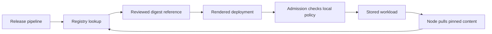

# Resolve Image Digests Without Blocking Admission on a Registry

Author: [nawazdhandala](https://www.github.com/nawazdhandala)

Tags: Kubernetes, DevOps

Description: Resolve image tags before deployment, retain immutable references, and design admission checks that do not wait for a container registry.

An image-pinning webhook receives a Pod with `app:release`, asks the registry what that tag means, and replaces it with a digest. That works until the registry slows down, its identity provider fails, or a credential expires. Now a dependency normally needed to pull images can also delay or reject Pod admission.

The better default is to resolve the tag during release preparation, save the resulting digest reference, and deploy that reference. Admission can then inspect the submitted value without making a registry request. This separates the control-plane decision from the registry lookup; it does not eliminate the registry's role in starting containers.

## Put resolution before the API request

A tag is a mutable name. A digest identifies particular content. Kubernetes explains [image references and digest pinning](https://kubernetes.io/docs/concepts/containers/images/), including the difference between choosing content and deciding when to pull it.

Make the release pipeline responsible for turning an approved tag into an immutable deployment input:



The final edge matters. Removing registry calls from the admission handler does not make an uncached node independent of the registry. A valid, admitted Pod can still fail to start if its image cannot be downloaded.

Kubernetes' [webhook good-practice guidance](https://kubernetes.io/docs/concepts/cluster-administration/admission-webhooks-good-practices/) recommends reducing dependencies and latency in admission. Resolving content before submission is one practical way to follow that guidance without silently skipping the pinning requirement during outages.

## Resolve one reference and retain it

The following commands use **crane v0.20.3**. The tagged [digest command documentation](https://github.com/google/go-containerregistry/blob/v0.20.3/cmd/crane/doc/crane_digest.md) defines `--full-ref`, which returns the repository reference with its digest rather than only the hash.

Run this from a release workspace with crane installed, registry access already configured, and the registry's certificate authority trusted. Replace the example hostname, repository, and tag with your approved release candidate. These commands read registry metadata and write local files; they do not deploy anything.

```bash
set -eu
image_ref='registry.example.internal/payments/api:release-candidate'
crane version
crane digest --full-ref "$image_ref" > image.lock.tmp
mv image.lock.tmp image.lock
crane manifest "$(cat image.lock)" > image-manifest.json
```

Confirm that the reported crane version is v0.20.3. `image.lock` should contain a reference shaped like `registry.example.internal/payments/api@sha256:...`, with the complete digest supplied by the registry. The temporary file prevents a failed lookup from replacing a previously retained lock file. The manifest fetch uses the digest reference, so a tag moving between the two commands does not select different content. The [manifest command](https://github.com/google/go-containerregistry/blob/v0.20.3/cmd/crane/doc/crane_manifest.md) returns the referenced manifest as JSON.

Use your normal registry authentication mechanism. The project's [authentication documentation](https://github.com/google/go-containerregistry/blob/v0.20.3/pkg/authn/README.md) describes its credential resolution. Keep credentials in the release environment rather than embedding passwords in deployment manifests or shell history. Registry CA trust is also separate from credentials; disabling TLS verification is not a substitute for installing the correct trust chain.

Feed the exact retained reference into your manifest renderer or chart values. Review the rendered workload before submission. Do not resolve the tag again during a later deployment stage and call it the same release: that would reopen the decision you just recorded.

## Know which digest you pinned

A multi-platform image has an index that points to platform-specific manifests. The [OCI image index specification v1.1.1](https://github.com/opencontainers/image-spec/blob/v1.1.1/image-index.md) describes those platform descriptors.

Without a platform selection, crane's digest command can return the index digest. That is useful when the workload must run on both AMD64 and ARM64 nodes: the index fixes the set of child manifests while allowing the runtime to choose the matching platform.

A deliberately platform-specific lookup is different:

```bash
crane digest --platform linux/amd64 --full-ref "$image_ref"
```

This asks for the AMD64 result when the reference is an index. Do not substitute that child digest into a mixed-architecture workload without a scheduling and compatibility decision. Conversely, pinning an index does not prove that it contains every platform your cluster needs. Inspect `image-manifest.json` and verify the required descriptors and availability as part of release preparation.

The examples were checked locally against a temporary TLS registry using the v0.20.3 command implementation. That exercise covered a moving tag, an unchanged digest reference, and index versus platform selection. It was not a production registry or Kubernetes image-pull test.

## Keep admission's decision local

A validator can require a digest-qualified reference and an approved registry without contacting that registry. If you also require proof of approval or provenance, provide locally available verified policy data or a supported verification system with an explicit availability design. The presence of `@sha256:` alone is not proof that an image is safe, signed, approved, or even present.

Use a real container-reference parser when implementing that check. Naively splitting on a colon confuses registry ports, tags, and digests. Validate the repository and digest together; a hash by itself does not identify which registry and repository the node will use.

Cover all image-bearing paths within your declared scope, including init containers and any relevant subresource operations. Do not claim a Pod-create rule also governs later ephemeral-container updates unless the admission configuration actually matches that path.

## If tags must remain accepted, define the cache contract

Some platforms need developers to submit tags. In that case, resolve approved tags asynchronously into a versioned mapping and let the webhook consult its local snapshot. A synchronous cache miss followed by a registry fetch still creates the dependency you were trying to remove.

Define the behavior explicitly:

| State | Deliberate admission behavior |
|---|---|
| Approved mapping present | Use the digest from the selected snapshot. |
| Mapping absent | Return an actionable rejection or follow a documented exception policy. |
| Snapshot too old | Apply the agreed freshness policy without an unbounded live lookup. |
| Registry unavailable | Keep serving the retained approved snapshot within its validity rules. |

A snapshot is an approval artifact, not a promise that a mutable tag still points there. Record its revision and coordinate activation across replicas. Scope mapping keys and access appropriately for private repositories and tenants; a shared cache must not become a way to expose or reuse another tenant's authorization.

Webhook `failurePolicy` is not a cache strategy. It controls how certain webhook call failures are handled, as described in the [admission reference](https://kubernetes.io/docs/reference/access-authn-authz/extensible-admission-controllers/#failure-policy). Choosing `Ignore` does not transform an unavailable registry result into a trustworthy digest.

## Test the boundary during an outage rehearsal

In staging, block the resolver's registry access while keeping the API server and webhook reachable. A previously prepared digest deployment should not cause the handler to attempt a registry call. An unknown tag should produce the designed response promptly. Check dependency logs and network observations, not only a successful API response.

Separately test image availability from a clean node. That validates a different dependency: distribution of the pinned content. Keep the release reference, approval evidence, retained image content, and node pull checks together so operators can tell whether a failure belongs to admission policy, release preparation, or container startup.
