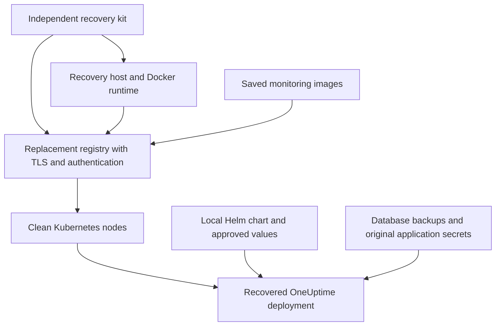

# Restore Air-Gapped Monitoring When the Private Registry Is Down

Author: [nawazdhandala](https://www.github.com/nawazdhandala)

Tags: Air-Gapped, Monitoring, Observability

Description: Recover an offline registry independently, import saved OneUptime images, and restore monitoring safely with separate data backups and clean-node checks.

A private registry stores the container images your Kubernetes nodes need. If it fails, existing monitoring containers might continue running, but replacement containers can fail to start. An offline installation bundle helps only if you can start somewhere that does not depend on the broken registry.

First determine what failed. If OneUptime and its databases remain healthy, recover image delivery without restoring databases. If the monitoring deployment and data are also lost, use the longer recovery sequence below. Examples are source-reviewed staging procedures, not a claim of live recovery testing.

## Break the Bootstrap Dependency

Bootstrap means starting the first service that other services require. Keep a recovery host outside the affected cluster, with its operating system and container runtime available independently. Otherwise, a registry running inside Kubernetes can need an image from itself before it can start.



The arrows show dependencies, not permission to start every component immediately. Database recovery must finish before ordinary application writers resume. If Kubernetes itself is lost, also retain its networking, storage-driver, and control-plane recovery materials; the OneUptime bundle does not rebuild that infrastructure.

## Retain Two Different Recovery Sets

Store these outside the failed registry's storage and identity dependencies. Protect credentials and private keys with your approved offline secret-recovery process.

| Retained material | Purpose |
| --- | --- |
| Registry image archive, runtime installers, tool binaries, checksums | Start the registry without pulling anything |
| Registry configuration, valid TLS chain and server key, CA trust, authentication file and credentials | Make the replacement reachable and authenticated |
| Monitoring image archives, image inventory, local chart, bundle script, complete Helm values | Recreate the deployed software version |
| PostgreSQL and ClickHouse backups, recovery instructions, original application secrets | Recover application records and telemetry |

Deployment artifacts are not data backups. Record backup timestamps and the accepted recovery point: PostgreSQL and ClickHouse captures should not be assumed to represent one atomic snapshot. Preserve OneUptime's original `ENCRYPTION_SECRET` with the corresponding backup; replacing it can make encrypted credentials unreadable. Consult the [OneUptime backup documentation](https://oneuptime.com/docs/en/installation/backups) for the recovery method and edition requirements applying to your installation.

Retain actual deployed image digests, architectures, chart version, and configuration. A mutable tag alone cannot identify what ran before the outage. Verify transferred files against an independently trusted integrity record; checksums delivered alongside tampered files do not establish authenticity.

## Prepare a Registry Archive Before the Outage

This connected preparation example uses a reviewed CNCF Distribution registry image. Replace the digest placeholder with your approved digest and select the recovery host's architecture. Run it while connected, then retain the resulting archive independently:

```bash
REGISTRY_SOURCE='registry@sha256:REPLACE_WITH_APPROVED_DIGEST'
docker pull --platform linux/amd64 "$REGISTRY_SOURCE"
docker tag "$REGISTRY_SOURCE" recovery-registry:pinned
docker image save --output registry-bootstrap.docker.tar recovery-registry:pinned
```

The local tag is a convenient name, not an immutable security guarantee. Record its source digest and archive checksum. Docker documents [digest-based pulls](https://docs.docker.com/reference/cli/docker/image/pull/), [tagging](https://docs.docker.com/reference/cli/docker/image/tag/), and [saving images](https://docs.docker.com/reference/cli/docker/image/save/).

This is specifically a **Docker image-save archive**, paired below with `docker image load`. It is not a container-filesystem export or an arbitrary OCI archive. OCI is a container-image standard; a `.tar` suffix does not identify an archive's internal format. Keep the producing tool and import method with every archive.

For OneUptime, the [pinned bundle script](https://github.com/OneUptime/oneuptime/blob/0de2d9ceac0a2404f5df7ad1f9ab1e22c56bea7e/HelmChart/AirGap/install.sh) has distinct Docker, Skopeo, and Crane paths. The example below assumes a bundle originally created with `--tool docker`. Do not substitute a different archive format because its filename looks similar. Retain the matching script, values, and tools separately from the bundle.

## Start an Independent Replacement Registry

Use a dedicated Linux staging host with Docker already installed from retained packages. Before running this example:

- Verify the bootstrap archive and restore the approved secret files securely.
- Prepare `/srv/registry-recovery/data` as a new, empty recovery directory, separate from surviving registry storage.
- Prepare `certs/server-fullchain.pem`, `certs/server.key`, and `auth/htpasswd` under the same root. The authentication file must contain supported bcrypt hashes.
- Point `recovery-registry.example.internal` at this host. Its TLS certificate must cover that name. Restrict access to authorized importers and cluster nodes.

Replace the internal IP placeholder. These commands load the saved image and start a new registry; they do not restore or modify the old registry's storage:

```bash
docker image load --input registry-bootstrap.docker.tar
RECOVERY_ROOT='/srv/registry-recovery'
REGISTRY_IP='REPLACE_WITH_INTERNAL_HOST_IP'

docker run -d --name recovery-registry --pull=never \
  --publish "${REGISTRY_IP}:5000:5000" \
  --mount "type=bind,src=${RECOVERY_ROOT}/data,dst=/var/lib/registry" \
  --mount "type=bind,src=${RECOVERY_ROOT}/certs,dst=/certs,readonly" \
  --mount "type=bind,src=${RECOVERY_ROOT}/auth,dst=/auth,readonly" \
  -e REGISTRY_HTTP_TLS_CERTIFICATE=/certs/server-fullchain.pem \
  -e REGISTRY_HTTP_TLS_KEY=/certs/server.key \
  -e REGISTRY_AUTH=htpasswd \
  -e REGISTRY_AUTH_HTPASSWD_REALM=Recovery \
  -e REGISTRY_AUTH_HTPASSWD_PATH=/auth/htpasswd \
  recovery-registry:pinned
```

[Docker load](https://docs.docker.com/reference/cli/docker/image/load/) restores the saved image and tag. [`--pull=never`](https://docs.docker.com/reference/cli/docker/container/run/) makes a missing image fail locally instead of attempting a download. Bind mounts keep registry data on the host and expose certificate and authentication files read-only. The directories must already exist.

The TLS and authentication settings follow [Distribution's deployment guide](https://distribution.github.io/distribution/about/deploying/). This small replacement does not reproduce a larger registry platform's scanning, signing policies, or role-based permissions. Account for those controls before production use.

Install the approved CA trust on the importer and every node runtime. For Linux Docker Engine, the registry-specific location is `/etc/docker/certs.d/recovery-registry.example.internal:5000/ca.crt`; see [Docker certificate configuration](https://docs.docker.com/engine/security/certificates/). Kubernetes nodes using containerd need their own runtime configuration. Docker trust on the recovery host does not configure those nodes. Keep certificate verification enabled.

## Import the Saved Monitoring Artifacts

Here `17.0.0` is a concrete chart/bundle example, valid only when it matches your retained deployment. Use your recovered version rather than turning recovery into an upgrade. After trust is configured, authenticate interactively and import:

```bash
REGISTRY='recovery-registry.example.internal:5000'
docker login "$REGISTRY"
bash air-gap.sh push \
  --bundle oneuptime-air-gap-17.0.0 \
  --registry "$REGISTRY" \
  --tool docker
```

`air-gap.sh` is your retained, reviewed bundle script. Its push operation checks bundle checksums before uploading. Keep sufficient importer disk space for loaded images. Follow the [offline installation documentation](https://oneuptime.com/docs/en/installation/air-gapped) and verify the resulting repository paths against the retained inventory.

Update complete recovery values to use the replacement registry. Review explicit image overrides as well as `global.imageRegistry`; one setting may not rewrite every custom reference. Provision namespace pull credentials for the new hostname and port. An importer's successful login does not authenticate Kubernetes.

## Recover Configuration and Data Deliberately

For a registry-only outage, retain healthy databases and the existing release. Validate the replacement image references and make a controlled deployment change only where required. Do not reinstall simply because the registry changed.

For full recovery, use isolated namespaces and separate storage. Restore matching PostgreSQL and ClickHouse backups using the approved database procedures, preserve original secrets, and keep general writers disabled. Retain failed disks for investigation. Do not overwrite surviving data or regenerate keys to make an installation proceed.

Render the retained chart with the complete recovery values before installation:

```bash
helm template oneuptime ./oneuptime-17.0.0.tgz \
  --namespace oneuptime-recovery \
  --values recovery-values.yaml > recovery-rendered.yaml
```

[`helm template`](https://helm.sh/docs/v3/helm/helm_template/) renders locally; it does not prove that the cluster will accept the resources. Protect the output because rendered Secrets can contain sensitive values. Review image references, restored volumes, secret references, and migration jobs, then validate against the recovery cluster through your deployment process.

Install the reviewed chart only in the sequence established by the database recovery plan. Migrations or application startup must not race an unfinished restore. A Helm rollback does not undo database changes; recovery after a migration needs a separately validated data plan.

## Prove Recovery on Uncached Nodes

Use disposable staging nodes with empty image caches and scoped public-egress denial. Do not erase production caches. Confirm that every required image comes from the replacement registry, including jobs and optional components.

Then admit controlled test traffic: fresh sign-in, a uniquely named log, metric, and trace, a synthetic browser check, and an alert received and acknowledged through an internal channel. Check historical records against the chosen backup recovery point before resuming normal writers and routing.

Keep evidence of image digests, registry requests, pod events, restored record checks, and alert acknowledgment. Unknown-issuer errors indicate trust or chain problems; unauthorized pulls indicate registry credentials; missing manifests suggest repository paths, absent images, or architecture mismatches. Cached-node success alone is not acceptance. Recovery passes when a clean node can start the stack and both restored data and new monitoring activity behave correctly without public services.
