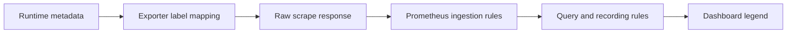

# Restore Missing Container, Image, Pod, and Namespace Labels in cAdvisor

Author: [nawazdhandala](https://www.github.com/nawazdhandala)

Tags: Kubernetes, Docker, Prometheus, Monitoring

Description: Trace missing cAdvisor labels from runtime metadata through scraping and queries, then repair the right layer without inventing container identity.

A memory graph can contain plausible numbers while its legend shows only a cgroup path. Another dashboard might show no data because it requires a `pod` label that the exporter never supplied. These are different failures, and changing the dashboard first can hide the distinction.

Start with one known application container and follow its labels through the collection path. A label is a named piece of metadata attached to a metric, such as `image="example/app:release"`. Restoring labels means finding where that metadata was lost, not assigning attractive names to otherwise unidentified measurements.

The examples below use standalone cAdvisor 0.55.1, Kubernetes 1.35.0 source, and Prometheus 3.7.3. Kubernetes embeds and configures cAdvisor itself; changing a separate cAdvisor deployment does not change kubelet's endpoint.

## Establish which endpoint you actually scrape

Record the scrape target, metrics path, exporter version, and one container identity. Compare the raw response from that exact endpoint with an unaggregated query in Prometheus. Use your established authenticated access method; do not expose the kubelet publicly to make inspection easier.



The first stage where the expected label disappears determines the repair. For example, a label visible in the raw response cannot be restored by changing Docker metadata: it is already reaching the exporter.

Use a simple query before opening a complicated dashboard:

```promql
container_memory_working_set_bytes{job="cadvisor", id!=""}
```

Replace `cadvisor` with the real job value. Inspect results as a table and retain `instance` and `id` while locating the chosen container. Do not initially require `image!=""` or `pod!=""`; those filters would remove the evidence you are investigating.

## Understand the two label contracts

Standalone cAdvisor and kubelet do not promise identical labels.

| Label | Standalone cAdvisor 0.55.1 | Kubelet mapping in Kubernetes 1.35.0 |
|---|---|---|
| `id` | Container/cgroup name | Container/cgroup name |
| `name` | First alias, when available | First alias or an empty value |
| `image` | Runtime image, when available | Image value, possibly empty |
| `pod`, `namespace`, `container` | Not automatically renamed from every runtime label | Explicit Kubernetes metadata mapping |
| `container_label_*` | Exported runtime labels, subject to filtering | Not supplied by this kubelet label function |

This distinction follows the [standalone label functions](https://github.com/google/cadvisor/blob/v0.55.1/metrics/prometheus.go) and [kubelet's `containerPrometheusLabelsFunc`](https://github.com/kubernetes/kubernetes/blob/v1.35.0/pkg/kubelet/server/server.go). Kubelet can also associate a pod cgroup with a pod when its initial pod and namespace metadata are missing. That does not turn the pod cgroup into an application container.

Empty labels on the host root or intermediate cgroups can be legitimate. Judge completeness against a known workload, not against every row exported by the node.

## Repair metadata before renaming it

For a Docker-managed workload, inspect its metadata using the same Docker context that reaches the relevant host. Replace the name below with the application container, not the cAdvisor container:

```bash
docker container inspect app-container \
  --format '{{.Name}} {{.Config.Image}} {{json .Config.Labels}}'
```

This read-only command prints its name, configured image reference, and labels. The [Docker inspect documentation](https://docs.docker.com/reference/cli/docker/container/inspect/) explains formatted output. Treat the output as potentially sensitive operational metadata.

If Docker has the name and image but the corresponding raw cAdvisor sample does not, investigate runtime discovery and access. Confirm the exporter is observing the same host and runtime. If it sees only a raw cgroup, adding a Prometheus rename rule will not supply missing runtime information.

Conversely, ordinary Docker containers do not inherently belong to a Kubernetes pod or namespace. Do not fabricate those fields from a container name just to satisfy a Kubernetes dashboard. Use a dashboard with a Docker identity contract, or supply a deliberately defined application label instead.

For standalone cAdvisor that already receives Kubernetes runtime labels, an allowlist can retain only the needed metadata. These are additional arguments for an existing cAdvisor 0.55.1 deployment, not a complete installation command:

```text
--store_container_labels=false
--whitelisted_container_labels=io.kubernetes.pod.name,io.kubernetes.pod.namespace,io.kubernetes.container.name
```

Use original runtime keys here, before Prometheus label-name sanitization. The allowlist takes effect with `store_container_labels=false`; it cannot create keys absent from the runtime. Review the [versioned flag definitions](https://github.com/google/cadvisor/blob/v0.55.1/cmd/cadvisor.go). Check the resulting raw endpoint before editing ingestion rules.

## Normalize only labels that really exist

Suppose your standalone endpoint already contains `container_label_io_kubernetes_pod_name`, but a dashboard expects `pod`. Add this fragment under that target's existing scrape configuration:

```yaml
metric_relabel_configs:
  - source_labels: [pod, container_label_io_kubernetes_pod_name]
    regex: ';(.+)'
    target_label: pod
    replacement: '${1}'
  - source_labels: [namespace, container_label_io_kubernetes_pod_namespace]
    regex: ';(.+)'
    target_label: namespace
    replacement: '${1}'
  - source_labels: [container, container_label_io_kubernetes_container_name]
    regex: ';(.+)'
    target_label: container
    replacement: '${1}'
```

Each rule fills an empty destination only when the corresponding source is nonempty. The default separator joins the two source values with `;`. Consequently, an existing `pod` survives, and a host-root sample with no pod metadata stays unidentified. The source labels also remain available for comparison.

These are metric relabel rules, applied to scraped samples. Target relabel rules run at a different stage. See [Prometheus configuration](https://prometheus.io/docs/prometheus/latest/configuration/configuration/). Do not copy the monitoring pod's discovery metadata onto every sample from a node exporter: that would incorrectly assign all observed containers to the monitoring pod.

Review existing rules for conflicts before merging this fragment. Validate the resulting complete configuration with the matching Prometheus tool:

```bash
promtool check config prometheus.yml
```

A successful check confirms configuration validity, not that the endpoint contains the required labels. Reload through your normal deployment procedure and inspect newly ingested samples. Relabeling changes do not rewrite historical data.

## Check whether the query discarded the labels

If labels exist in Prometheus but disappear in a panel, examine recording rules and aggregation. `sum(...)` combines series and removes their identifying dimensions. A `sum by (namespace, pod)` deliberately preserves only those dimensions; `container` and `image` will be gone even when collection is healthy. The [aggregation documentation](https://prometheus.io/docs/prometheus/latest/querying/operators/) describes this behavior.

Choose retained labels according to the question. A pod-total panel should not promise an individual container image. An image breakdown needs a query that retains image identity and avoids summing parent and child cgroups together.

Finish by comparing the same workload at all three points: raw endpoint, stored sample, and final panel. Check a second container and a host-root sample too. The second container should remain distinct; the root should not acquire invented pod labels. Record any remaining missing metadata explicitly rather than replacing it with a reassuring but incorrect legend.
