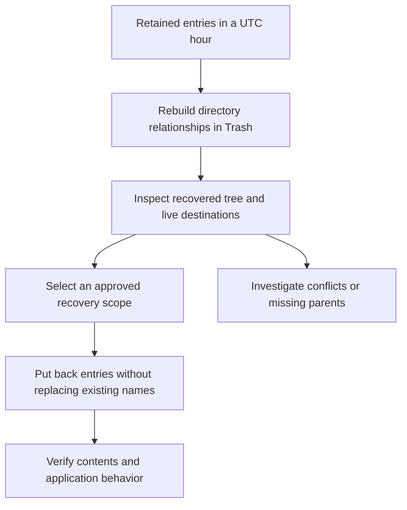

# Restore Deleted JuiceFS Files with a Reviewed Put-Back Procedure

Author: [nawazdhandala](https://www.github.com/nawazdhandala)

Tags: JuiceFS, Backup, Disaster Recovery

Description: Locate retained JuiceFS Trash entries, rebuild their directory structure, review conflicts, and restore files to live paths with checks beyond command exit status.

A deleted JuiceFS directory may still be recoverable from Trash, but recovery is not simply a matter of rerunning a command until the old names appear. Applications may have recreated those names, the deletion may span several time buckets, and some retained data may already have expired.

Use a short recovery sequence: identify the deleted objects, rebuild their structure, review the scope, return approved objects to their original locations, and verify their contents. Keep the affected writers paused until the restored state is understood.

This guide describes **JuiceFS Community Edition 1.4.2**. The `restore` examples require a protected administrative shell and root privileges on Linux or macOS. The metadata URL must identify the existing volume; this procedure does not format, replace, or reload its metadata database.

## Determine whether Trash is the right recovery source

Trash retains deleted filesystem objects according to the volume's retention policy. It cannot recover data that was permanently purged, deliberately bypassed Trash, or lost from object storage. Restoring an overwritten file to an earlier version is also different from recovering a deleted entry: it may require an appropriate metadata backup and retained object data.

Before changing anything, record the original path, approximate deletion time and timezone, expected contents, affected applications, and whether the application has recreated any paths. Coordinate a pause for writers to the affected tree. Avoid unrelated garbage collection, Trash cleanup, or retention changes during the investigation.

Use the volume's established recovery policy to preserve candidate data before expiration. Merely browsing Trash does not freeze its retention clock. If the candidate is close to expiring, escalate that retention risk immediately rather than assuming the recovery window will remain open.

## Locate the correct hour and filesystem root

Trash is accessible from a mount of the filesystem root, not a mount restricted to an application subdirectory. Confirm that the administrative mount refers to the same volume as `META_URL`.

For an illustrative mount at `/mnt/jfs`:

```bash
juicefs --version
ls -ld /mnt/jfs/.trash
ls /mnt/jfs/.trash
```

Hour directories use UTC in the form `YYYY-MM-DD-HH`. Select an actual observed directory. The example `2026-11-20-14` means the hour beginning at 14:00 UTC; replace it with the incident's observed hour rather than copying it literally.

```bash
ls -l /mnt/jfs/.trash/2026-11-20-14
```

Entries initially have names containing a parent inode, an object inode, and the original name. An inode is the numeric identity of a filesystem object. Parent identifiers allow reconstruction even when the deleted tree was flattened into one hour directory. See the [Trash recovery documentation](https://github.com/juicedata/juicefs/blob/v1.4.2/docs/en/security/trash.md#recover).

If the original parent still exists, `juicefs info` can help identify it:

```bash
juicefs info /mnt/jfs/projects/analytics
```

Compare the reported inode with the candidate entries. A newly recreated directory with the same name is not necessarily the original parent. Path spelling alone is insufficient evidence of identity.

## Understand the two recovery stages



The first stage is a mutation inside Trash, not a dry run. In this release, `restore` without `--put-back` reconnects entries whose parent directories are present in the selected Trash hour. Entries that need to return to a live parent remain for the put-back stage.

From the authorized root administrative shell, with `META_URL` supplied securely:

```bash
juicefs restore --threads 1 "$META_URL" 2026-11-20-14
```

One worker makes a small incident review easier to follow; it is not required for correctness. Save the command's output in the incident record. Expect counts such as rebuilt, need-put-back, conflicts, and failed. Inspect the selected hour again to confirm what actually changed.

The command processes an hour's entries, not one original path supplied through a path filter. Do not infer a nonexistent `--path` option. If the hour includes unrelated deletions, review those too before choosing a broad put-back operation.

## Review live destinations and handle conflicts

Before proceeding, compare each recovered top-level candidate with the live destination. Ask whether the original parent still exists and whether another object now occupies the desired name. If only part of the reconstructed tree is approved for recovery, use a separately reviewed, narrowly scoped filesystem move or copy procedure rather than restoring the whole hour blindly.

For the approved full-hour case:

```bash
juicefs restore --put-back --threads 1 \
  "$META_URL" 2026-11-20-14
```

The [1.4.2 implementation](https://github.com/juicedata/juicefs/blob/v1.4.2/cmd/restore.go) uses a no-replace rename operation. When a target already exists, it records a conflict rather than overwriting that name. There is no promise to merge a recovered directory into a newly created replacement directory.

Do not delete a conflicting live object just to make the next attempt succeed. Preserve both candidates, establish which application state is valid, and decide explicitly where each belongs. Likewise, creating an empty directory with the old path does not recreate its original inode identity.

Deletions spanning several hour directories need a reviewed order based on parent-child relationships. The CLI accepts multiple hour arguments, but a missing parent or conflicting object can still leave a partial result. Work through a small number of known buckets and inspect each outcome.

## Verify more than the exit code

Some per-entry failures are reported through log messages and counters; the top-level command does not necessarily return a failing exit status for every incomplete restoration. A successful shell status is therefore not sufficient acceptance evidence.

Check restored names, ownership, permissions, file sizes, and expected content. For files with a known trusted SHA-256 digest, this read-only helper verifies bytes using Python 3.11 or later:

```python
import argparse
import hashlib
import re

parser = argparse.ArgumentParser()
parser.add_argument("path")
parser.add_argument("expected_sha256")
args = parser.parse_args()
if not re.fullmatch(r"[0-9a-fA-F]{64}", args.expected_sha256):
    parser.error("expected_sha256 must contain exactly 64 hexadecimal digits")

with open(args.path, "rb") as stream:
    actual = hashlib.file_digest(stream, "sha256").hexdigest()
print(actual)
if actual != args.expected_sha256.lower():
    raise SystemExit("Checksum mismatch")
```

Save it outside the volume as `verify_file.py`, then supply the restored path and a digest from a trusted pre-incident manifest. A newly computed digest without a known reference is useful evidence but cannot prove that you recovered the desired version. Python documents the streaming helper in its [hashlib reference](https://docs.python.org/3/library/hashlib.html#hashlib.file_digest).

Run an application-specific read or validation operation under the intended service identity. For a configuration file, parse it; for a dataset, validate its expected records or manifest. Only after those checks should controlled application traffic resume, followed by normal writers once the result remains healthy.

## Leave an auditable recovery result

Record selected hour buckets, reconstructed candidates, restored paths, unresolved conflicts, failed entries, and content checks. Preserve unresolved candidates according to the incident retention policy. If objects are missing or already purged, move to the tested backup-recovery procedure instead of repeatedly mutating the same Trash directory.

For this guide, the root requirement and restore behavior were checked against the pinned source and CLI; the checksum helper was tested locally. No privileged live JuiceFS restoration was performed. Rehearse the full sequence on a disposable mounted volume, including a conflicting destination, before relying on it during an incident.
