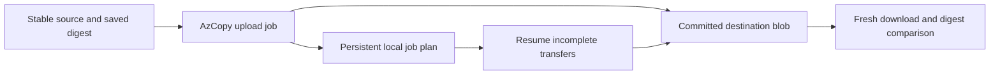

# Resume Cloud File Transfers with Retries and Verified Checksums

Author: [nawazdhandala](https://www.github.com/nawazdhandala)

Tags: File Storage, Azure Blob Storage, Data Integrity

Description: Use persistent AzCopy jobs to recover interrupted uploads, then verify downloaded bytes against a trusted SHA-256 digest before acceptance.

A large upload reaches 90 percent, the laptop sleeps, and the browser loses its session. Starting again may work, but there is no useful recovery procedure unless you know which state survived and how to prove the final file is correct.

For recurring transfers, use a tool with explicit job records and a documented recovery path. This walkthrough uses Azure Blob Storage and AzCopy **10.30.1** as a pinned reference, not a claim that it is the newest release. It separates three questions: what retries automatically, what survives a process interruption, and what proves that the destination contains the intended bytes. [Official release](https://github.com/Azure/azure-storage-azcopy/releases/tag/v10.30.1).

## Chunking, retries, and resuming solve different problems

Chunking divides a large transfer into smaller units. Azure block blobs can be assembled from previously uploaded blocks through a final block-list commit. A successful block request alone is therefore not evidence that the complete blob has been published. [Azure Put Block List](https://learn.microsoft.com/en-us/rest/api/storageservices/put-block-list).

A retry repeats a failed request while the process is running. Resuming starts work again using state retained after the original process stopped. Neither feature is a substitute for content verification.



This distinction matters when estimating recovery time. Do not promise that a resumed job will continue at precisely the last byte sent. AzCopy's documented recovery contract identifies files from the original plan that were not already transferred. Budget for repeated work on an interrupted file. Files added later need a new transfer operation. [Job recovery documentation](https://learn.microsoft.com/en-us/azure/storage/common/storage-use-azcopy-configure).

## Prepare an isolated destination and durable working state

Use a stable source export that will remain unchanged until verification finishes. For a database, obtain an application-consistent backup first; copying a changing database file does not create one. Give each delivery a new destination path so a failed attempt cannot replace an accepted production object.

The examples require Bash, AzCopy 10.30.1 on your PATH, Python 3.11, an existing private Blob container, and network access to Azure identity and storage endpoints. Use a Microsoft Entra user with an appropriate data role, such as Storage Blob Data Contributor scoped to the test container. Ordinary management-plane access alone is not the same as permission to upload blob contents.

Interactive `azcopy login` stores its token in the operating system's secret store. A machine without a usable store needs a different documented authentication method. Replace the tenant identifier before running:

```bash
azcopy --version
azcopy login --tenant-id='YOUR-TENANT-ID'
```

Expect the version to match the selected reference and follow the displayed sign-in instructions. Do not paste access tokens into the article's commands or your incident notes. [Identity prerequisites and login](https://learn.microsoft.com/en-us/azure/storage/common/storage-use-azcopy-authorize-user-identity).

Choose a private directory on persistent local storage. Replace the absolute path; do not use a disposable container filesystem or temporary directory for resumable job state:

```bash
umask 077
export AZCOPY_JOB_PLAN_LOCATION='/persistent/private-transfer/plans'
export AZCOPY_LOG_LOCATION='/persistent/private-transfer/logs'
mkdir -p "$AZCOPY_JOB_PLAN_LOCATION" "$AZCOPY_LOG_LOCATION"
azcopy env
```

Check the displayed locations. Preserve these settings when reopening a shell and retain the plans until acceptance. The restrictive file-creation mask helps protect newly created records; it does not repair permissions on an existing shared directory. Plans and logs contain operational details and deserve controlled access. [Plan and log locations](https://learn.microsoft.com/en-us/azure/storage/common/storage-use-azcopy-configure).

## Record the expected content before uploading

Save this small program as `hash_file.py`. It reads the file in bounded chunks and prints a SHA-256 digest, a fixed-size fingerprint of all its bytes:

```python
import hashlib
import sys

h = hashlib.sha256()
with open(sys.argv[1], 'rb') as stream:
    for chunk in iter(lambda: stream.read(8 * 1024 * 1024), b''):
        h.update(chunk)
print(h.hexdigest())
```

Create the reference on the frozen source and retain it in an evidence directory separate from the delivery. Replace the paths; the evidence directory must already exist:

```bash
python3.11 hash_file.py /exports/frozen-delivery.tar > /evidence/source.sha256
```

Check that the command succeeded. Keep this reference protected from changes alongside the source identifier. A digest is not a signature: someone able to replace both the file and its reference can defeat this comparison. SHA-256 is preferable to MD5 for an independent content fingerprint; Python documents MD5's collision weaknesses. [Python hashing API](https://docs.python.org/3.11/library/hashlib.html).

## Upload, inspect, and recover the same job

Replace the account, container, run directory, and source path. Reserve the destination exclusively for this delivery:

```bash
azcopy copy '/exports/frozen-delivery.tar'   'https://ACCOUNT.blob.core.windows.net/CONTAINER/run-001/delivery.tar'   --overwrite=false --put-md5
```

`--overwrite=false` avoids intentionally replacing a conflicting destination. A skipped transfer is not acceptance: inspect the final summary and reject unexpected skips. `--put-md5` calculates and stores the file's Content-MD5 property for the download check below. Leave block sizing at the tool's selected value for this first example rather than copying a tuning number from an unrelated workload. [Pinned copy flags](https://raw.githubusercontent.com/Azure/azure-storage-azcopy/v10.30.1/cmd/copy.go).

Record the job identifier printed by the upload. After an interruption, restore the same plan-directory settings and inspect that job:

```bash
azcopy jobs list
azcopy jobs show 'JOB-ID'
azcopy jobs show 'JOB-ID' --with-status=Failed
```

`Failed` is case-sensitive. Read the terminal failure and nearby log entries; an early transient error may already have recovered. Do not clear the job history while investigating. [Job inspection](https://learn.microsoft.com/en-us/azure/storage/common/storage-use-azcopy-configure).

If the source is still unchanged and the destination remains reserved, restore valid authorization and resume:

```bash
azcopy login --tenant-id='YOUR-TENANT-ID'
azcopy jobs resume 'JOB-ID'
```

The pinned implementation obtains OAuth credentials from its token mechanism when the transfer uses that authentication path. It does not require inventing a SAS token for this Entra-authenticated example. Keep using the same tool version and retained plans through this recovery exercise. [Versioned resume implementation](https://raw.githubusercontent.com/Azure/azure-storage-azcopy/v10.30.1/cmd/jobsResume.go).

## Verify what can actually be downloaded

After successful upload completion, download to a new local filename with sufficient free space:

```bash
azcopy copy   'https://ACCOUNT.blob.core.windows.net/CONTAINER/run-001/delivery.tar'   '/verification/new-delivery.tar'   --overwrite=false --check-md5=FailIfDifferentOrMissing
python3.11 hash_file.py /verification/new-delivery.tar > /evidence/download.sha256
cmp /evidence/source.sha256 /evidence/download.sha256
```

Run these steps individually and proceed only when each succeeds. Require a completed, unskipped download into a previously absent path. The MD5 option rejects a missing or different stored digest; the separate SHA-256 comparison connects the downloaded bytes to your protected source reference. `cmp` should produce no output and return zero. A mismatch blocks acceptance. The MD5 option applies to downloads, whereas `--put-md5` applies to uploads. [Pinned checksum flags](https://raw.githubusercontent.com/Azure/azure-storage-azcopy/v10.30.1/cmd/copy.go).

A full download consumes time, bandwidth, and potentially retrieval charges. Plan for it instead of treating a matching file size as equivalent evidence. Keep the destination unchanged throughout verification and subsequent handoff.

## Troubleshoot before repeating

| Symptom | Next investigation |
| --- | --- |
| Job cannot be found | Confirm the retained plan directory and original job identifier |
| Final transfer fails with authorization errors | Check identity, data permissions, storage firewall, and endpoint reachability |
| Process disappears without a normal summary | Inspect host resource pressure and process termination evidence |
| Transfer completes but checksum differs | Stop handoff; compare source identity, destination identity, and modification history |

AzCopy documents zero as success, one as an error, and two as a panic; other failures can originate from the operating system. Record both exit status and transfer totals. A recovery loop that ignores these signals only repeats the problem. [Official troubleshooting guidance](https://learn.microsoft.com/en-us/troubleshoot/azure/azure-storage/blobs/connectivity/storage-use-azcopy-troubleshoot).

Practice cancellation and recovery with disposable staging data before using the procedure for an important delivery. This article's local checks covered the pinned command help and the hashing example, including changed-content detection. They did not include an Azure upload or interruption test. Your acceptance exercise should demonstrate retained job state, successful recovery, an unskipped download, and an exact digest match before the receiving application uses the object.
