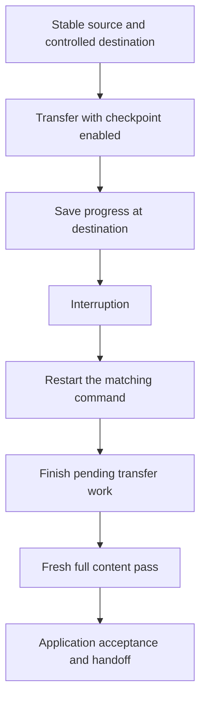

# Resume JuiceFS Sync from Checkpoints and Verify File Contents

Author: [nawazdhandala](https://www.github.com/nawazdhandala)

Tags: JuiceFS, Data Migration, Storage

Description: Resume an interrupted JuiceFS sync with matching checkpoints, then run a separate content-verification pass before accepting the migrated dataset.

A long copy can stop after transferring most of its files. Restarting from a saved checkpoint avoids treating every restart as an entirely new job, but a checkpoint is a record of progress, not proof that the final destination matches the source.

Use two phases: resume the original transfer, then perform an independent final content pass while both datasets are controlled. Preserve the original source until the destination passes its application-level acceptance checks.

This guide uses **JuiceFS Community Edition 1.4.2**. Its checkpoint support and option matching are version-specific. The examples use two existing local paths, which can be mounted JuiceFS paths, to make source and destination boundaries explicit. The same feature supports other sync backends, but their credentials, request costs, and operation support need separate review.

## Establish a stable migration scope

Choose a source that will not change during the final migration window. Keep destination writers stopped as well: `sync` is a copying tool, not a conflict resolver for two independently changing trees.

Record the exact source and destination strings, trailing slashes, filters, link behavior, permissions options, client version, and command flags. Paths in this example end with `/` to copy the source directory's contents into the destination directory. Verify the intended layout using a small staging copy before starting a large migration.

Keep logs and any source manifest outside both trees. Limit who can modify the destination, including its hidden checkpoint objects. A checkpoint contains operational information about paths and pending work; treat it as migration state rather than an expendable temporary file.

## Enable checkpointing on the initial transfer

With approved existing paths, run:

```bash
juicefs sync \
  --enable-checkpoint \
  --checkpoint-interval 30s \
  --check-new \
  --threads 4 \
  /mnt/source/release-a/ \
  /mnt/destination/release-a/
```

Replace both paths. `--check-new` verifies newly copied content, and four workers provide an explicit starting concurrency. The 30-second interval requests periodic progress saves; the default is ten seconds. Use your normal job supervision and protected logging rather than closing an interactive terminal accidentally.

Checkpoint state is saved at the destination under a hidden name resembling `.juicefs-sync-checkpoint.<hash>.json`. It records listing progress, pending and failed objects, delayed deletions, and progress statistics. Successful completion removes the checkpoint; interruption or failed work can leave it for a subsequent run. The [pinned sync documentation](https://github.com/juicedata/juicefs/blob/v1.4.2/docs/en/guide/sync.md#checkpoint) describes this lifecycle.



An abrupt failure can occur after the last saved checkpoint. Expect some work to be revisited rather than promising that every transferred byte is remembered. Keep destination capacity available for temporary transfer data and checkpoint updates.

## Resume the same job without resetting its progress

First determine why the job stopped. Restore credentials, network access, capacity, or service availability before restarting. Confirm the original process is no longer running; do not start two independent jobs against the same migration checkpoint and destination.

Then rerun the same command with the same source, destination, and semantic options. Inspect the startup log for checkpoint loading and resumed work. Merely seeing a checkpoint object in the directory does not prove that this invocation selected it.

The [checkpoint implementation](https://github.com/juicedata/juicefs/blob/v1.4.2/pkg/sync/checkpoint.go) derives the checkpoint identity from the endpoints and relevant options. Filters, copy behavior, link settings, verification choices, and deletion settings participate. Changing `--check-new` to `--check-all` is therefore not simply continuing the identical run with stronger checks.

Do not add `--checkpoint-force-reset` as a routine retry flag. Its purpose is to disregard existing progress and start afresh. If a restart unexpectedly says no checkpoint was found, compare the recorded command and destination state before choosing to reset anything.

Also keep filter-list contents stable. A checkpoint cannot make a mutable source listing into a point-in-time snapshot. If the source changes after a prefix has been processed, a resumed job is not a substitute for a fresh reconciliation of the desired final state.

## Run a fresh verification pass after completion

Once the resumed transfer finishes successfully, keep the source and destination controlled and run a separate pass without checkpoint reuse:

```bash
juicefs sync \
  --check-all \
  --threads 4 \
  /mnt/source/release-a/ \
  /mnt/destination/release-a/
```

Use the same intended scope and required copy options as the original transfer. In this minimal regular-file example, there are no include/exclude filters or special link options to repeat.

`--check-all` checks existing files as well as handling files that still require copying. This matters because normal incremental sync can skip equal-sized files even when their contents differ. The [sync behavior documentation](https://github.com/juicedata/juicefs/blob/v1.4.2/docs/en/guide/sync.md#sync-behavior) explains these choices.

This command is **not read-only**. If comparison finds a mismatch, sync can replace the destination from the source. Use it only when the source is authoritative and destination writers remain stopped. If the destination contains independent edits, investigate and preserve them before running a repairing copy pass.

For matched existing regular files, the [implementation](https://github.com/juicedata/juicefs/blob/v1.4.2/pkg/sync/sync.go) can compare source and destination content directly. Newly copied data can use a checksum verification path. Do not equate the option with a separately retained cryptographic manifest or proof against a malicious destination.

## Define what “verified” includes

A content pass does not settle every migration question:

| Concern | Additional acceptance evidence |
| --- | --- |
| Expected files | Source inventory and final destination inventory |
| Extra destination files | Explicit reconciliation policy; no deletion is requested here |
| Empty directories | Include `--dirs` when that is part of the required scope |
| Ownership and mode | Review `--perms` support and inspect numeric attributes |
| Symbolic links | Choose link semantics deliberately and verify targets |
| Application usability | Read or validate data as the intended application identity |

Do not claim that every destination byte was covered if filters excluded files or extra destination objects were left untouched. State the exact accepted dataset and the policies applied to it.

Retain final exit status, failed-object counts, verification output, and the application result. If errors remain, the migration is incomplete even if most bytes arrived. Avoid deleting the source or adding destination-deletion flags simply to make the final inventory smaller.

## Rehearse interruption before the real migration

Local validation used twelve regular files in disposable directories with JuiceFS 1.4.2. After a checkpoint appeared, only the owned test process was terminated. The identical command resumed, completed the files, and removed its checkpoint. A separate `--check-all` pass repaired a deliberately introduced equal-size destination mismatch, and all file bytes were compared independently afterward.

That exercise did not test a remote object store, multipart recovery, live source changes, or mounted JuiceFS behavior. Rehearse those deployment-specific conditions as needed. The useful acceptance standard is a completed transfer plus an understood final dataset, not merely a successful restart message.
