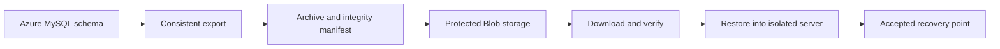

# Retain Azure MySQL Backups Beyond 35 Days with MyDumper and Blob Storage

Author: [nawazdhandala](https://www.github.com/nawazdhandala)

Tags: Azure, MySQL, Backup, Disaster Recovery

Description: Build a long-retention logical backup workflow with consistent MyDumper exports, protected Blob storage, integrity checks, and isolated restore drills.

A backup retained for a year is useful only if someone can recover it a year later. Keeping a directory of SQL files is not enough: you also need its consistency evidence, a compatible loader, database ownership information, and a tested path back into a working server.

Azure MySQL's normal automated backup retention is limited to 35 days. A separate logical export can provide an older recovery point, but it does not extend Azure's point-in-time restore window. Microsoft also documents an Azure Backup long-term-retention preview; as of this review, that documentation says new backup configuration is paused. Check its status before choosing a managed alternative. [Operational backup retention](https://learn.microsoft.com/en-us/azure/mysql/flexible-server/concepts-backup-restore), [Long-term-retention preview status](https://learn.microsoft.com/en-us/azure/backup/backup-azure-mysql-flexible-server-about)

This walkthrough describes an operator-managed MyDumper export to a private Blob container. It preserves one application schema, not the complete Azure server resource.

## Define the recovery promise first

Decide how often to export, how long to retain each recovery point, and how long a restore may take. A monthly export permits a much larger gap between recovery points than daily backups. Its upload timestamp is not necessarily the database snapshot timestamp.

Record which schemas, routines, triggers, and events belong to the backup. Keep server configuration, network definitions, account and grant provisioning, and external encryption-key recovery under their own protected procedures. A schema export is not a replacement for those dependencies.



Use an isolated runner with database network access, a maintained CA trust bundle, sufficient disk space, and a backup account with the privileges required for your chosen lock mode and objects. Freeze schema changes during the export and agree on the effect of backup locks with the application owner. [MyDumper privilege requirements](https://mydumper.github.io/mydumper/docs/html/requirements.html)

## Take a consistent export

The example pins **MyDumper/MyLoader 1.0.19-1**. Review the installed build's version and help output before use. The shell examples require Bash, `tar`, and `shasum`; run them sequentially in the same shell after replacing the placeholders.

This example assumes the selected application's tables are InnoDB. `FTWRL` means **flush tables with a read lock**, used to coordinate the export threads' snapshots. It can wait behind existing work and block writes while held, so rehearse its behavior. Do not bypass a lock failure by silently switching to an inconsistent no-lock export. [Lock modes](https://mydumper.github.io/mydumper/docs/html/locks.html)

```bash
set -euo pipefail
umask 077
BACKUP_ROOT='/REPLACE_WITH_PROTECTED_BACKUP_DIRECTORY'
MYSQL_HOST='REPLACE_WITH_SERVER.mysql.database.azure.com'
CA_FILE='/REPLACE_WITH_APPROVED_CA_BUNDLE.pem'
RUN_DIRECTORY=$(mktemp -d "$BACKUP_ROOT/mysql-$(date -u +%Y%m%dT%H%M%SZ)-XXXXXX")
RUN_ID=$(basename "$RUN_DIRECTORY")

mydumper \
  --host "$MYSQL_HOST" --user backup_reader --ask-password \
  --ssl-mode VERIFY_IDENTITY --ca "$CA_FILE" \
  --database appdb --outputdir "$RUN_DIRECTORY/dump" \
  --threads 4 --sync-thread-lock-mode FTWRL \
  --routines --triggers --events
```

Create the protected parent directory beforehand. Replace `appdb` and the account name as needed. The password is prompted rather than placed in the command line. For unattended jobs, use your approved secret-delivery mechanism and restrictive configuration-file permissions.

The TLS options request certificate and hostname verification. The object flags are explicit because routines, triggers, and events must not be assumed present just because table data was exported. The flags are defined in the pinned [connection source](https://github.com/mydumper/mydumper/blob/v1.0.19-1/src/connection.c) and [dump arguments](https://github.com/mydumper/mydumper/blob/v1.0.19-1/src/mydumper/mydumper_arguments.c).

Require a successful process exit and review the dump log and metadata before packaging. Confirm the expected object inventory and investigate every skipped object or consistency warning. If the chosen lock or metadata privileges are unavailable on the managed service, resolve that with a reviewed backup design; do not label a partial run successful.

## Package one recovery point together

Write `recovery-notes.md` in `RUN_DIRECTORY` before this step. Include source identity and engine version, MyDumper version/build, UTC start and finish, snapshot metadata location, schema scope, lock mode, and required restore settings. Do not put passwords in the notes.

```bash
mkdir "$RUN_DIRECTORY/package"
tar -czf "$RUN_DIRECTORY/package/backup.tar.gz" \
  -C "$RUN_DIRECTORY" dump recovery-notes.md
(
  cd "$RUN_DIRECTORY/package"
  shasum -a 256 backup.tar.gz > SHA256SUMS
  shasum -a 256 -c SHA256SUMS
)
```

The archive keeps the dump and its recovery notes together. Budget for both the original dump and the archive on local disk. Compression is not encryption: protect the runner's storage and apply your organization's encryption requirements before upload.

The expected checksum result is `backup.tar.gz: OK`. A checksum detects changed bytes when compared with a trusted expected value; it does not prove database consistency or establish who created the backup. Retain the expected digest in the protected backup catalog as well. [Checksum commands](https://perldoc.perl.org/shasum)

## Upload without replacing an earlier run

Prepare a private storage container with the required retention and access controls. The runner needs Blob data permissions, not merely permission to view the storage account. Use Microsoft Entra authentication rather than embedding account keys. [Blob CLI authorization](https://learn.microsoft.com/en-us/azure/storage/blobs/storage-quickstart-blobs-cli)

The following uses Azure CLI's documented batch upload options. Replace both storage placeholders:

```bash
STORAGE_ACCOUNT='REPLACE_WITH_STORAGE_ACCOUNT'
CONTAINER='REPLACE_WITH_PRIVATE_CONTAINER'

az storage blob upload-batch \
  --account-name "$STORAGE_ACCOUNT" --auth-mode login \
  --destination "$CONTAINER" --destination-path "$RUN_ID" \
  --source "$RUN_DIRECTORY/package" \
  --type block --overwrite false
```

Only the package directory is uploaded. Each run has a distinct prefix, and overwrite is refused. A failed batch can leave some files uploaded, so an existing prefix is not a completion signal. Record upload status separately from restore-test status. [Upload command reference](https://learn.microsoft.com/en-us/cli/azure/storage/blob?view=azure-cli-latest)

Download the archive and manifest into a new verification directory and compare them with the locally retained manifest:

```bash
VERIFY_DIRECTORY=$(mktemp -d "$BACKUP_ROOT/verify-XXXXXX")
for filename in backup.tar.gz SHA256SUMS; do
  az storage blob download \
    --account-name "$STORAGE_ACCOUNT" --auth-mode login \
    --container-name "$CONTAINER" \
    --name "$RUN_ID/$filename" \
    --file "$VERIFY_DIRECTORY/$filename"
done
cmp "$RUN_DIRECTORY/package/SHA256SUMS" "$VERIFY_DIRECTORY/SHA256SUMS"
(
  cd "$VERIFY_DIRECTORY"
  shasum -a 256 -c SHA256SUMS
)
```

Proceed only if both comparisons succeed. Do not delete the local recovery point merely because the upload command returned successfully.

## Make retention resistant to mistakes

A lifecycle policy can move or delete blobs according to age and prefix. Scope rules to the intended backup collection, and review what happens to archive and manifest together. Lifecycle deletion is an expiration mechanism, not protection against an administrator deleting a backup early. [Lifecycle policies](https://learn.microsoft.com/en-us/azure/storage/blobs/lifecycle-management-overview)

If the retention requirement includes protection from overwrite or deletion, assess Blob immutability. Test the policy before locking it: a locked time-based policy cannot simply be shortened or removed later. Separate backup-writing permissions from retention-policy administration. [Immutable storage](https://learn.microsoft.com/en-us/azure/storage/blobs/immutable-storage-overview)

Choose storage tiers using the recovery-time requirement. Archive-tier objects must be rehydrated before reading, and that can take hours. Include retrieval, transfer, extraction, database loading, and application checks in the recovery estimate. [Archive retrieval](https://learn.microsoft.com/en-us/azure/storage/blobs/archive-rehydrate-overview)

## Prove an old backup can become a working database

Periodically select an older retained run, download and verify it, and extract it into a clean workspace. Restore with the matching MyLoader into a new isolated server, using an account and server configuration appropriate for Azure. Test the actual loader settings beforehand, including binary logging restrictions and stored-object definers; a generic self-managed MySQL restore command may require privileges Azure does not provide.

Keep scheduled events and external jobs disabled during recovery. Compare the expected schema inventory, selected row counts and business aggregates, and stored-object behavior. Run application checks using its normal account. Record actual elapsed recovery time and any manual dependencies discovered.

Alert on missed exports, failed uploads, verification failures, and overdue restore drills. Keep a recovery-point catalog that distinguishes exported, uploaded, verified, and restore-tested runs. Retention then describes a collection of recoverable database states rather than a folder that nobody has opened since it was created.
