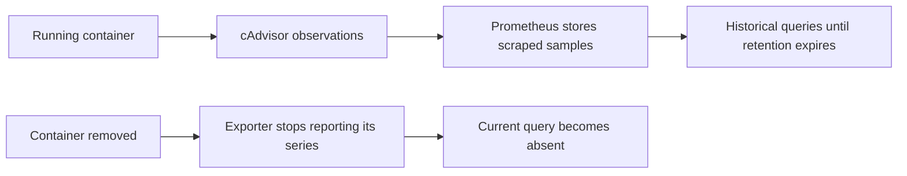

# Keep Stopped-Container Metrics After cAdvisor Removes Them

Author: [nawazdhandala](https://www.github.com/nawazdhandala)

Tags: Prometheus, Docker, Monitoring

Description: Preserve scraped container history in Prometheus, query stopped containers without pretending they are live, and distinguish exporter cache, retention, and missing observations.

A container disappears from cAdvisor after it stops, and its dashboard now looks empty. That does not necessarily mean the historical metrics were deleted. The exporter, the time-series database, and the dashboard's current-time query each answer a different question.

cAdvisor reports what it currently knows. Prometheus stores samples it has already received. A dashboard can still hide those stored samples by querying only the present or by filtering through a list of currently running containers.

This guide uses cAdvisor 0.55.1 and Prometheus 3.7.3 as reference versions. The objective is useful historical investigation, not keeping stopped containers falsely marked as healthy.

## Separate exporter cache from stored history

In the pinned cAdvisor implementation, stopping the managed container data removes the container from the in-memory cache. Extending a general cache duration is therefore not a substitute for an external history store. [cAdvisor container cleanup](https://github.com/google/cadvisor/blob/v0.55.1/manager/container.go).

Prometheus retention is independent of that exporter lifecycle. Samples already ingested remain available until storage retention or another storage operation removes them. The exporter does not reach into Prometheus and delete its old samples when a container stops.



There is an important limit: neither a database nor a longer query window can restore a sample that was never collected. A container that starts and exits between observations may leave no resource metrics. Retain runtime events and workload completion records separately when those brief lifetimes matter.

## Configure a durable Prometheus data path

Use persistent storage for Prometheus and give it an explicit retention policy. The following Compose fragment illustrates a thirty-day time limit with an additional size bound:

```yaml
services:
  prometheus:
    image: prom/prometheus:v3.7.3
    command:
      - --config.file=/etc/prometheus/prometheus.yml
      - --storage.tsdb.path=/prometheus
      - --storage.tsdb.retention.time=30d
      - --storage.tsdb.retention.size=20GB
    volumes:
      - prometheus-data:/prometheus
volumes:
  prometheus-data:
```

Merge this into the existing deployment, preserving its configuration mount, security settings, networks, and any other command arguments. Replacing Compose's `command` can discard previous flags, so inspect the final service definition before applying it.

The numbers are illustrative storage-policy choices, not a sizing recommendation. When both time and size retention are configured, whichever limit is reached first governs removal. Twenty gigabytes may retain far less than thirty days for a large or high-churn deployment. Leave disk headroom for the write-ahead log, head data, compaction, and other storage needs. [Prometheus local storage and retention](https://prometheus.io/docs/prometheus/latest/storage/).

A named volume survives ordinary container replacement, but it is not a backup or protection from volume deletion and host loss. Test the backup and recovery procedure appropriate to your storage platform. Do not run volume-removal commands while trying to troubleshoot missing history.

## Query the time when the container existed

First use the actual historical container labels, not merely its current replacement's name:

```promql
container_memory_working_set_bytes{
  job="cadvisor", instance="node-a:8080", id="/docker/OLD_CONTAINER_ID"
}
```

Replace the target and ID with the values captured for that runtime instance. Set the dashboard's time range to include its lifetime. A range query evaluates the expression at a sequence of timestamps; it can return earlier samples even when an instant query at the present is empty. [Prometheus range-query API](https://prometheus.io/docs/prometheus/latest/querying/api/#range-queries).

Do not immediately replace the query with a zero fallback. An absent present-time series can correctly mean the container no longer exists. A displayed zero memory value would instead imply a measured current value.

Staleness and lookback rules affect which samples an instant selector considers. They are query semantics, not proof that the historical storage has been erased. [Prometheus staleness documentation](https://prometheus.io/docs/prometheus/latest/querying/basics/#staleness).

## Show the last observed value with an explicit window

For an investigation table, an explicit range function can retrieve the last value seen within a bounded period:

```promql
last_over_time(container_memory_working_set_bytes{
  job="cadvisor", instance="node-a:8080", id="/docker/OLD_CONTAINER_ID"
}[24h])
```

Label the result “last observed memory within 24 hours.” It is not current memory consumption, and it says nothing about whether the container is running. Once the last sample falls outside that window, the result becomes absent even if older data remains in storage. [Prometheus over-time functions](https://prometheus.io/docs/prometheus/latest/querying/functions/#aggregation_over_time).

For peak investigation, use a different expression:

```promql
max_over_time(container_memory_working_set_bytes{
  job="cadvisor", instance="node-a:8080", id="/docker/OLD_CONTAINER_ID"
}[24h])
```

This returns the maximum observed sample, not necessarily the real peak between scrapes. Keep the container ID and host in the output so a replacement container cannot silently overwrite the interpretation.

Avoid globally extending lookback merely to keep stopped workloads visible. That changes current-time query behavior across dashboards and does not create a durable container inventory. Use explicit historical views instead.

## Preserve enough identity to find the old series

A deployment can reuse application names, Pod names, or container aliases. Preserve a runtime-specific identity alongside human-readable workload labels. If an investigation starts from a service name, use retained deployment or event records to locate the old runtime identity.

Dashboard dropdowns can be another source of confusion. A variable populated only from current samples may no longer list the stopped container even though the time-series database still has its data. Allow a historical time-range lookup or a direct ID input for forensic views, and test the generated query.

Separate current inventory from historical inventory. Joining an old memory series to a current-only metadata metric can exclude it. If you need historical owner information, record that mapping while the workload exists and retain it with an appropriate lifecycle.

## Prove retention with a disposable workload

Use a controlled staging workload long enough to obtain several successful scrapes. Record its ID and a recognizable resource change, stop it through the normal runtime workflow, and verify three outcomes:

| Check | Expected behavior |
| --- | --- |
| Current instant query | Eventually absent after reporting stops and staleness applies |
| Historical time range | Captured samples remain visible |
| Explicit last-value window | Returns the last observed value while it remains in the window |

Then restart Prometheus using the same persistent data path and confirm historical samples still exist. This deployment test establishes persistence; a configuration syntax check alone does not.

The published expressions were locally evaluated with synthetic stopped-series fixtures, including a staleness marker and a window that no longer includes the samples. No live Docker lifecycle or long-duration retention experiment is claimed.

If history is still missing, check the queried data source, exact labels, ingestion success, configured storage path, retention bounds, and any remote-store policy. Enlarging retention now cannot recover data already deleted. A reliable historical view depends on capturing observations first, retaining them deliberately, and keeping their original identity searchable.
