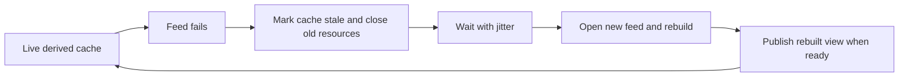

# Recover an Unavailable RethinkDB Changefeed Without Missing State

Author: [nawazdhandala](https://www.github.com/nawazdhandala)

Tags: RethinkDB, JavaScript, Reliability

Description: Recover a RethinkDB changefeed with bounded backoff, explicit stale status, and a rebuilt cache so reconnecting does not hide updates missed during an outage.

A changefeed stops with `Changefeed aborted (unavailable).` Your application reconnects and starts receiving changes again. That looks healthy, but the local cache can still contain rows deleted during the interruption or old versions of rows updated while no subscription existed.

Recovery therefore has two parts: restore the subscription and restore confidence in the derived state. This tutorial implements that distinction for a small in-memory cache. It does not turn a changefeed into a durable event log or promise replay of every missed transition.

The example targets the official JavaScript driver `rethinkdb` 2.4.2, with server behavior checked against RethinkDB 2.4.4 documentation and source. Local tests exercised the code using simulated cursor responses on Node 24.1.0; no server outage or failover was performed.

## Understand what the error establishes

The server's [2.4.4 changefeed implementation](https://github.com/rethinkdb/rethinkdb/blob/v2.4.4/src/rdb_protocol/changefeed.cc) uses this error when stopping subscriptions on an unavailable feed. It is evidence that the existing subscription cannot continue, not a diagnosis of the underlying cluster problem. Check server availability, table availability, and network changes around the same time.

A new connection does not revive the old cursor. The driver's [`reconnect`](https://rethinkdb.com/api/javascript/reconnect/) operation manages a connection; your application must establish and consume a new query result. Keep the recovery owner explicit so two error handlers do not create duplicate subscriptions.



During the gap, decide whether consumers should receive an unavailable response or an explicitly stale view. Silently presenting the old cache as current hides the most important failure signal.

## Rebuild current state instead of replaying guesses

For this example, subscribe with `includeInitial` and `includeStates`. Initial rows and subsequent updates populate a new map, and the `ready` notification marks completion of the initial result. Actual changes can be interleaved with initial rows, so apply them in order. The [changes reference](https://rethinkdb.com/api/javascript/changes/) defines these notifications.

Create a fresh map on every attempt. Merely merging new initial rows into the old cache would retain rows deleted during the gap. Publish the replacement only after initialization completes, then continue applying changes to that attempt's map.

This is a view-rebuilding strategy. If a row changed from A to B to C while disconnected, a rebuilt view can recover C without recovering B as an event. Notifications, billing actions, and audit history need a durable processing design with explicit deduplication and recovery semantics. The [changefeed overview](https://rethinkdb.com/docs/changefeeds/javascript/) describes feeds as streams of changes; do not assume an application checkpoint can request an arbitrary historical replay.

## Use one bounded recovery loop

Install the pinned driver in a disposable Node project with `npm install --save-exact rethinkdb@2.4.2`. Save the following module as `recover-feed.cjs`:

```javascript
const r = require("rethinkdb");
const sleep = ms => new Promise(resolve => setTimeout(resolve, ms));

function retryable(error) {
  const message = String(error.message || "");
  return message.startsWith("Changefeed aborted (unavailable).") ||
    message.startsWith("Changefeed cache over array size limit") ||
    error.name === "ReqlTimeoutError" ||
    (error.name === "ReqlDriverError" &&
      /^(Could not connect to |Connection is closed\.)/.test(message));
}

async function follow(options, publish, markStale, deps = {}) {
  const driver = deps.driver || r;
  const pause = deps.pause || sleep;
  const random = deps.random || Math.random;
  for (let attempt = 0; attempt < 6; attempt++) {
    let connection, cursor, failure;
    const rows = new Map();
    let ready = false;
    markStale();
    try {
      connection = await driver.connect(options);
      connection.on("error", markStale);
      cursor = await driver.table("items").changes({
        includeInitial: true, includeStates: true,
      }).run(connection);
      while (true) {
        const change = await cursor.next();
        if (change.error) throw new Error(change.error);
        if (change.state === "initializing") continue;
        if (change.state === "ready") {
          ready = true;
        } else if (change.new_val === null) {
          rows.delete(change.old_val.id);
        } else {
          rows.set(change.new_val.id, change.new_val);
        }
        if (ready) publish(new Map(rows));
      }
    } catch (error) {
      failure = error;
      markStale();
    } finally {
      if (cursor) await cursor.close().catch(() => {});
      if (connection) await connection.close().catch(() => {});
    }
    if (!retryable(failure) || attempt === 5) throw failure;
    const ceiling = Math.min(8000, 500 * 2 ** attempt);
    await pause(Math.floor(random() * ceiling));
  }
}

module.exports = { follow, retryable };
```

Call `follow` from your service with approved [`r.connect` options](https://rethinkdb.com/api/javascript/connect/), a synchronous `publish` callback, and a synchronous `markStale` callback. The connection options must select the database containing `items` and provide your normal authentication and TLS settings. Keep credentials outside source code. The last argument exists for deterministic tests; ordinary callers omit it.

`publish` should replace the application's visible map and mark it current. `markStale` should mark the visible view unusable or stale without pretending that a rebuild has completed. Both callbacks should be fast and non-throwing. Treat published documents as read-only; copying a Map does not deeply clone its document objects.

The example is deliberately scoped to a bounded full table named `items`, with string primary keys stored in `id`. It does not handle custom primary-key fields, ordered limited feeds, or projections that remove the key. Copying the whole map on each update is suitable only for a small cache; a larger system needs a more efficient publication mechanism and an explicit memory budget.

## Know what the loop retries

The classifier accepts the observed unavailable error, the documented queue-overflow notification, timeouts, and selected connection failures. Authentication, permission, and unknown failures propagate instead of being retried forever. Review the [ReQL error categories](https://rethinkdb.com/docs/error-types/) when extending this list for your environment. Do not classify all driver errors as transient; bad connection options are also errors.

Each retry waits for a random delay below an exponentially growing ceiling: 500 milliseconds, then 1, 2, 4, and 8 seconds. Jitter means different workers do not all retry on the same schedule. The six-attempt budget counts subscription sessions, including sessions that became healthy before failing later. It is intentionally not reset on every `ready` message.

When the budget is exhausted, surface the failure and keep the view stale. If a supervisor restarts the worker, give that supervisor its own cooldown and alerting policy; immediate process restarts would defeat the bounded retry design.

The loop awaits [`cursor.next`](https://rethinkdb.com/api/javascript/next/) rather than launching concurrent handlers. It attempts to close both the [cursor](https://rethinkdb.com/api/javascript/close-cursor/) and [connection](https://rethinkdb.com/api/javascript/close/) before reopening. Cleanup errors are suppressed here to preserve the original failure; production instrumentation should count cleanup failures separately. The connection's [error event](https://rethinkdb.com/api/javascript/event_emitter) also marks the view stale, while query errors arrive through the awaited operations.

This module does not implement graceful service shutdown or interrupt an in-progress retry sleep. Integrate cancellation and resource cleanup with your service lifecycle before using it as a long-running worker. Those concerns are separate from recovering the unavailable subscription.

## Test the gap, not only reconnection

A useful staging exercise makes cache correctness observable. Start with two known rows, interrupt only the test subscriber, update one row and delete the other, then restore its connection. The rebuilt cache must reflect the updated value and omit the deleted row before becoming current. Keep the test isolated from production traffic.

| Check | Passing evidence |
|---|---|
| Failure visibility | View becomes stale immediately after observed failure |
| Rebuild boundary | Partial initial results are not published as current |
| Missed deletion | Row absent from the new initial result disappears from the cache |
| Retry control | One active recovery loop and bounded, varied delays |
| Permanent failure | Permission or authentication failure surfaces without a retry storm |
| Exhausted budget | Worker stops retrying and remains visibly unhealthy |

The local simulated-feed tests verified replacement after a gap, live updates, stale marking, cleanup calls, retry delays, and termination on a permanent error. They do not establish server delivery behavior under failover, real network cleanup, or performance on a large table.

Track retry count, time spent stale, rebuild duration, and overflow reports in operation. An idle table can legitimately emit no changes, so time since the last row event alone is not a reliable health check. Recovery is complete when the new subscription has rebuilt a usable view and that view's freshness is visible to its consumers.
