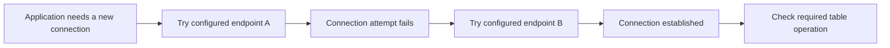

# Fail Over RethinkDB Client Connections When the Seed Node Dies

Author: [nawazdhandala](https://www.github.com/nawazdhandala)

Tags: RethinkDB, Python, Reliability

Description: Replace a dead single RethinkDB endpoint with bounded connection selection, verify every endpoint's TLS and access, and recover operations separately.

A RethinkDB cluster still has enough replicas to serve requests, but the application is down because its only configured endpoint has stopped. Database failover and client connection failover are separate tasks. The database can choose a new primary without moving an existing client socket to another machine.

Calling the first endpoint a “seed” can hide this distinction. Some drivers and pools use seed lists to discover other servers. The official synchronous Python driver's `connect` call takes one host and port. Do not assume it discovers and retains alternative endpoints just because the database is clustered.

This tutorial implements bounded connection selection with Python 3.11 and `rethinkdb==2.4.10.post1`. Tests use injected connection functions; no live node was stopped and no network failover was performed.

## Identify which connection actually failed

There are at least three relevant paths: application to database endpoint, database server to its peers, and application to any proxy or load balancer. A working path on one layer does not prove that the others work.

RethinkDB's [connect reference](https://rethinkdb.com/api/python/connect/) documents the individual host, driver port, authentication, and TLS options. The default driver port is 28015. The [replication guide](https://rethinkdb.com/docs/sharding-and-replication/) also describes proxy nodes, which route queries without storing data replicas. If your application connects through a proxy, include that proxy's availability in the recovery design.



The final step matters. A successful handshake does not establish that the target table has an available voting majority or that the account has permission to perform the required query. RethinkDB's [failover rules](https://rethinkdb.com/docs/failover/) still apply behind the chosen endpoint.

## Prepare alternatives before the incident

Maintain an explicit list of endpoints reachable from the application's network. For each one, verify DNS resolution, driver-port access, certificate hostname coverage, trust in the issuing certificate authority, and the intended user credentials.

TLS, or Transport Layer Security, authenticates and encrypts the connection. The Python driver accepts `ssl={"ca_certs": "/path/to/approved-ca.pem"}`. Use the approved certificate bundle and keep verification enabled. An alternative node with a certificate valid only for another hostname is not a working failover endpoint.

Keep credentials and CA paths in your deployment's existing secret and configuration mechanisms. Do not discover a public or management-only address and assume application traffic may use it. Explicit endpoint lists trade automatic membership discovery for predictable routing; update the list when nodes are replaced.

The Python driver's connection objects are not thread-safe according to its documentation. Give each worker thread or process its own connection, or use a driver-specific manager with a documented concurrency model. One global connection shared by unrelated workers makes recovery ownership much harder.

## Bound connection attempts without replaying queries

Install the pinned driver with `python -m pip install rethinkdb==2.4.10.post1`. Save this as `seeds.py`:

```python
import random
import time
from rethinkdb import RethinkDB
from rethinkdb.errors import ReqlAuthError, ReqlDriverError, ReqlTimeoutError

r = RethinkDB()


def connect_any(endpoints, options, connect=r.connect, pause=time.sleep):
    if not endpoints:
        raise ValueError("At least one endpoint is required")
    if {"host", "port", "timeout"} & options.keys():
        raise ValueError("Endpoint and timeout belong to this helper")
    candidates = list(endpoints)
    random.shuffle(candidates)
    last_error = None
    for round_number in range(2):
        for host, port in candidates:
            try:
                conn = connect(host=host, port=port, timeout=3, **options)
                return conn, (host, port)
            except ReqlAuthError:
                raise
            except ReqlTimeoutError as error:
                last_error = error
            except ReqlDriverError as error:
                if not str(error).startswith("Could not connect to "):
                    raise
                last_error = error
        if round_number == 0:
            pause(random.uniform(0.5, 1.0))
    raise RuntimeError("No configured endpoint accepted a connection") from last_error
```

The helper makes at most two passes through the list. It randomizes the initial order so every application process does not always prefer the same first server, and it waits briefly between unsuccessful passes. It returns both the connection and the selected endpoint for diagnostics.

Supply endpoint tuples such as `("db-a.example.internal", 28015)` and `("db-b.example.internal", 28015)`, replacing these placeholders with approved internal names. The `options` dictionary contains `db`, `user`, `password`, and the appropriate `ssl` settings. The helper owns the host, port, and connection timeout so conflicting settings fail early.

Authentication errors stop immediately. Other unknown driver errors also escape. Connection timeouts and the pinned driver's `Could not connect to ...` error form allow the next candidate. That error text is version-specific, so review the classifier when upgrading the driver. A TLS failure may be wrapped as a connection error and allow another verified endpoint to be tried; it never causes verification to be disabled.

The helper's three-second timeout applies to each connection attempt. It is not a hard overall deadline for all work, DNS behavior, later queries, or shutdown. Give the surrounding service an appropriate lifecycle deadline and cancellation policy. If both passes fail, surface the failure and let the supervisor apply its own bounded cooldown instead of immediately starting an unlimited outer loop.

## Own the returned connection explicitly

A small staging caller can check the transport and then close it:

```python
from seeds import connect_any, r

conn, selected = connect_any(endpoints, connection_options)
try:
    print({"endpoint": selected, "expression_result": r.expr(1).run(conn)})
finally:
    conn.close()
```

Here `endpoints` and `connection_options` are the validated configuration described above. A result of 1 establishes that this connection can execute a simple expression. It does not test table readiness, application permissions, or data correctness. Follow it with a representative authorized read or an isolated staging probe appropriate to your workload.

The [`close` reference](https://rethinkdb.com/api/python/close/) describes connection cleanup. When recovering a failed existing session, retire its cursors and connection through their owner before installing the replacement. Do not let several callbacks independently start replacement sessions for the same worker.

The [`reconnect` method](https://rethinkdb.com/api/python/reconnect/) closes and reopens a connection. In the pinned Python implementation, it uses that connection's existing settings; it is not a selector over your alternative endpoint list. Use explicit selection when the configured host itself is unavailable.

## Recover the interrupted work separately

The helper deliberately does not accept a query to retry. A connection failure during a write can leave an uncertain outcome: the server may have applied the operation before the response was lost. Sending an increment again can increment twice. Use stable operation identifiers and a reconciliation or idempotency strategy before retrying such work. The [consistency documentation](https://rethinkdb.com/docs/consistency/) discusses indeterminate write outcomes.

A changefeed also needs more than a new socket. Its old cursor does not migrate. Recreate the subscription and rebuild or reconcile derived state that may have missed updates. Keep that state visibly stale or unavailable until recovery completes.

For ordinary reads, decide whether retrying still satisfies the request's deadline and consistency requirements. Even a safe-to-repeat read should not be retried forever. Record the original failure, the replacement endpoint, and the final operation outcome as separate events.

## Verify endpoint loss in staging

Start with all configured endpoints healthy. Confirm that each can independently authenticate and execute the application's representative query. Then make only the selected test endpoint unavailable using the staging environment's lifecycle controls. Verify that a replacement connection selects another endpoint and that required table operations succeed after any database recovery interval.

Repeat with all endpoints unavailable. The expected outcome is a bounded acquisition failure, not a busy retry loop. Test a bad credential and an invalid configuration separately so permanent errors do not masquerade as transient outages.

The local tests verified next-endpoint selection after a timeout, two-pass exhaustion, immediate authentication and configuration failure, option propagation, and rejection of an empty endpoint list. They did not test TLS handshakes, real sockets, database quorum, or uncertain-write recovery.

Monitor connection acquisition duration, endpoint selection, failed acquisition rounds, and operation failures after reconnection. That separation tells you whether an incident is caused by endpoint access, database availability, or application recovery rather than labeling every symptom “the seed is down.”
