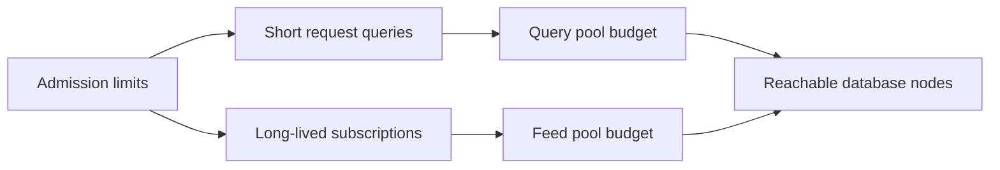

# Manage RethinkDB Pools for Changefeeds, Failures, and Idle Connections

Author: [nawazdhandala](https://www.github.com/nawazdhandala)

Tags: RethinkDB, Node.js, Reliability

Description: Separate changefeeds from short queries, understand failed-node selection, and configure idle cleanup in a pinned rethinkdbdash connection-pool example.

An application can have a reachable database and still spend most of its time waiting for a connection. Long-lived subscriptions occupy capacity, short queries queue behind them, and increasing the pool size only postpones the next overload.

A connection pool reuses database connections instead of opening a new one for every operation. Its behavior depends on the driver. This article uses `rethinkdbdash` 2.3.31, a third-party Node.js driver with its own pool manager. Its options are not options for the official `rethinkdb` JavaScript package, and the example is not a recommendation to switch drivers without evaluating compatibility and maintenance.

The package's published source commit is `7421553ea98a0874a54980505966383e75d2973f`. Local tests on Node 24.1.0 exercised configuration and selected pool methods with simulated connections. No live cluster, TLS handshake, failover, or load benchmark was run.

## Separate work by connection lifetime

A short lookup returns a result and releases capacity. A changefeed keeps producing a partial result until it ends or is closed. In this driver's [connection implementation](https://github.com/neumino/rethinkdbdash/blob/7421553ea98a0874a54980505966383e75d2973f/lib/connection.js), partial stream responses do not release the connection in the same way that a completed sequence does.

Give ordinary queries and changefeeds separate driver instances. This creates independent pool budgets inside the process. It does not isolate database CPU, memory, or network bandwidth, so excessive feed work can still affect the cluster.



Admission limits mean deciding how many operations may enter the system. A connection ceiling alone is not a bound on waiting application requests. Decide whether excess requests should wait briefly, be rejected, or be handled by a durable queue before they reach the driver.

## Configure two modest pools

Install the pinned package in an isolated Node project with `npm install --save-exact rethinkdbdash@2.3.31`. Save this factory as `clients.cjs`:

```javascript
const createDriver = require("rethinkdbdash");

function createClients({ servers, user, password, ca }, make = createDriver) {
  const shared = {
    servers,
    user,
    password,
    db: "app",
    discovery: false,
    ssl: { ca, rejectUnauthorized: true },
    timeout: 5,
    timeoutError: 1000,
    maxExponent: 5,
    timeoutGb: 60000,
  };
  return {
    queries: make({ ...shared, buffer: 4, max: 24 }),
    feeds: make({ ...shared, buffer: 2, max: 16 }),
  };
}

module.exports = { createClients };
```

Call `createClients` once during process startup with an approved `servers` array, such as two objects containing your internal DNS names and driver ports. Supply a least-privileged database user, its password from your secret store, and the trusted certificate-authority bundle as `ca`. Replace the `app` database name with your existing database. Constructing the real clients starts their pool activity; do not construct them per request.

The factory returns `queries` and `feeds`. Build short queries using `queries.table(...)` and subscriptions using `feeds.table(...).changes()`, calling `.run()` without passing a connection. That calling convention belongs to [rethinkdbdash](https://github.com/neumino/rethinkdbdash), whose pool manager obtains connections for queries.

`buffer` sets the desired available capacity, while `max` bounds growth according to this driver's pool allocation logic. The values here are deliberately illustrative: 24 query connections and 16 feed connections per process are starting budgets to test, not universal production settings. Multiply process budgets by your maximum replica count, and include rolling-deployment overlap when estimating demand.

The source divides settings across server pools and adjusts allocations when healthy membership changes. Rounding and transitions make the configured maximum unsuitable as a strict cluster-wide connection quota. Enforce service-level admission limits and measure actual connections.

TLS means Transport Layer Security. Certificate verification remains enabled in the example. The driver's [TLS connection code](https://github.com/neumino/rethinkdbdash/blob/7421553ea98a0874a54980505966383e75d2973f/lib/connection.js) passes the supplied TLS options to Node; validate every configured hostname and certificate chain in staging. RethinkDB's own [security guide](https://rethinkdb.com/docs/security/) documents server-side driver TLS. Do not rely on the older driver's README statement that RethinkDB lacks native TLS support.

## Distinguish node selection from query replay

With `discovery: false`, the application supplies its intended endpoints explicitly. This avoids assuming that addresses discovered inside the database network are reachable from the application. Keep that list under configuration management and test each endpoint independently.

The pinned [pool manager](https://github.com/neumino/rethinkdbdash/blob/7421553ea98a0874a54980505966383e75d2973f/lib/pool_master.js) searches healthy pools for available connections and advances its selection index. When a pool becomes empty, it is removed from the healthy set; when capacity returns, it can rejoin. Failures are detected through connection behavior, so this is not instantaneous knowledge of node health.

`timeout` is a connection-opening timeout in seconds. `timeoutError` and `maxExponent` govern reconnection delays. They do not give every query an execution deadline, and they do not mean a failed write is safe to replay.

If a write loses its response, the application may not know whether the server applied it. Retrying a non-idempotent operation can duplicate its effect. An idempotent operation produces the same intended outcome when repeated; otherwise use application identifiers and reconciliation appropriate to the operation. A replacement connection also cannot restore changes missed by a terminated feed. Rebuild or reconcile the feed's derived state before declaring it current.

## Understand what idle cleanup actually removes

The oddly named `timeoutGb` option is an idle cleanup interval in milliseconds. Here it is 60 seconds. The pinned [pool implementation](https://github.com/neumino/rethinkdbdash/blob/7421553ea98a0874a54980505966383e75d2973f/lib/pool.js) closes excess available connections while preserving its buffer target.

Therefore, a quiet application can retain some open connections indefinitely. That is deliberate reuse, not proof of a leak. A feed still consuming a stream is not an available idle connection, even when no documents are changing. Its owner must close its cursor when the subscriber goes away.

Avoid setting a cleanup interval so low that normal bursts repeatedly destroy and recreate useful connections. Compare connection-opening rate, available capacity, and request latency before changing the setting. A smaller number of sockets is not automatically a healthier service.

## Observe waiting and drain in the right order

The driver's pool manager exposes `getLength()` and `getAvailableLength()`, along with a `queueing` event for waiting queries. Record those separately for query and feed clients. A `healthy` event means that the manager considers at least one pool usable; it is not an application readiness test and does not prove that queries are completing promptly.

During shutdown, stop admitting new work first. Close owned feed cursors and let in-flight short work finish according to your service policy. Then await each client's `getPoolMaster().drain()` operation. Calling drain while indefinite feeds still hold their connections can prevent the pool from finishing its drain. Use a supervisor deadline and report incomplete cleanup instead of calling a started drain “complete.”

A useful staging acceptance test has four phases. First, run ordinary traffic and establish waiting-time and connection baselines. Next, add the expected number of subscriptions and verify that short-query capacity remains usable. Then make one test endpoint unavailable and observe failures, recovery delays, and feed reconciliation. Finally, close subscribers and wait through idle cleanup to confirm that excess connections fall while the configured buffer remains.

The local tests verified separate settings, per-server allocation, available-pool rotation, rejection with no healthy pools, and idle trimming above the buffer using the installed implementation. Real authentication, transport failures, delayed failure detection, and load remain deployment checks. Pool tuning is successful when bounded demand meets predictable latency and recoverable failures, not merely when the connection count looks small.
