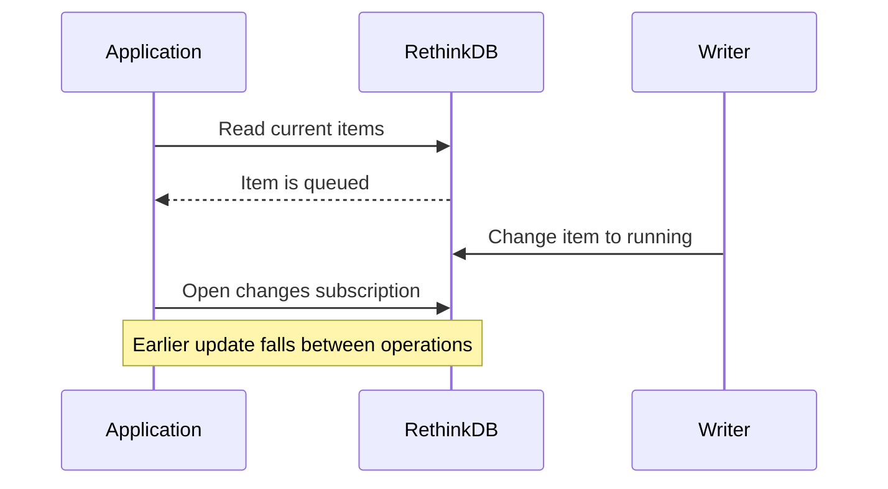

# Bridge the RethinkDB Snapshot Gap with include_initial

Author: [nawazdhandala](https://www.github.com/nawazdhandala)

Tags: RethinkDB, Python, Reliability

Description: Build a RethinkDB subscription from initial rows and live changes in one stream, with a readiness gate that keeps partial data out of your application.

A dashboard loads all open items, then subscribes to changes. Between those two operations, somebody updates an item. The dashboard has already read its old value, and the new subscription starts too late to receive that update. Nothing crashes. The dashboard simply stays wrong until another change happens to that row.

This is a startup race: correctness depends on the timing of independent operations. A faster query makes the vulnerable interval shorter without removing it. RethinkDB's `include_initial` option lets one subscription supply the initial view and subsequent changes, avoiding that separate read-then-subscribe boundary.

This tutorial focuses on building the initial view correctly. It uses Python 3.11 and the official Python driver `rethinkdb==2.4.10.post1`. Local tests exercise the consumer with synthetic notifications and construct the real driver query; they do not run a database or prove behavior under concurrent server writes.

## See where the separate operations lose information

Consider an item whose status starts as `queued`. The application reads that value. A writer changes it to `running`. The application then opens its changefeed. Its cache still says `queued`, even though both operations succeeded.



Opening the feed first and then reading a separate snapshot introduces a different coordination problem. You must buffer changes, decide when the snapshot is complete, and avoid applying an older buffered version over a newer snapshot value. That approach needs a precise reconciliation protocol; switching the order alone is not a complete fix.

Use a single query for this small-cache case. The [official changefeed guide](https://rethinkdb.com/docs/changefeeds/python/) explains how initial values and state notifications can accompany a subscription. There is no second query whose boundary your application must guess.

## Define what ready means to the reader

The subscription has two application states: building and available. While building, accumulate rows privately. Once the feed reports `ready`, expose the assembled view. After that, apply each notification and publish the updated view.

Do not equate the first row with readiness. A table might contain thousands of rows, or none. An empty table still needs an explicit completion signal so the application can distinguish “loaded and empty” from “still loading.”

The [Python changes reference](https://rethinkdb.com/api/python/changes/) documents three options used here: `include_initial` sends existing rows, `include_states` adds initialization status, and `include_types` labels notification kinds. Initial rows can interleave with changes to rows already delivered. Preserve stream order and handle updates during initialization rather than discarding everything until `ready`.

JavaScript uses camel-case names such as `includeInitial`; Python uses the underscore names shown below. Mixing the two styles is an avoidable source of configuration mistakes.

## Build a small full-table view

In a disposable Python environment, install the exact driver version with `python -m pip install rethinkdb==2.4.10.post1`. The [official driver repository](https://github.com/rethinkdb/rethinkdb-python) provides the `RethinkDB` entry point used here.

Save this code as `subscription.py`:

```python
from rethinkdb import RethinkDB

r = RethinkDB()


def consume(events, publish):
    rows = {}
    ready = False
    for event in events:
        if "error" in event:
            raise RuntimeError(event["error"])
        kind = event.get("type")
        if kind == "state":
            if event["state"] == "initializing":
                continue
            if event["state"] != "ready":
                raise ValueError("Unexpected feed state")
            ready = True
        elif kind in ("initial", "add", "change"):
            row = event["new_val"]
            rows[row["id"]] = row
        elif kind == "remove":
            rows.pop(event["old_val"]["id"], None)
        else:
            raise ValueError("Unsupported notification type")
        if ready:
            publish(dict(rows))


def subscribe(conn, publish, mark_unavailable):
    cursor = None
    mark_unavailable()
    try:
        cursor = r.table("items").changes(
            include_initial=True, include_states=True, include_types=True
        ).run(conn)
        consume(cursor, publish)
    finally:
        mark_unavailable()
        if cursor is not None:
            cursor.close()
```

The example subscribes to an existing `items` table in the connection's selected database. Every document must have a string primary key named `id`. It intentionally handles a full table, not an ordered top-ten query, a projection without keys, or a table with a custom primary-key name.

Call `subscribe(conn, publish, mark_unavailable)` from the worker that owns the connection. Obtain `conn` through your application's approved [connection settings](https://rethinkdb.com/api/python/connect/), including authentication and TLS where required. Keep credentials outside this module. The function does not open or close the caller's connection.

`publish` replaces the visible view and marks it available. `mark_unavailable` prevents consumers from treating it as current. These callbacks should be fast, synchronous, and non-throwing. Published dictionaries are shallow copies: the documents inside must remain read-only to consumers. Copying the whole view per update is reasonable only for a small, bounded table.

The consumer applies each notification exactly once in arrival order. Initial rows, additions, and replacements set the document by key. Removals delete it. A notification before readiness changes only private state; a notification after readiness also triggers publication.

The `finally` block marks the view unavailable if consumption ends and closes the cursor. [Closing a cursor](https://rethinkdb.com/api/python/close-cursor/) cancels its query. Connection shutdown, cancellation of a blocked worker, and retry policy belong to the surrounding service lifecycle; this sample is not a complete background-worker framework.

## Test interleaving rather than only a quiet table

A quiet table cannot expose the bug that matters. Feed the consumer a deliberately awkward sequence:

| Notification | Private view | Published view |
|---|---|---|
| Initial row A, value 1 | A=1 | Unavailable |
| Update A to value 2 | A=2 | Unavailable |
| Initial row B | A=2, B present | Unavailable |
| Remove B | A=2 | Unavailable |
| Ready | A=2 | A=2 |
| Add C | A=2, C present | A=2, C present |

This sequence checks two common errors: ignoring real updates during initialization and publishing a partially loaded table. A separate empty-table case should publish an empty dictionary at readiness. A stream that ends before readiness should publish nothing.

The local tests passed those cases, along with rejection of an overflow notification and an unsupported notification type. Query construction with the installed driver also passed. These tests establish the behavior of the Python consumer, not the database's delivery guarantees.

For a staging integration test, use a dedicated table and controlled writer. Record the writer's final expected documents, start the subscription while applying known updates, then stop writes and wait for the consumer to converge. Compare complete documents and missing keys, not only row counts. A count can match while one deleted row and one missing insertion cancel each other out.

## Keep the boundaries explicit

The sample rejects `uninitial` because ordered limited feeds can have membership and ordering behavior that a simple full-table map does not model. Do not silently broaden this implementation to a ranked list. Use a consumer designed for that query's notification contract.

An overflow notification also invalidates the view. Continuing after the server reports skipped changes would make availability look better than correctness. Rebuild through a fresh subscription and keep the old view visibly unavailable or stale while recovery runs.

Finally, avoiding the startup gap does not establish a transactionally consistent snapshot across several tables or turn feed events into proof of durable writes. RethinkDB's [consistency documentation](https://rethinkdb.com/docs/consistency/) distinguishes visibility, durability, and read guarantees. A feed-driven dashboard and an audit ledger therefore need different correctness criteria.

Measure initialization duration, loaded row count, failures before readiness, and time unavailable. The first useful success signal is a complete initial view, followed by continued consumption. Treat that signal as part of the application contract, rather than inferring success from an open socket or the first received document.
