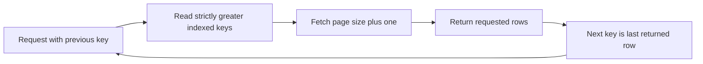

# Paginate RethinkDB with Indexed Boundaries Instead of Large Skips

Author: [nawazdhandala](https://www.github.com/nawazdhandala)

Tags: RethinkDB, Python, Performance

Description: Replace deep offset pagination with a compound RethinkDB index, an exclusive continuation boundary, and a stable tie-breaker for equal timestamps.

The first page of an event list loads quickly. Page 500 is slower, even though both pages return only 50 documents. An offset-based query asks the database to discard earlier results before returning the requested slice. The farther the offset advances, the more preceding results the request asks it to skip.

Keyset pagination changes the question from “skip 24,950 rows” to “start after this indexed key.” The client remembers the last delivered key, and the next request uses it as a boundary. This is useful for next-page browsing and sequential exports; it does not provide direct jumps to arbitrary page numbers.

This example uses Python 3.11 and `rethinkdb==2.4.10.post1`. Local checks construct real driver queries and test pagination logic against an in-memory ordering model. No database index was built and no performance benchmark was run.

## Choose a key that completely defines the order

A timestamp alone is usually not enough. Three events may share the same millisecond. If a page ends after the first one and the next query asks for timestamps strictly greater than that millisecond, the other two disappear from the traversal.

Use a compound key: `[created_ms, id]`. `created_ms` is an immutable integer timestamp in milliseconds, and `id` is the table's unique primary key. For this tutorial, IDs are nonempty ASCII strings. The unique ID resolves timestamp ties, giving every document a distinct position.

RethinkDB's [secondary-index guide](https://rethinkdb.com/docs/secondary-indexes/python/) explains compound indexes as array-valued index keys. The [between reference](https://rethinkdb.com/api/python/between/) defines their lexicographic ordering: compare the first component, then the next when the first components match.

| Key | Position relative to `[1000, "b"]` |
|---|---|
| `[1000, "a"]` | Before |
| `[1000, "b"]` | Boundary itself |
| `[1000, "c"]` | After, despite the same timestamp |
| `[1001, "a"]` | After, because the timestamp is larger |

Keep both fields present and of consistent types. If an index expression errors for a document, that document can be absent from the index. Validate the data before interpreting an incomplete indexed result as an empty page.

## Create and wait for the index

Use an existing staging table named `events`, with the schema described above and an authenticated connection named `conn`. After importing `RethinkDB` and creating `r = RethinkDB()`, run this once as a schema migration:

```python
r.table("events").index_create(
    "created_ms_id", lambda row: [row["created_ms"], row["id"]]
).run(conn)
r.table("events").index_wait("created_ms_id").run(conn)
```

The first operation creates the index and the second waits until it can be used. [`index_wait`](https://rethinkdb.com/api/python/index_wait/) is a readiness check, not a substitute for verifying the intended index definition. If the name already exists, inspect the existing definition through your migration process instead of dropping it blindly or ignoring the mismatch.

Index construction consumes resources. Schedule it according to your database change process, and do not place these operations inside the request handler. The local review constructed these queries without executing them.

## Read one extra row to determine continuation

Save the following module as `paging.py` in an environment with `rethinkdb==2.4.10.post1` installed:

```python
from rethinkdb import RethinkDB

r = RethinkDB()
INDEX = "created_ms_id"


def page_query(after=None, size=50):
    if type(size) is not int or not 1 <= size <= 100:
        raise ValueError("size must be an integer from 1 to 100")
    if after is not None:
        if (not isinstance(after, list) or len(after) != 2
                or type(after[0]) is not int
                or not isinstance(after[1], str)
                or not after[1] or not after[1].isascii()):
            raise ValueError("after must be [integer timestamp, ASCII id]")
    lower = r.minval if after is None else after
    return (r.table("events")
            .between(lower, r.maxval, index=INDEX, left_bound="open")
            .order_by(index=INDEX)
            .limit(size + 1))


def finish_page(rows, size):
    page = rows[:size]
    next_after = None
    if len(rows) > size:
        last = page[-1]
        next_after = [last["created_ms"], last["id"]]
    return {"items": page, "next_after": next_after}


def read_page(conn, after=None, size=50):
    cursor = page_query(after, size).run(conn)
    try:
        return finish_page(list(cursor), size)
    finally:
        cursor.close()
```

Call `read_page(conn)` for the first page. If the result contains a non-null `next_after`, pass that value into the next call. `conn` must select the database holding `events` and use your application's normal authentication and TLS configuration.

The lower boundary is exclusive: `left_bound="open"` prevents repeating the final row from the previous page. The first page uses `r.minval`, which sorts below real index keys. Both the range and ordering use `created_ms_id`; [indexed ordering](https://rethinkdb.com/api/python/order_by/) must match the range index to preserve the intended efficient access path.

The query fetches at most `size + 1` rows. The extra row tells the application that another page existed when this request ran. It is not delivered yet. The continuation key comes from the last row actually returned to the caller, not from that extra row. Using the extra row's key would skip it on the next request.

The function limits page sizes to 1 through 100 and validates the continuation shape. `finish_page` is an internal helper used after that validation, not an independent public API accepting arbitrary sizes. The cursor is closed after consumption, including when reading fails.



## Keep continuation tokens tied to the query

The raw two-element list is easy to inspect during development. An HTTP API will usually encode it as an opaque continuation token. Preserve the integer timestamp and exact string ID when encoding and decoding; converting timestamps through a lower-precision format can change the boundary.

Bind the token to its query contract: sort direction, filters, tenant scope, and a version identifying the index scheme. A token from one filtered list should not silently continue a different list. Validate its contents on every request, and authenticate it when the API relies on its integrity. Encoding JSON as base64 alone does not make it trustworthy.

Authorization still belongs in the server-side query. A continuation key is not permission to read another tenant's data. If the list is tenant-scoped, design the index and range to enforce that scope, for example with an additional leading tenant component. Do not add a tenant filter casually and assume this unscoped example has the same performance or security properties.

## Understand changes between pages

Keyset pagination avoids offset shifts caused by deleting earlier rows, but it does not freeze the dataset. A newly inserted event whose key is before the current boundary will not appear later in that traversal. Changing an existing row's ordering fields can move it across the boundary and cause a missing or repeated appearance.

That is why this example requires immutable ordering fields. For a stable export, define a separate snapshot or cutoff strategy and its limits. A cutoff alone does not exclude later backdated inserts. RethinkDB's [consistency guarantees](https://rethinkdb.com/docs/consistency/) should inform the export contract rather than assuming that several page requests form one transaction.

For descending order, the continuation becomes an exclusive upper boundary and the index order must be descending. Reusing this ascending lower-bound query with only the display reversed is incorrect. Implement and test the reverse traversal as a separate case.

## Validate correctness before comparing latency

The local tests traversed equal-timestamp rows without losing the remaining ties, checked empty and exactly full pages, and verified that continuation uses the final delivered row. Invalid page sizes and malformed keys were rejected. Query construction passed with the pinned driver. These tests do not measure server planning or index performance.

In staging, compare the ordered IDs returned by a complete traversal against a known fixed dataset. Include ties spanning page boundaries, a final partial page, and a deleted boundary row. Then compare deep-offset queries using [`skip`](https://rethinkdb.com/api/python/skip/) with indexed-boundary queries under the same page size and dataset conditions. Record latency and database resource use rather than promising a universal speedup.

The migration is complete when the API has an explicit continuation contract, tie handling is correct, and deep traversal no longer depends on increasing offsets. The index is only one part of that result; boundary semantics are what keep the faster path correct.
