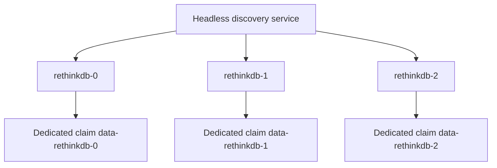

# Give RethinkDB Pods Stable Identities and Separate Persistent Volumes

Author: [nawazdhandala](https://www.github.com/nawazdhandala)

Tags: RethinkDB, Kubernetes, Storage

Description: Use a StatefulSet, headless discovery, and one persistent claim per RethinkDB pod, then verify that pod replacement preserves the database server identity.

A database pod can restart successfully and still be the wrong database server. If its data directory was temporary, RethinkDB starts with new on-disk metadata. Reusing the same Kubernetes pod name does not recover the old identity or its data.

The opposite mistake is mounting one shared data directory into several RethinkDB processes. A shared filesystem does not turn that directory into a cluster. Each server needs its own directory; RethinkDB replication moves data between servers according to table configuration.

A StatefulSet solves the Kubernetes naming and volume-association part. You still need to verify discovery, database identity, replica placement, and recovery separately.

## Keep the three identities separate

A pod ordinal is the numbered suffix in a name such as `rethinkdb-0`. A persistent volume claim, or PVC, requests storage for that pod. RethinkDB also has its own server identifier, retained in its data and metadata directory.

[StatefulSets](https://kubernetes.io/docs/concepts/workloads/controllers/statefulset/) provide stable pod identity and associate claims from a volume template with individual pods. The database's [v2.4.4 startup implementation](https://github.com/rethinkdb/rethinkdb/blob/v2.4.4/src/clustering/administration/main/command_line.cc) generates a new server identifier when initializing a new directory. Therefore, preserving the PVC and mounting the correct directory matters as much as preserving the pod name.



The arrows to storage represent separate claims, not three subdirectories in one claim. A replacement pod with ordinal zero should return to claim `data-rethinkdb-0`.

## Use an isolated lab before adapting the pattern

The manifest below demonstrates identity and storage on Kubernetes APIs available in version 1.30. It pins `rethinkdb:2.4.4-bookworm-slim`, a tag listed in the [Docker Official Images manifest](https://github.com/docker-library/official-images/blob/master/library/rethinkdb). The [associated image source](https://github.com/rethinkdb/rethinkdb-dockerfiles/blob/48876a66c3be922c6b01c436bf78d662e53bceef/bookworm/2.4.4/Dockerfile) uses `/data` as its working directory and installs RethinkDB 2.4.4. For immutable deployment, resolve and retain your approved image digest rather than relying solely on the tag.

Prerequisites are a disposable namespace named `rethinkdb-lab`, a dynamic default StorageClass with sufficient capacity, and a network plugin that enforces NetworkPolicy. Apply the policy before starting the pods. This lab deliberately omits database authentication and transport encryption; use no production data, and allow only trusted operators to create pods in its namespace. A namespace alone does not isolate network traffic. Review [NetworkPolicy enforcement requirements](https://kubernetes.io/docs/concepts/services-networking/network-policies/).

Save this first document as `lab-policy.yaml`:

```yaml
apiVersion: networking.k8s.io/v1
kind: NetworkPolicy
metadata:
  name: rethinkdb-lab-ingress
  namespace: rethinkdb-lab
spec:
  podSelector:
    matchLabels:
      app: rethinkdb
  policyTypes: [Ingress]
  ingress:
    - from:
        - podSelector:
            matchLabels:
              app: rethinkdb
      ports:
        - protocol: TCP
          port: 29015
```

This permits cluster traffic from matching pods in the same namespace. It does not grant application access to the driver port. Node-originated traffic has special treatment under Kubernetes networking, so this is not an isolation boundary against a hostile cluster administrator or node. Egress remains unchanged, including DNS access.

## Give every pod its own claim and peer addresses

Save these two documents as `rethinkdb-lab.yaml`:

```yaml
apiVersion: v1
kind: Service
metadata:
  name: rethinkdb-peers
  namespace: rethinkdb-lab
spec:
  clusterIP: None
  publishNotReadyAddresses: true
  selector:
    app: rethinkdb
  ports:
    - name: cluster
      port: 29015
      targetPort: cluster
---
apiVersion: apps/v1
kind: StatefulSet
metadata:
  name: rethinkdb
  namespace: rethinkdb-lab
spec:
  serviceName: rethinkdb-peers
  replicas: 3
  podManagementPolicy: Parallel
  updateStrategy:
    type: OnDelete
  selector:
    matchLabels:
      app: rethinkdb
  template:
    metadata:
      labels:
        app: rethinkdb
    spec:
      terminationGracePeriodSeconds: 60
      containers:
        - name: rethinkdb
          image: rethinkdb:2.4.4-bookworm-slim
          env:
            - name: POD_NAME
              valueFrom:
                fieldRef:
                  fieldPath: metadata.name
          command: ["/bin/sh", "-ec"]
          args:
            - |
              server_name=$(printf '%s' "$POD_NAME" | tr '-' '_')
              set -- rethinkdb --directory /data/rethinkdb_data \
                --server-name "$server_name" --bind all \
                --no-http-admin --no-update-check --cache-size 256
              for ordinal in 0 1 2; do
                peer="rethinkdb-$ordinal"
                if [ "$peer" != "$POD_NAME" ]; then
                  set -- "$@" --join "$peer.rethinkdb-peers.rethinkdb-lab.svc:29015"
                fi
              done
              exec "$@"
          ports:
            - name: cluster
              containerPort: 29015
            - name: driver
              containerPort: 28015
          resources:
            requests:
              cpu: 250m
              memory: 512Mi
            limits:
              memory: 1Gi
          readinessProbe:
            tcpSocket:
              port: driver
            initialDelaySeconds: 5
            periodSeconds: 5
          volumeMounts:
            - name: data
              mountPath: /data
  volumeClaimTemplates:
    - metadata:
        name: data
      spec:
        accessModes: [ReadWriteOnce]
        resources:
          requests:
            storage: 10Gi
```

The claim template requests three separate volumes. Omitting `storageClassName` selects the cluster's default; set an explicit approved class when adapting this. `ReadWriteOnce` means read-write mounting by one node, not a universal one-pod lock. Kubernetes documents that distinction in its [persistent-volume access modes](https://kubernetes.io/docs/concepts/storage/persistent-volumes/).

The shell converts pod-name hyphens to underscores for the RethinkDB name and supplies the other two pods as initial peers. Peer addresses use cluster DNS, while the data directory sits beneath the mounted volume. The [server command reference](https://rethinkdb.com/docs/cli-options/) documents directory, join, binding, cache, and administration options. The fixed three-peer list must be revised before scaling beyond three pods.

A headless Service publishes pod addresses rather than a load-balanced virtual IP. `publishNotReadyAddresses` lets peers discover each other before readiness succeeds; otherwise, discovery and readiness can depend on each other. [Kubernetes DNS documentation](https://kubernetes.io/docs/concepts/services-networking/dns-pod-service/) describes these records. `Parallel` starts pods without waiting for each predecessor to become ready.

## Validate before creating resources

After creating the disposable namespace through your normal workflow, inspect the current context and submit each file for server-side dry-run:

```bash
kubectl config current-context
kubectl apply --dry-run=server -f lab-policy.yaml
kubectl apply -f lab-policy.yaml
kubectl apply --dry-run=server -f rethinkdb-lab.yaml
```

The policy application is a real change. The other apply commands request [server-side dry-run](https://kubernetes.io/docs/reference/kubectl/generated/kubectl_apply/), which checks admission without persisting the submitted workload. It does not prove that volumes will provision or pods will join. Once those checks pass in your lab, applying the workload file starts the three servers.

Inspect the resulting associations:

```bash
kubectl -n rethinkdb-lab get pods -l app=rethinkdb -o wide
kubectl -n rethinkdb-lab get pvc
kubectl -n rethinkdb-lab get pod rethinkdb-0 \
  -o jsonpath='{.spec.volumes[?(@.name=="data")].persistentVolumeClaim.claimName}{"\n"}'
```

Expect three claims and `data-rethinkdb-0` for the last command. Pending claims suggest a storage provisioning or topology issue. A running pod with an unexpected claim is an identity problem even if its TCP port accepts connections.

## Verify persistence and database availability independently

Through an approved diagnostic connection, record RethinkDB server identifiers and a small fixture's contents. During a controlled lab pod-replacement test, retain the PVC. Confirm the replacement uses the same claim, retains the database server identifier, rejoins its peers, and serves the expected fixture. Never delete the claim merely to make a replacement schedule faster.

The TCP readiness probe only confirms an accepting driver port. It does not prove table readiness or replication health. Three pods do not automatically give existing tables three voting replicas; inspect and configure table replication separately. Production placement must also spread replicas across appropriate failure domains.

`OnDelete` prevents an image-template edit from automatically rolling the StatefulSet. Plan upgrades explicitly, respecting RethinkDB version compatibility. Add reviewed authentication, TLS, storage permissions, resource sizing, backup restoration, and application-specific health checks before production use. Local validation for this example covers YAML structure and shell argument construction; no Kubernetes cluster, storage provisioning, or database restart was exercised.
