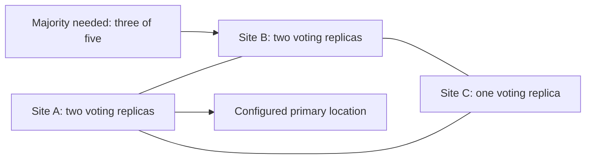

# Place RethinkDB Replicas Across Datacenters Without Losing Quorum

Author: [nawazdhandala](https://www.github.com/nawazdhandala)

Tags: RethinkDB, High Availability, Reliability

Description: Use server tags to plan RethinkDB replica placement, keep a voting majority after site loss, and separate primary location from failover authority.

Putting RethinkDB replicas in two datacenters does not automatically let either datacenter keep writing when the link between them breaks. If each side could independently accept conflicting writes, recovery would have to resolve two incompatible histories. That situation is commonly called split brain.

The placement decision therefore starts with a failure policy: which surviving group should retain a majority, and which group must stop? Server tags describe where replicas belong. They do not override the voting rules that determine whether those replicas can make progress.

This tutorial uses a five-replica example spread across three sites. Python snippets target `rethinkdb==2.4.10.post1`. Local tests constructed queries and checked the failure arithmetic; no geographically distributed cluster, network partition, or reconfiguration was executed.

## Write the site-loss matrix first

A voting majority is more than half of the configured voting replicas. Apply that rule to each shard, which is a partition of a table's data. A layout that preserves enough servers in total can still leave an individual shard without enough voters if its placement differs.

Consider these stable layouts, assuming the surviving replicas are healthy and mutually reachable:

| Voters by site | Majority | Lose A | Lose B | Lose C |
|---|---:|---|---|---|
| A=2, B=1 | 2 | Cannot retain majority | Retains majority | Not applicable |
| A=2, B=2 | 3 | Cannot retain majority | Cannot retain majority | Not applicable |
| A=2, B=2, C=1 | 3 | Retains majority | Retains majority | Retains majority |

The first layout deliberately favors site A. The second looks symmetrical but cannot tolerate losing either whole site. The third can retain a majority after any one site disappears, provided the remaining sites can communicate.

These are placement calculations, not guarantees about recovery time. RethinkDB's [failover documentation](https://rethinkdb.com/docs/failover/) explains the available-majority requirement and the limitations of unusual, non-transitive connectivity failures. Do not infer that every partial network failure behaves like a clean site shutdown.



The diagram represents one shard's placement. Site C contains a real data replica, not a lightweight witness that stores no data. Capacity planning must include its storage, replication traffic, and ability to participate in the surviving group.

## Tag servers according to actual failure domains

Use mutually exclusive placement tags such as `dc_a`, `dc_b`, and `dc_c`: a server should have exactly one of these site tags. Other tags can remain for separate purposes. If one machine has several site tags, the labels no longer prove physical separation.

The [replication guide](https://rethinkdb.com/docs/sharding-and-replication/) documents `--server-tag` for startup configuration and the `server_config` system table for existing servers. Add the appropriate site tag through your deployment configuration, preserving any tags on which other tables depend. Do not replace an existing server's entire tag list with a single site tag without checking those dependencies.

Before changing table placement, inspect the actual inventory. With an authorized connection named `conn`, this read-only query prints server identifiers, names, and tags:

```python
from rethinkdb import RethinkDB

r = RethinkDB()
cursor = r.db("rethinkdb").table("server_config").pluck(
    "id", "name", "tags"
).run(conn)
try:
    for server in cursor:
        print(server)
finally:
    cursor.close()
```

You need at least two eligible data servers tagged `dc_a`, two tagged `dc_b`, and one tagged `dc_c` for this example. Check the inventory against infrastructure records, not only names that happen to contain a region label. The [system-table documentation](https://rethinkdb.com/docs/system-tables/) distinguishes configured servers from their current status, so also verify connectivity and readiness.

## Preview placement for one staging table

Use an existing staging table, here `geo_lab.events`, and record its current configuration before changing anything. The connection must have the appropriate administrative permission. Preserve the current shard count:

```python
target = r.db("geo_lab").table("events")
current = target.config().run(conn)
placement = {"dc_a": 2, "dc_b": 2, "dc_c": 1}
shard_count = len(current["shards"])
proposal = target.reconfigure(
    shards=shard_count,
    replicas=placement,
    primary_replica_tag="dc_a",
    dry_run=True,
).run(conn)
print(proposal)
```

The [`reconfigure` reference](https://rethinkdb.com/api/python/reconfigure/) requires `primary_replica_tag` when replica counts are expressed as a tag mapping. That tag must appear in the mapping. `dry_run=True` returns the proposed configuration without applying it.

Review each proposed shard. It should have five replicas on distinct servers with the intended site distribution, no unexpected non-voting replicas, and a configured primary on an eligible site-A server. Also review write acknowledgments and durability: the command resets these to `majority` and `hard` respectively.

A primary location is not an instruction to accept writes without a majority. Nor should it be treated as an absolute prohibition on a surviving majority choosing a replacement elsewhere after failure. The documented failover process chooses among available voting replicas and restores the configured primary role when that server returns.

## Apply only with a backfill and availability plan

After reviewing the proposal in staging, apply the same intended settings during the planned change window:

```python
print(target.reconfigure(
    shards=shard_count,
    replicas=placement,
    primary_replica_tag="dc_a",
).run(conn))
print(target.wait(wait_for="all_replicas_ready", timeout=300).run(conn))
print(target.config().run(conn))
print(target.status().run(conn))
```

The preview does not reserve particular servers. Recheck the actual resulting placement. Reconfiguration can temporarily affect availability and copy data to new replicas; that copying is called backfill. The five-minute readiness timeout is an example deployment budget, not a prediction of transfer duration. Large tables or slow links may need a different planned budget.

[`wait`](https://rethinkdb.com/api/python/wait/) and [`status`](https://rethinkdb.com/api/python/status/) provide different evidence: one waits for the selected condition, while the other shows current readiness and replica states. Do not begin a site-loss exercise until the desired configuration has converged.

With two voters in the primary site and a majority of three, progress depends on at least one remote voter. Inter-site latency is therefore part of the design. Measure latency under normal traffic and under the reduced-capacity failure state; do not promise local-only performance from a multi-site majority layout.

## Do not trade away the vote you need

Marking a remote replica non-voting can change latency behavior, but it changes the failure matrix too. If site C becomes non-voting in this example, only four voters remain. Losing either two-voter site leaves two of four, which is insufficient.

Keep non-voting placement explicit in a separate reviewed design. It is not a transparent optimization. Similarly, changing write acknowledgments to `single` does not grant a minority permission to act as an independent writable cluster.

During an outage, preserve the distinction between automatic failover and emergency repair. The [emergency-repair documentation](https://rethinkdb.com/api/python/reconfigure/#emergency-repair-mode) warns that it bypasses normal safeguards and can lose data. Do not run separate automatic repair procedures on both sides of a partition to make both sides writable.

## Rehearse the application path as well as the database

In an isolated staging environment, test loss of A, B, and C separately, restoring full health between exercises. Record unavailable duration, replica states, acknowledged write IDs, and whether application clients can reach the surviving group. A database majority is not useful to a client that only knows endpoints in the lost site.

The local checks verified the three placement matrices and query construction only. Real backfill, cross-site latency, client reconnection, and partition behavior remain deployment tests. Keep the placement script and failure matrix together so a later tag change cannot silently invalidate the recovery policy.
