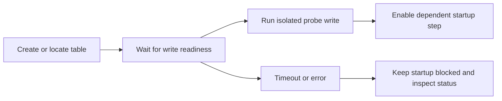

# Wait for RethinkDB Write Readiness After Creating a Table

Author: [nawazdhandala](https://www.github.com/nawazdhandala)

Tags: RethinkDB, Python, Reliability

Description: Diagnose primary-replica errors after table creation, use a bounded write-readiness check, and distinguish startup timing from persistent cluster failures.

A deployment creates a table and immediately inserts its first document. The insert reports that a primary replica is unavailable. Adding a five-second sleep seems to fix the problem until a slower restart or a different cluster makes it fail again.

The right question is whether the table can accept the operation you are about to perform. A table name appearing in metadata, a successful TCP connection, and all replicas finishing their work are different conditions. Make your startup requirement explicit and stop startup when that requirement cannot be met.

This tutorial uses Python 3.11 with `rethinkdb==2.4.10.post1`. It also checks RethinkDB server 2.4.4 source for an important table-creation detail. The local tests use simulated responses and real driver query construction; no cluster was started and no readiness timing was measured.

## Check what creation actually waited for

The [table_create reference](https://rethinkdb.com/api/python/table_create/) says that tables are available for writing when the command returns. Do not treat table creation as a command that merely schedules work and always returns immediately.

There is a version-specific qualification. The [2.4.4 server implementation](https://github.com/rethinkdb/rethinkdb/blob/v2.4.4/src/clustering/administration/real_reql_cluster_interface.cc) waits for table readiness after creation, but puts a ten-second timer around that wait. If the timer expires, it can return normally. A successful creation result therefore should not be treated as a perpetual availability guarantee or an unlimited readiness barrier.

Also check the application itself. An asynchronous caller may have started creation without awaiting completion. Another process may have created the table. The application may be using a different default database. Availability can change between the creation response and the first write.

Log the fully qualified database and table, the creation result, and the timestamps of the first failed operation. Those details separate a sequencing error from an actual replica-availability problem.

## Choose readiness for the next operation

The [`wait` command](https://rethinkdb.com/api/python/wait/) accepts several readiness targets. A write-oriented application should request `ready_for_writes` explicitly. The default, `all_replicas_ready`, is stronger and can wait for replicas that are still catching up even when writes are already possible.

| Startup purpose | Readiness target |
|---|---|
| Application must write | `ready_for_writes` |
| Application needs normal reads | `ready_for_reads` |
| Maintenance requires all replicas caught up | `all_replicas_ready` |
| Deliberately permitted outdated reads | `ready_for_outdated_reads` |

An outdated-read condition is not a substitute for write readiness. Likewise, table readiness is not secondary-index readiness: use [`index_wait`](https://rethinkdb.com/api/python/index_wait/) for indexes that a later query requires.

Set a nonzero timeout. The documented default of zero means no timeout, which can leave a startup job waiting indefinitely. A readiness timeout should fail the deployment gate and produce useful diagnostics rather than silently enabling traffic.



This is a startup gate, not a guarantee that every future write succeeds. Runtime error handling remains necessary after the gate opens.

## Use a bounded staging bootstrap

Create an empty staging database named `bootstrap_lab` through your normal provisioning process. Supply an authenticated connection with permission to manage the test table. Install the pinned Python driver in an isolated environment with `python -m pip install rethinkdb==2.4.10.post1`.

Save this module as `bootstrap.py`:

```python
from uuid import uuid4
from rethinkdb import RethinkDB

r = RethinkDB()


def prepare_and_probe(conn, database="bootstrap_lab", table="events", driver=r):
    db = driver.db(database)
    # A single migration owner must serialize this check and creation.
    if table not in db.table_list().run(conn):
        db.table_create(table, shards=1, replicas=1).run(conn)
    target = db.table(table)
    ready = target.wait(wait_for="ready_for_writes", timeout=30).run(conn)
    if ready.get("ready") != 1:
        raise RuntimeError("Unexpected readiness result")
    probe_id = "readiness-" + str(uuid4())
    result = target.insert({"id": probe_id, "kind": "readiness_probe"}).run(conn)
    if result.get("errors", 0) or result.get("inserted") != 1:
        raise RuntimeError(result.get("first_error", "Probe insert was not confirmed"))
    return {"probe_id": probe_id, "ready": ready, "write": result}
```

Call `prepare_and_probe(conn)` in the staging migration job. The helper creates an `events` table only when absent, waits up to 30 seconds for write readiness, then inserts a uniquely named probe document. The expected result contains the probe ID and an insert result with `inserted: 1` and no errors.

This fixture uses one shard and one replica to keep the lab requirement small. It is not a highly available production topology. Production table placement and replica counts belong in a reviewed migration, and an existing table's definition must be checked independently.

The existence check and creation are not atomic. The example assumes one migration owner serializes schema changes. Running this helper from every application replica can race between `table_list` and `table_create`; do not hide that race by catching every database exception and continuing.

The probe intentionally writes a document. Run it only in the dedicated staging table, retain its returned ID for evidence, and remove lab data later through your normal test-data cleanup. The code neither overwrites existing documents nor drops tables.

The [insert reference](https://rethinkdb.com/api/python/insert/) distinguishes returned write errors from successfully inserted rows. Checking only whether `.run()` returned would miss errors recorded in the result object. The helper checks both `errors` and the expected insertion count.

## Inspect status when the gate fails

From an administrative diagnostic session with appropriate permissions, use these read-only queries. They assume the same `r` and `conn` as above:

```python
target = r.db("bootstrap_lab").table("events")
print(target.status().run(conn))
print(target.config().run(conn))
```

[`status`](https://rethinkdb.com/api/python/status/) reports current readiness and the states of shard replicas. [`config`](https://rethinkdb.com/api/python/config/) describes intended placement and settings. Comparing the two is more informative than repeatedly retrying the insert.

For example, `backfilling` means a replica is copying data; `waiting_for_primary`, `waiting_for_quorum`, or `disconnected` calls for investigation of the corresponding replica and cluster communication. A quorum is the required voting group used to make safe progress. The [system-table documentation](https://rethinkdb.com/docs/system-tables/) describes these fields and their relationship to table configuration.

A wait cannot repair missing servers, unsuitable replica placement, broken networking, or insufficient permissions. If the gate times out repeatedly, preserve the error and status evidence. Do not automatically reduce replica counts, weaken write acknowledgments, or drop and recreate the table to make the check pass.

## Keep timeout scopes separate

The 30-second option belongs to the server-side readiness operation. It is not a universal deadline covering name resolution, connection establishment, query transport, and every later write. Give the migration runner an overall deadline appropriate to your environment and report which phase exceeded its budget.

If a probe write loses its response, its outcome may be uncertain. Avoid automatically generating another probe and declaring the first one absent. Preserve the attempted ID in your production-quality diagnostic wrapper so an operator can check the result before retrying. This small helper returns its ID on success; it is not a complete uncertain-write reconciliation system.

The local tests verified the new-table and existing-table paths, sequencing of creation before waiting and waiting before insertion, and suppression of the insert after a simulated readiness failure. Real driver construction also accepted the creation, wait, status, and configuration queries. None of those checks establish actual failover behavior.

In staging, record creation time, readiness duration, probe outcome, and status on failure. Then repeat under your supported restart or reconfiguration scenario. A useful readiness gate has a clear success condition, a finite failure path, and enough evidence to explain why startup remained blocked.
