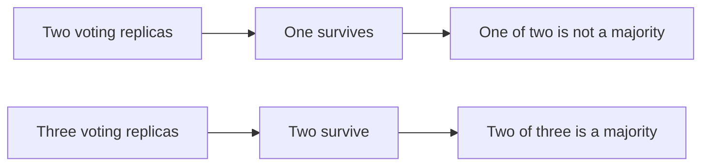

# Why RethinkDB Needs Three Voting Replicas for One-Node Failover

Author: [nawazdhandala](https://www.github.com/nawazdhandala)

Tags: RethinkDB, High Availability, Reliability

Description: Explain why two voting replicas cannot tolerate losing one, audit per-shard voting membership, and plan a verified move to three replicas.

Two database machines look redundant: there are two copies of the data, so either machine should be able to take over. That intuition misses the question a distributed database must answer during a failure: which surviving group is allowed to keep accepting changes?

For a RethinkDB shard with two voting replicas, losing one leaves half the voters. Half is not a majority. Three voting replicas leave two voters after a single loss, which can still form a majority. The useful unit is the shard's voting replica set, not the number of machines visible in a server list.

This article explains that distinction and gives a staged inspection and reconfiguration procedure. Examples target the Python driver `rethinkdb==2.4.10.post1`; local checks covered query construction and majority calculations, not a running cluster or actual failover.

## Count the votes before counting the machines

A shard is a partition of a table's data. A replica is a copy of that shard. A voting replica participates in decisions that require a majority, also called a quorum. A primary handles the shard's primary role, but it is not the only voter.

For a stable configuration with N voting replicas, the majority is `floor(N / 2) + 1`:

| Voting replicas | Majority needed | Voter losses that still leave a majority |
|---|---:|---:|
| 2 | 2 | 0 |
| 3 | 2 | 1 |
| 4 | 3 | 1 |
| 5 | 3 | 2 |

RethinkDB's [failover documentation](https://rethinkdb.com/docs/failover/) requires enough available voting replicas for the table and each shard. It explicitly explains why a two-machine configuration cannot provide automatic failover. It also documents a temporary interruption while another replica takes over and limitations under non-transitive network connectivity.

The following picture shows the arithmetic for one shard after a node loss. It is not a network topology or a prediction of election timing.



Three replicas are useful only if they can communicate as required. Two replicas placed on the same physical failure domain can disappear together. A failure domain is a shared dependency, such as a host, rack, or availability zone, whose loss affects several replicas at once.

## A third server is not automatically a third voter

RethinkDB configures replication per table. Adding a server does not mean every existing table now has another replica. A table can still have two replicas even while the cluster contains many servers. The [sharding and replication guide](https://rethinkdb.com/docs/sharding-and-replication/) describes these table-level settings.

A proxy node does not store a data replica. A non-voting replica stores data but does not increase the voting group. Consequently, two voters plus one non-voter still require both voters to remain available.

Likewise, a table using one replica on one of two servers may remain usable when the unrelated server fails, but it has no second copy ready to provide automatic recovery if its own replica is lost. Avoid interpreting that observation as evidence that a two-replica failover design works.

## Audit each shard's intended membership

Use an authenticated administrative connection called `conn` with permission to inspect the target table. In this staging example, the existing database is `failover_lab` and the table is `events`:

```python
from rethinkdb import RethinkDB

r = RethinkDB()
target = r.db("failover_lab").table("events")
config = target.config().run(conn)
status = target.status().run(conn)
print(config)
print(status)
```

These queries are read-only. [`config`](https://rethinkdb.com/api/python/config/) describes intended replica placement; [`status`](https://rethinkdb.com/api/python/status/) reports current replica states and readiness. You need both: three configured voters are not the same as three ready voters.

This small helper summarizes the configured voting membership. Save it as `audit.py` and call `voting_summary(config)` with the result above:

```python
def voting_summary(config):
    result = []
    for number, shard in enumerate(config["shards"]):
        replicas = set(shard["replicas"])
        nonvoting = set(shard.get("nonvoting_replicas", []))
        if not nonvoting <= replicas:
            raise ValueError("Non-voting replica is missing from replicas")
        voters = replicas - nonvoting
        majority = len(voters) // 2 + 1
        result.append({
            "shard": number,
            "voters": sorted(voters),
            "required_majority": majority,
            "single_voter_loss_leaves_majority": len(voters) - 1 >= majority,
        })
    return result
```

The helper subtracts `nonvoting_replicas` from the replica list, then calculates the majority. The [system-table reference](https://rethinkdb.com/docs/system-tables/) defines these fields. A true result in the last column means only that the configured arithmetic permits one voter loss. It does not prove live connectivity, current synchronization, available disk space, or application access to a surviving node.

Local tests checked the arithmetic for one through five voters and the two-voters-plus-one-non-voter case. They did not simulate RethinkDB's election protocol.

## Preview a change while the cluster is healthy

Plan the expansion before losing the majority. For a staging table with both current replicas healthy, add a third eligible data server through your normal provisioning process. Confirm capacity, connectivity, credentials, and the server tags used for placement.

Preserve the existing shard count when previewing the change:

```python
shard_count = len(config["shards"])
proposal = target.reconfigure(
    shards=shard_count, replicas=3, dry_run=True
).run(conn)
print(proposal)
```

The [`reconfigure` reference](https://rethinkdb.com/api/python/reconfigure/) documents `dry_run=True` as returning a proposed configuration without applying it. Review every shard's proposed replicas and placement. This integer-count example assumes servers eligible under the default-tag placement rules. A deliberately tagged topology needs a tag-aware configuration; do not replace its placement policy with this shortcut.

A preview is not a reservation. If membership changes before application, the selected placement may differ. Recheck the cluster and review the actual result when applying during the approved staging maintenance window:

```python
result = target.reconfigure(shards=shard_count, replicas=3).run(conn)
print(result)
print(target.wait(wait_for="all_replicas_ready", timeout=120).run(conn))
print(target.config().run(conn))
print(target.status().run(conn))
```

This block changes replica configuration and can temporarily affect availability. The documentation also states that `reconfigure` resets durability to `hard` and write acknowledgments to `majority`; include those settings in the review. The bounded wait is illustrative, and a large backfill can require a longer planned window. Backfill is the copying needed to populate the new replica.

Do not begin a failure exercise merely because the configuration command returned. Confirm that the intended voters are present, all replicas are ready, and the application can reach surviving endpoints. None of these server operations were executed during the local article checks.

## Test the failure the design is supposed to survive

Use an isolated staging cluster with a known dataset and controlled writes. Record the primary and replica states, then stop one chosen database process through the environment's normal lifecycle controls. Measure the unavailable interval and confirm that writes resume through a reachable survivor. Repeat separately with a primary loss and a secondary loss after restoring full health between tests.

Record write IDs and acknowledged results so recovery checks can compare actual data, not only a green health indicator. Reconnect client transports as needed, and reconcile interrupted changefeeds; database failover does not preserve every application subscription automatically.

If two of three voters are unavailable, the single survivor lacks a majority. That is an expected safety boundary. Do not treat `write_acks="single"` as a replacement for voting quorum, and do not use emergency repair as a routine failover mechanism. Emergency repair can involve data-loss decisions and belongs to a separate recovery procedure.

The migration succeeds when every required shard has the intended voting placement, the replicas have caught up, and a controlled single-node failure meets your application's recovery expectations. Three machines on a diagram are only the beginning of that verification.
