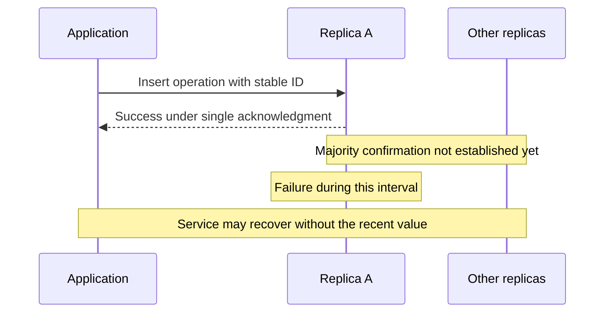

# When RethinkDB Can Lose a Write It Already Acknowledged

Author: [nawazdhandala](https://www.github.com/nawazdhandala)

Tags: RethinkDB, Reliability, Data Integrity

Description: Understand how single write acknowledgments differ from disk durability and quorum, and verify RethinkDB settings before testing failure recovery.

An application receives a successful insert result, then a database node fails. After recovery, the document is missing. This sounds impossible if “success” means “safely replicated,” but that is not what every acknowledgment policy promises.

RethinkDB's `write_acks` setting controls how many replica acknowledgments are required before replying to the client. With `single`, a reply can arrive before the write has been confirmed by a majority. A failure during that interval can leave the surviving database without the acknowledged value.

This article explains the failure window, shows how to inspect the relevant settings, and describes a controlled validation approach. Examples use Python 3.11 and `rethinkdb==2.4.10.post1`. Local checks cover query construction and response classification only; no acknowledged-write loss was reproduced on a live server.

## Separate three different questions

An acknowledgment policy answers how many replicas must confirm a write. Durability answers whether those confirmations wait for disk persistence. Voting quorum answers whether a group of replicas can safely make progress at all.

| Setting or condition | Question it answers |
|---|---|
| `write_acks="single"` | Can one replica's acknowledgment satisfy the response condition? |
| `write_acks="majority"` | Must a majority of voting replicas confirm before success? |
| `durability="hard"` | Must acknowledgment wait for the write to reach disk? |
| `durability="soft"` | May acknowledgment occur while the write is still only in memory? |
| Available voting majority | Can the surviving group continue under normal quorum rules? |

The [consistency documentation](https://rethinkdb.com/docs/consistency/) defines the acknowledgment and durability settings and explicitly warns that recent writes using `single` acknowledgments or `soft` durability can be lost after network or server failures.

These settings change the point at which the client receives acknowledgment, not whether the system attempts replication. `single` does not mean “keep only one copy forever.” It means the response does not wait for the stronger replication condition.

## Follow the vulnerable interval

Imagine three voting replicas, A, B, and C. A acknowledges a new value while the other replicas have not yet confirmed it. The client records success. A then becomes unavailable before the value is safely established on the surviving group. That group can retain enough votes to recover service without retaining that particular recent write.



This is an explanatory failure scenario, not a report of an experiment. Timing matters: a normal replication path may close the interval before a test stops a node. A test that retains every write does not prove the weaker policy has the stronger guarantee.

`hard` durability on A does not make A's disk available to B and C when A is lost. Conversely, multiple in-memory copies under `soft` durability do not establish the same protection as disk-confirmed copies. Think about both replica loss and persistence when choosing a policy.

## Read the table configuration before interpreting success

Use an authenticated connection named `conn` to inspect the exact table. The staging names here are `acks_lab.events`:

```python
from rethinkdb import RethinkDB

r = RethinkDB()
target = r.db("acks_lab").table("events")
config = target.config().run(conn)
print({key: config[key] for key in ("write_acks", "durability", "shards")})
```

This query is read-only. The [`config` command](https://rethinkdb.com/api/python/config/) exposes the table's settings, including replica membership. Record them with the test evidence so a successful run is not attributed to the wrong policy.

Also inspect application query options. The [`run` reference](https://rethinkdb.com/api/python/run/) documents per-query durability and read-mode controls. A table default is not the whole story if a write overrides durability or if the verification query permits weaker reads.

Do not confuse `read_mode="single"` with `write_acks="single"`. They control different operations. A normal read can observe a value without proving the acknowledgment and persistence conditions you intend to validate. The [`table` reference](https://rethinkdb.com/api/python/table/) documents how to request majority reads explicitly.

## Establish the intended policy in staging

For a reviewed staging table where majority acknowledgments and hard durability are intended, apply and verify these settings:

```python
result = target.config().update({
    "write_acks": "majority",
    "durability": "hard",
}).run(conn)
if result.get("errors", 0):
    raise RuntimeError(result.get("first_error", "Configuration update failed"))
actual = target.config().run(conn)
assert actual["write_acks"] == "majority"
assert actual["durability"] == "hard"
```

This changes the table's policy, so schedule it through the normal database change process. The [replication guide](https://rethinkdb.com/docs/sharding-and-replication/) explains that these fields are configurable through table configuration. A subsequent `reconfigure` also resets them to `majority` and `hard`, as documented in the [reconfigure reference](https://rethinkdb.com/api/python/reconfigure/); record settings again after topology changes.

With majority acknowledgments, hard durability, and majority reads, RethinkDB documents stronger guarantees for individual atomic document operations. Do not expand that into an atomic transaction across several documents, immunity to losing all durable copies, or protection from unsafe emergency repair.

## Keep write evidence separate from readback

Use a stable operation ID chosen and recorded by the test harness before submission. This helper writes a single staging document and checks a majority read afterward:

```python
from rethinkdb import RethinkDB

r = RethinkDB()


def classify_insert(result):
    if result.get("errors", 0):
        raise RuntimeError(result.get("first_error", "Insert reported an error"))
    if result.get("inserted") != 1:
        raise RuntimeError("Expected exactly one newly inserted document")
    return "acknowledged"


def probe(conn, operation_id):
    expected = {"id": operation_id, "kind": "ack_probe", "value": 1}
    target = r.db("acks_lab").table("events")
    result = target.insert(expected, durability="hard").run(conn)
    outcome = classify_insert(result)
    observed = r.db("acks_lab").table(
        "events", read_mode="majority"
    ).get(operation_id).run(conn)
    return {"id": operation_id, "outcome": outcome,
            "matches_majority_read": observed == expected}
```

Call `probe(conn, operation_id)` with a fresh, nonempty ID for each new test operation. Keep that ID outside the database being tested. The insert uses the default conflict policy, so rerunning the same ID does not silently overwrite an earlier document.

The [`insert` reference](https://rethinkdb.com/api/python/insert/) describes the returned `errors`, `first_error`, and `inserted` fields. A returned result object is not automatically a successful write. The helper rejects errors and any result that did not confirm exactly one new document.

The helper is a small steady-state check, not a durable test journal. A failure during readback can occur after insertion succeeded. For fault testing, the harness must record submitted, acknowledged, failed, and indeterminate outcomes separately at the moment each occurs, rather than relying only on this function's final return.

An indeterminate outcome means the client cannot establish whether its operation took effect. Preserve the ID and reconcile it instead of automatically replaying a non-idempotent action. An idempotent action has a repeat-safe effect; an arbitrary increment or external notification generally needs additional safeguards.

## Design a useful failure exercise

Use a disposable, replicated staging environment with independent evidence storage. First establish a healthy baseline and record table configuration, replica readiness, operation IDs, and successful responses. Then exercise the approved node or network failure through the test environment's controls, recover the cluster, and compare acknowledged IDs against the recovered data using the intended read policy.

Separate acknowledged-but-missing IDs from operations whose responses never arrived. Those categories represent different problems. Record timing and replica state so a run that missed the vulnerable interval is not mistaken for proof that the interval does not exist.

The local tests accepted a confirmed insert and rejected duplicate-error, zero-insert, and replacement-only results. Driver construction accepted the configuration update, hard insert, and majority read. No replication, persistence, or failure behavior was executed.

Choose acknowledgment policy from the loss the application can tolerate, then measure its latency cost under representative load. A faster success response is useful only when its meaning matches what the application tells its users.
