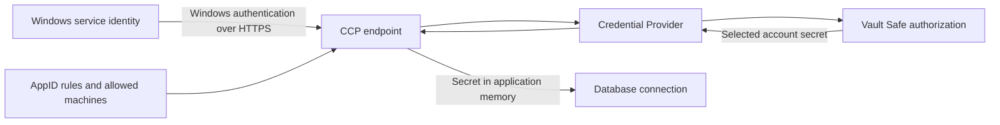

# Retrieve CyberArk Application Secrets Without a Secret Zero

Author: [nawazdhandala](https://www.github.com/nawazdhandala)

Tags: CyberArk, Security, Access Control

Description: Replace embedded Vault passwords with an approved application identity, using CyberArk Credential Provider or Windows-authenticated CCP retrieval.

Moving a database password into CyberArk helps little if the application now contains a permanent Vault password that can retrieve it. That replacement credential is often called a **secret zero**: the initial secret needed to obtain the other secrets.

The practical goal is to remove a separately embedded bootstrap password from application configuration. It is not to eliminate trust or credentials from the system. The operating system, provider, directory, certificate authority, and provisioning process still need protection. This guide uses an existing Windows service identity to make that boundary concrete.

## Choose the identity path before writing retrieval code

CyberArk Credential Provider (CP) runs alongside an application and offers local SDK interfaces. Central Credential Provider (CCP) exposes retrieval through an IIS-hosted web service backed by CP. An application does not authenticate to CCP simply by knowing an Application ID, or AppID. The AppID selects an application definition; configured authentication rules establish whether the caller may use it.

| Situation | Practical path | Trust to review |
| --- | --- | --- |
| Managed host can run a local provider | CP SDK with supported application checks | Host, service identity, approved executable |
| Windows service already has an approved domain identity | CCP with Windows authentication | Directory identity, IIS configuration, allowed hosts |
| Remote application uses certificate identity | CCP with client-certificate authentication | Private-key protection, issuance, renewal, revocation |
| Short-lived container workload | A supported workload-identity integration | Issuer, audience, workload claims and policy |

CP can check application characteristics including OS user, path, and executable hash. CCP supports different remote authentication mechanisms; do not assume a remote HTTP request proves the caller's executable path. The reviewed official CP and CCP development guides are **version 1.3**, pinned at commit `4dec83637ab47d0eee710eacd1f2de8375f40ff8`. [CP integration guide](https://github.com/cyberark/Idira-Partner-Integration-Docs/blob/4dec83637ab47d0eee710eacd1f2de8375f40ff8/docs/secrets-management/credential-provider/development-guide.md), [CCP integration guide](https://github.com/cyberark/Idira-Partner-Integration-Docs/blob/4dec83637ab47d0eee710eacd1f2de8375f40ff8/docs/secrets-management/central-credential-provider/development-guide.md).

For the rest of this example, choose an existing Windows service identity whose credentials are managed by the host and directory. Do not create a second username/password pair in the application just to call CCP.

## Configure authentication and authorization independently

Authentication establishes who is calling. Authorization determines which account that identity may retrieve. Both must be correct.

Configure a dedicated AppID for the application and environment. Restrict its authentication rules to the intended service identity and approved machines. Avoid a shared organization-wide AppID that can retrieve unrelated production and development secrets.

For Windows authentication, the application must authenticate to IIS. CyberArk documents `-UseDefaultCredentials` for using the Windows identity running the request, and requires the corresponding authentication method in the application definition. Mixed authentication methods may need separate CCP endpoints. Configure the exact endpoint with the platform owner before testing. [CCP authentication configuration](https://docs.cyberark.com/credential-providers/latest/en/content/cp%20and%20ascp/authentication-methods-for-ccp.htm).

In the target Safe, the provider user needs List accounts, Retrieve accounts, and View Safe Members. The application needs Retrieve accounts. If object-level access is enabled, both must also have access to the selected account. These are separate identities; granting only one is insufficient. [Provisioning requirements](https://docs.cyberark.com/credential-providers/latest/en/content/ccp/provisioning-privileged-application-accounts.htm).



The application must trust the CCP server's HTTPS certificate. That server trust is independent of the caller's Windows authentication. Fix the host's certificate trust configuration rather than turning verification off.

## Retrieve one account without printing its password

The following PowerShell **7.5.4** example targets a Windows service process. It requires a configured CCP endpoint supporting the documented POST retrieval method, a trusted server certificate, and an authorized service identity. Replace every `REPLACE_` value. Use your configured Windows-authentication endpoint path if it differs from `AIMWebService`.

```powershell
$ccpUri = 'https://REPLACE_CCP_FQDN/AIMWebService/api/Accounts'
$request = @{
    AppID = 'REPLACE_APP_ID'
    Safe = 'REPLACE_SAFE'
    Object = 'REPLACE_ACCOUNT_OBJECT'
}
if ($ccpUri.Contains('REPLACE_') -or
    ($request.Values | Where-Object { $_.Contains('REPLACE_') })) {
    throw 'Replace the endpoint and account selectors before retrieval'
}
if (([uri]$ccpUri).Scheme -ne 'https') {
    throw 'CCP endpoint must use HTTPS'
}
$reply = Invoke-RestMethod -Uri $ccpUri -Method Post `
    -UseDefaultCredentials -HttpVersion 1.1 `
    -ContentType 'application/json' `
    -Body (ConvertTo-Json -InputObject $request) `
    -MaximumRedirection 0 -ConnectionTimeoutSeconds 10 `
    -OperationTimeoutSeconds 40 -ErrorAction Stop
if ($reply.Content -isnot [string] -or $reply.Content.Length -eq 0) {
    throw 'CCP did not return a nonempty password'
}
$databasePassword = $reply.Content
$reply = $null
```

The expected result is an in-memory variable for your database client, with no password printed. Supply it through the client's credential interface rather than a command-line argument or a logged connection string. Remove references after use, while recognizing that ordinary managed strings do not provide a guarantee of immediate memory erasure.

CCP's POST service uses HTTP/1.1 and returns the secret in `Content`. The request uses an AppID and an exact Safe/object selection instead of a broad search. POST keeps those selectors out of the URL, but request-body logging can still expose them. [POST API reference](https://docs.cyberark.com/credential-providers/latest/en/content/ccp/calling-the-web-service-using-rest_post.htm). The timeout, redirect, and default-credential parameters are documented by [Microsoft](https://learn.microsoft.com/en-us/powershell/module/microsoft.powershell.utility/invoke-restmethod?view=powershell-7.5).

Run this under the intended service identity, not an administrator's desktop session. A successful interactive test proves only that the interactive caller could retrieve the account.

## Avoid moving secret zero into another file

A client certificate is useful identity evidence, but an exportable private key copied beside the application is still sensitive bootstrap material. If its password is stored in the same configuration, the design has merely renamed the original problem. Prefer platform-protected key storage and an approved automated issuance process where the integration supports them.

Likewise, the provider's own Vault credential file belongs to the protected provider installation. It is not an application configuration value to copy into images or source control. Restrict access, plan renewal, and test recovery of the provider independently from application deployment.

Allowed-machine rules are useful additional constraints, but network location alone may cover many processes behind the same host or gateway. Review what the server actually observes after proxies and address translation. Pair those constraints with the supported identity checks your application can satisfy.

## Prove isolation, rotation, and failure behavior

In staging, test retrieval with the correct service identity, then verify denial from an unauthorized identity, machine, and AppID. Check that a valid application cannot retrieve a neighboring Safe's secret. Keep the test output to pass/fail and a correlation reference; redact response bodies from exception collectors and tracing systems.

Next, rotate a test credential through the approved workflow and confirm new application connections acquire the current value. Bound retries during transitions so a bad credential does not produce an account-lockout storm. Decide explicitly how existing connection pools, provider caching, and service restarts affect freshness.

Finally, interrupt the staging retrieval path and observe the application's behavior. It should follow a documented availability policy, with bounded waiting and an actionable alert. It must not silently fall back to a hard-coded password. The finished design has no application-owned Vault password, a narrowly authorized identity, and a tested explanation of what happens when that identity or retrieval service is unavailable.
