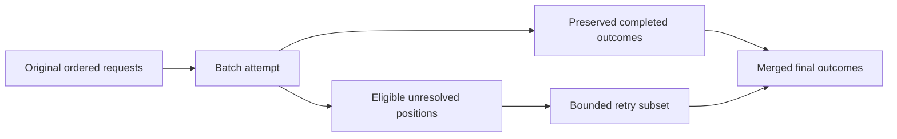

# Retry Unresolved Aerospike Batch Reads After failedNodes Errors

Author: [nawazdhandala](https://www.github.com/nawazdhandala)

Tags: Aerospike, Java, Troubleshooting, Database

Description: Interpret failedNodes diagnostics correctly, preserve completed Aerospike batch results, and retry selected unresolved reads without replaying downstream effects.

A batch read fails, and the error includes `failedNodes`. It is tempting to submit the original batch again. That can waste work, replace results you already received with newer versions, and repeat downstream actions that were triggered by the first response.

Recover at the level of individual requested keys. Keep completed results, distinguish missing records from unresolved requests, and allow only a bounded retry of explicitly eligible failures. The first step is understanding what the diagnostic actually tells you.

## Do not turn failedNodes into a key list

`failedNodes` appears in older Aerospike client timeout messages. In the [Java client 3.3.2 command implementation](https://github.com/aerospike/aerospike-client-java/blob/3.3.2/client/src/com/aerospike/client/command/SyncCommand.java), it is a counter incremented when an attempt encounters an inactive node. It is not a list of failed keys or necessarily a count of distinct physical servers.

That old message format does not define the recovery API for every modern client. Capture your client language and version, then use its structured per-record outcomes. Do not parse `failedNodes=2` and infer that two records failed, or retry records based on the order of node names in a log.

The examples below target **Java client 10.5.0**, Maven artifact `com.aerospike:aerospike-client-jdk8:10.5.0`. The old source is cited only to explain the diagnostic; it is not a recommendation to deploy that client.

## Keep one outcome per original request

Use a stable position for every requested key. For example, positions 0 through 4 might finish like this:

| Position | Result | Recovery decision |
| --- | --- | --- |
| 0 | Record returned | Preserve it |
| 1 | Key not found | Preserve the absence result |
| 2 | Timeout | Candidate for a bounded retry |
| 3 | No response | Investigate overall failure, then consider retry |
| 4 | Permission error | Report the error; do not retry unchanged |

A missing record is a completed read. It is different from a request whose result never arrived. Similarly, a filter excluding a record is not automatically a transport failure.

For `List<BatchRead>`, the Java client stores results in the supplied list. Each entry has a `resultCode` as well as a `record`; a null record can mean absence or an error. Check the status instead of using null as the retry condition. These fields are defined in the [10.5.0 BatchRecord source](https://github.com/aerospike/aerospike-client-java/blob/10.5.0/client/src/com/aerospike/client/BatchRecord.java).



Maintain the original mapping when retrying a subset. If retry position 0 corresponds to original position 2, merge its result into position 2. Do not append it and silently reorder the application's response.

## Select candidates without changing the results

Save this helper as `BatchRetrySelection.java` in a project using the pinned artifact. It selects a deliberately narrow set of transient read outcomes and returns their original positions:

```java
import com.aerospike.client.BatchRead;
import com.aerospike.client.ResultCode;
import java.util.ArrayList;
import java.util.List;

public final class BatchRetrySelection {
    private BatchRetrySelection() {}

    public static List<Integer> candidates(List<BatchRead> results) {
        List<Integer> positions = new ArrayList<>();
        for (int i = 0; i < results.size(); i++) {
            int code = results.get(i).resultCode;
            if (code == ResultCode.NO_RESPONSE
                    || code == ResultCode.TIMEOUT
                    || code == ResultCode.SERVER_NOT_AVAILABLE) {
                positions.add(i);
            }
        }
        return positions;
    }
}
```

The constants come from the [tagged ResultCode class](https://github.com/aerospike/aerospike-client-java/blob/10.5.0/client/src/com/aerospike/client/ResultCode.java). This helper performs no network calls, mutates no entries, and does not authorize a retry by itself. A batch-wide authentication or configuration error must stop recovery even if untouched entries still say `NO_RESPONSE`.

The selected list is a candidate set. Your caller still checks the overall exception, remaining deadline, retry count, and whether the operation is genuinely a read. Add other error codes only after defining why repeating them can succeed; do not classify every nonzero code as transient.

## Inspect results on both completion paths

The synchronous `client.get(batchPolicy, records)` overload returns a boolean and can also throw `AerospikeException`. Inspect the entries when it returns and after a handled batch exception; do not assume that an exception erases successful records. The [client implementation](https://github.com/aerospike/aerospike-client-java/blob/10.5.0/client/src/com/aerospike/client/AerospikeClient.java) documents that the results remain in the supplied list.

Before another attempt, retain each original request specification: namespace, set, key, requested bins or read operations, filter, and applicable policy. Construct fresh `BatchRead` entries for the eligible subset using the same semantics. Avoid passing completed entries back into another batch call: result objects are prepared for reuse, which resets their outcome fields.

When the retry finishes, update only the matching unresolved positions. Preserve completed values and completed absence results from the earlier attempt. If a retry produces a terminal error, keep that error at its original position. If time runs out, return an explicit unresolved outcome rather than disguising it as “not found.”

## Set one recovery budget

Use a deadline for the overall business request, not a new full deadline for every batch attempt. Account for client-internal retries as well as your application retry loop. A two-attempt application loop around a client configured for several retries can generate substantially more work than expected.

For a staging recovery test, consider setting the batch policy's internal `maxRetries` to zero while verifying the application-level selection and merge logic. This makes the number of attempts easier to observe. It is a test choice, not a general production setting. Then evaluate the chosen production retry layer under the same deadline.

Back off only within the remaining budget, and cap concurrency across simultaneous recoveries. Retrying every failed batch immediately during a node outage can overload the surviving nodes. If the remaining time cannot cover another useful attempt, return the partial outcome with a clear failure to the caller.

## Keep reads and side effects separate

A batch is not automatically an all-or-nothing operation across records. Aerospike's [batch documentation](https://aerospike.com/docs/develop/client/java/usage/multi/batch/) explains that individual operations can succeed or fail independently. Do not apply this read-recovery helper to a mixed batch of writes, increments, deletes, or user-defined functions.

Even read workflows can have effects elsewhere. If receiving a record sends a message or updates a search index, replaying the original batch can repeat those actions. Either defer downstream work until outcomes are merged, or give downstream processing its own durable idempotency key. “This read is safe to retry” does not mean “everything the application does afterward is safe to repeat.”

Also review read-touch behavior if record expiry must remain unchanged. A read that renews time to live has different semantics from a purely observational read. Use the appropriate read policy for the client and server version.

## Test recovery with mixed outcomes

Start with a local test of the selector and merge logic. Include successful records, key-not-found, filtered-out, timeout, no-response, server-unavailable, and permission failures. Confirm only the intended positions are selected and that inspecting them does not mutate the original list.

Then rehearse against a staging cluster. Use unique test keys, arrange an approved temporary failure, and capture which keys completed before the failure. Verify that the second attempt contains only the permitted subset. Test an exhausted deadline and a permanent error so the recovery loop cannot continue indefinitely.

Finally, change a record between attempts. A retried read can observe a later value; combining results from separate attempts does not create a point-in-time snapshot. If the business operation requires that guarantee, choose an appropriate consistency or transaction design instead of claiming that retry-and-merge supplies it.

Retain the original positions, final status of each request, attempt count, and downstream processing identifiers. That makes partial recovery auditable and prevents a node-level error message from turning into an uncontrolled replay of application work.
