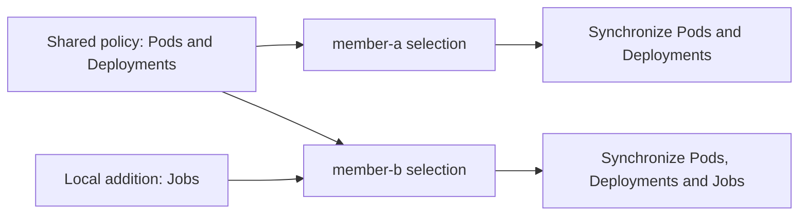

# Reuse Clusterpedia Sync Policies with Explicit Per-Cluster Additions

Author: [nawazdhandala](https://www.github.com/nawazdhandala)

Tags: Kubernetes, Multi-Cluster, Configuration Management

Description: Share Clusterpedia resource selections safely, add cluster-specific resources, and roll out policy changes without mistaking additions for exclusions.

A shared synchronization policy saves you from editing the same resource list on every imported cluster. However, calling a local list an "override" creates a dangerous expectation: a shorter local list might seem to remove resources from the shared policy. In Clusterpedia, it does not.

This walkthrough uses Clusterpedia **v0.9.0**, with the custom resource definitions shipped in chart **2.7.0**. The examples assume two already imported clusters, `member-a` and `member-b`. They change resource selection only; cluster credentials and connection settings stay in the existing PediaCluster objects. The YAML was checked against the chart schemas locally. No live cluster reconciliation was tested.

## Understand what the shared object controls

A `PediaCluster` describes an imported cluster. A `ClusterSyncResources` object holds a reusable list of resource types to synchronize. Both are cluster-scoped objects in the hosting Kubernetes cluster. A PediaCluster references the shared object by name through `spec.syncResourcesRefName`.

When a member also has `spec.syncResources`, Clusterpedia concatenates that local list with the shared list. For example, shared Pods and Deployments plus local Jobs select all three resource types. There is no exclusion rule in that combination. The [official shared-policy documentation](https://clusterpedia.io/docs/concepts/cluster-sync-resources/) describes this behavior.



The diagram describes intended selection, not a guarantee of successful synchronization. Each member must still serve the selected APIs, and its import identity must have the required read permissions.

| Requirement | Suitable configuration |
| --- | --- |
| Both members need Pods and Deployments | Reference one shared baseline |
| Only member-b also needs Jobs | Add Jobs to member-b's local list |
| One member must never collect Deployments | Give it a smaller baseline or a wholly local selection |
| One member needs a different tested API version | Use a separately reviewed policy instead of assuming local precedence |

Avoid overlapping entries that try to express conflicting versions. Even where resource selection ultimately deduplicates an entry, a confusing configuration is harder to audit than one unambiguous selection.

## Create a small baseline first

Use a hosting-cluster context with permission to manage these custom resources. Replace `HOST_CONTEXT` in every command. This is not the context of either imported member. Check the installed Clusterpedia version and CRD availability before proceeding.

Save this as `workloads-v1.yaml`:

```yaml
apiVersion: cluster.clusterpedia.io/v1alpha2
kind: ClusterSyncResources
metadata:
  name: workloads-v1
spec:
  syncResources:
    - group: ""
      resources: [pods]
      versions: [v1]
    - group: apps
      resources: [deployments]
      versions: [v1]
```

The empty group identifies Kubernetes' core API group. The `versions` fields are explicit API versions, not Clusterpedia releases. Here, both selected resources use `v1`. The schema is available in the [pinned chart's CRD](https://github.com/clusterpedia-io/clusterpedia-helm/blob/clusterpedia-2.7.0/charts/clusterpedia/_crds/cluster.clusterpedia.io_clustersyncresources.yaml).

```bash
kubectl --context HOST_CONTEXT apply --dry-run=server -f workloads-v1.yaml
kubectl --context HOST_CONTEXT apply -f workloads-v1.yaml
```

Run the second command only after reviewing the first result and confirming that this policy name is unused or its existing consumers are understood. Server dry-run checks API acceptance without persisting the object. It does not contact each member to prove that its credentials can list Deployments.

Use a naming convention such as `workloads-v1`, `workloads-v2`, and a review rule that published baselines are not edited in place. These names are an operational convention; Kubernetes does not make the objects immutable.

## Attach the baseline without replacing credentials

First inspect only the selection fields on both existing objects:

```bash
kubectl --context HOST_CONTEXT get pediaclusters member-a member-b -o json \
  | jq '.items[] | {name: .metadata.name,
      reference: .spec.syncResourcesRefName,
      local: .spec.syncResources}'
```

This avoids printing credential fields in a full PediaCluster export. Record the existing selection in your change review before altering it. Coordinate with whichever GitOps controller or configuration owner normally manages these fields.

For member-a, save `member-a-sync.yaml`:

```yaml
spec:
  syncResourcesRefName: workloads-v1
  syncResources: []
```

For member-b, save `member-b-sync.yaml`:

```yaml
spec:
  syncResourcesRefName: workloads-v1
  syncResources:
    - group: batch
      resources: [jobs]
      versions: [v1]
```

These are **patch documents**, not complete PediaCluster manifests. The empty list deliberately removes member-a's previous local selection. The Jobs list replaces member-b's previous local list. Include any local resources you intend to retain.

```bash
kubectl --context HOST_CONTEXT patch pediacluster member-a \
  --type=merge --patch-file=member-a-sync.yaml --dry-run=server -o name
kubectl --context HOST_CONTEXT patch pediacluster member-a \
  --type=merge --patch-file=member-a-sync.yaml -o name
```

After reviewing member-a, repeat those commands with `member-b` and `member-b-sync.yaml`. JSON merge patch preserves unspecified object fields but replaces a supplied array. Explicit `--type=merge` also avoids relying on strategic merge patch, which is not supported for custom resources. See the [Kubernetes patch guide](https://kubernetes.io/docs/tasks/manage-kubernetes-objects/update-api-object-kubectl-patch/).

## Verify the outcome on each member

Check the desired reference and then the observed status:

```bash
kubectl --context HOST_CONTEXT get pediacluster member-b \
  -o jsonpath='{.spec.syncResourcesRefName}{"\n"}'
kubectl --context HOST_CONTEXT get pediacluster member-b \
  -o jsonpath='{.status.conditions}{"\n"}{.status.syncResources}{"\n"}'
```

Expect `workloads-v1` as the reference. In resource synchronization status, inspect Pods, Deployments, and Jobs individually. A healthy connection condition does not establish that the Jobs watch is authorized. Confirm a known Job appears through your existing Clusterpedia search connection, and compare its identity with the member API. An empty Job result is meaningful only if the member actually contains a Job you expected to find.

Before the rollout, review member-b's import identity for `get`, `list`, and `watch` on `batch/jobs`. Changing the selection does not grant permissions. Separate policy acceptance, API discovery, authorization, and stored query results in the evidence you collect.

## Handle missing references and policy changes deliberately

In v0.9.0, a missing shared object does not make selection fail closed. The manager records a warning and proceeds with the local list. Other errors retrieving the reference take a different validation path. This distinction is visible in the [tagged manager implementation](https://github.com/clusterpedia-io/clusterpedia/blob/v0.9.0/pkg/synchromanager/clustersynchro_manager.go).

Consequently, deleting a shared policy is a poor rollback mechanism. It can leave local Jobs selected while removing the intended baseline from the effective configuration. Before applying a reference, verify that the named object exists. Monitor condition messages as well as boolean status values.

For a revision, create `workloads-v2`, review its resource differences, and switch one pilot member to that name. Check synchronization errors, storage growth, and representative search results before moving the remaining members. Keep the old object while references still use it. An in-place edit has a larger change surface because the manager requeues referencing clusters.

If the pilot fails, restore its previous reference and local list from the reviewed configuration. That reverses desired selection; it is not a database snapshot restore and should not be treated as a guarantee about previously stored rows. Verify the resulting query behavior separately. A reusable baseline is useful when its membership, permissions, and rollout evidence remain easy to explain.
