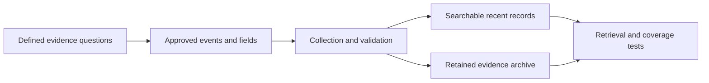

# Replace “Log Everything” with a Useful Evidence Plan

Author: [nawazdhandala](https://www.github.com/nawazdhandala)

Tags: Compliance, Logging, Security

Description: Define the events, fields, retention tiers, and retrieval tests your evidence needs, while controlling logging volume and avoiding unnecessary sensitive data.

“Log everything” sounds safe until an incident requires a specific answer. A terabyte of request bodies may still fail to show who granted a privileged role, whether a deployment was approved, or which configuration changed.

Start from the questions the organization must answer. Then choose events, fields, sources, retention, and access controls that support those answers. The result should be a documented evidence plan that engineering can implement and the evidence owner can review.

This article uses illustrative event records and a locally tested volume calculation. It does not prescribe a universal retention period or assert that a chosen log format meets a particular regulation.

## Translate questions into observable events

Write the investigative question before selecting a log source. “Who changed access to production?” needs a permission-change event with an authenticated actor and target. A request log showing HTTP 200 is not necessarily enough.

| Question | Candidate event | Minimum useful context |
| --- | --- | --- |
| Who granted a privileged role? | Role assignment decision | Actor, target principal, role, outcome, time |
| Which artifact entered production? | Deployment result | Deployment ID, environment, artifact digest, outcome |
| Was a sensitive export performed? | Export authorization and completion | Actor, dataset reference, scope, outcome, correlation ID |
| Did evidence collection finish? | Collection checkpoint | Source scope, run ID, completeness, storage reference |
| Who changed the logging policy? | Logging configuration change | Actor, policy version, affected sources, outcome |

These are starting points. Define where each event becomes authoritative. For example, an export request, authorization decision, and completed download may be separate events with different meanings.

Document known blind spots. If a product exposes configuration snapshots but no historical change events, a snapshot can describe the observed state without identifying every intervening change. Do not label that source a complete activity history.

## Define a small structured event contract

Use an allowlist of fields that serve the question. The following is an illustrative application event, not an AWS or OpenTelemetry schema:

```json
{
  "schema_version": 1,
  "event_id": "evt-demo-001",
  "event_type": "role_assignment",
  "occurred_at": "2026-11-20T10:15:00Z",
  "principal_ref": "principal-42",
  "target_ref": "principal-87",
  "role": "production-reader",
  "outcome": "denied",
  "reason_code": "approval_required",
  "correlation_id": "request-demo-001"
}
```

The event records a denied decision without including a password, bearer token, or full request body. Actor identity should come from the authenticated execution context, not an unverified client header. Validate lengths and permitted values, and use structured serialization so a newline in user-supplied text cannot impersonate a second event.

A principal reference can still be sensitive if it is linkable to a person. Control the lookup mapping and log access accordingly. Avoid treating pseudonymous identifiers as automatically anonymous data.

OWASP recommends excluding or appropriately protecting secrets and sensitive data in logs, and testing logging behavior as part of application verification. Use that guidance to review fields before they enter the pipeline. [OWASP logging guidance](https://cheatsheetseries.owasp.org/cheatsheets/Logging_Cheat_Sheet.html)

## Separate operational diagnostics from retained evidence

Debug messages help engineers diagnose a running system. Evidence records support an explicit historical question. They can share infrastructure, but they need not share every field, access permission, or retention period.



Specify how records move between tiers. If the archive is the long-term source of truth, test its completeness and retrieval rather than assuming a successful write to the searchable store also reached the archive.

Temporary diagnostic logging should have an owner, expiry, and review of additional fields. Turning up a log level during an incident should not silently establish permanent collection of request payloads.

## Calculate volume before selecting a retention tier

Measure representative serialized event size and event rate. Use average values for baseline capacity, then separately examine bursts and unusually large records. The following Python 3 calculation uses hypothetical inputs and decimal gigabytes:

```python
events_per_second = 500
bytes_per_event = 600
seconds_per_day = 24 * 60 * 60
raw_gb_per_day = events_per_second * bytes_per_event * seconds_per_day / 10**9
print(f"Raw volume: {raw_gb_per_day:.2f} GB/day")
for days in (30, 180):
    print(f"{days} days: {raw_gb_per_day * days:.2f} GB")
```

The outputs are 25.92 GB/day, 777.60 GB for 30 days, and 4665.60 GB for 180 days. These are uncompressed payload estimates, not billed storage or a pricing quote. The example ran with Python 3.11.13.

Build the budget from separate components: source-event charges, ingestion, indexing, stored copies, archive operations, retrieval, query scanning, and transfer. Compression may reduce stored bytes without reducing every other charge. A storage tier that is cheap to retain can be expensive or slow to investigate.

Do not reduce required evidence coverage by quietly sampling it. Sampling can be appropriate for some diagnostic traffic, but it prevents claiming a complete event population unless the requirement and analysis explicitly accommodate it. First remove redundant payloads, unnecessary fields, and duplicate collection paths.

## Inspect actual source coverage

A service being enabled does not imply that every event class is collected. AWS CloudTrail, for example, does not log data events in trails or event data stores by default, and additional charges apply. Advanced event selectors can narrow collection to required resources and operations. [CloudTrail data events](https://docs.aws.amazon.com/awscloudtrail/latest/userguide/logging-data-events-with-cloudtrail.html)

For an existing trail, this read-only AWS CLI command shows its event selectors. Replace the profile, Region, and trail name with approved values. The profile needs permission to read the trail's selectors.

```bash
aws cloudtrail get-event-selectors \
  --profile evidence-readonly \
  --region us-east-1 \
  --trail-name production-audit \
  --no-cli-pager
```

Compare the returned selectors against the event inventory. The command does not prove successful delivery or coverage for other trails, accounts, or event data stores. Its shape was checked locally with AWS CLI 2.38.1 using an output skeleton; no AWS request was made. [CloudTrail selector inspection](https://docs.aws.amazon.com/awscloudtrail/latest/userguide/logging-data-events-with-cloudtrail.html)

Keep the approved selector configuration under review. A change intended to reduce cost can also remove the only evidence source for an important operation.

## Make retention an owned decision

For each event class, record its owner, purpose, searchable period, total retained period, storage location, and deletion or hold process. Have the responsible records and privacy owners approve the requirement. “Keep forever” is a decision with ongoing access, cost, and data-exposure consequences.

CloudWatch Logs exposes configurable retention for log groups. Review the effective settings rather than relying on the existence of the group or a template default. [CloudWatch log-group retention](https://docs.aws.amazon.com/AmazonCloudWatch/latest/logs/Working-with-log-groups-and-streams.html)

Retention is not the same as immutability or backup. Define which copies can be changed, who can delete them, and what happens to exports and temporary investigation copies. Apply access restrictions to archived records as well as the main search interface.

## Test the answer, not just log ingestion

In staging, produce a permitted event, a denied event, and a collection failure. Find each by identifier and verify actor, outcome, timestamps, and correlation. Confirm that the stored record omits prohibited fields and that unauthorized readers cannot retrieve it.

Then retrieve an older archived record using the documented process. Measure the time required and identify missing dependencies such as an expired decryption key, unavailable schema, or broken identity mapping.

Monitor expected source coverage, collection lag, dropped events, and configuration changes. Record gaps explicitly and investigate their affected period. The successful outcome is not the largest log archive: it is a set of retained records that can answer the agreed questions, with known limits and a workable retrieval process.
