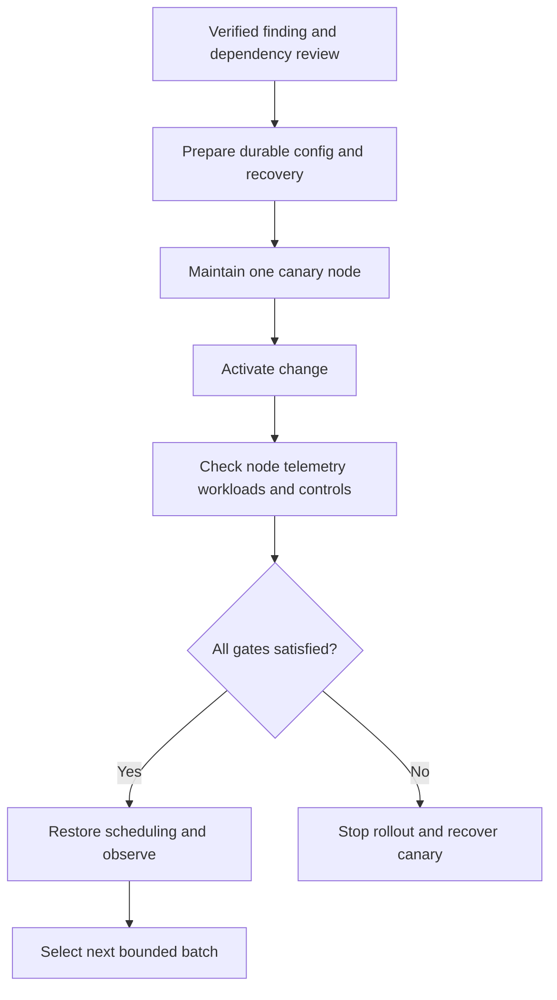

# Roll Out kube-bench Kubelet Fixes One Node at a Time

Author: [nawazdhandala](https://www.github.com/nawazdhandala)

Tags: Kubernetes, Security, Reliability

Description: Turn kube-bench kubelet findings into a controlled rollout with dependency checks, a single-node canary, disruption safeguards, and evidence-based recovery gates.

A kube-bench remediation can be technically correct and still cause an outage when applied everywhere at once. Disabling an old kubelet endpoint may break a monitoring agent. Changing authentication can affect clients that assumed anonymous access. Restarting kubelets across a pool can turn a small configuration problem into a large operational incident.

Treat a finding as input to a change plan. Confirm the evidence, identify consumers of the setting, test one representative node, and advance only after both the security check and workload health are understood.

This guide uses **kube-bench v0.14.0** and a concrete example: disabling the kubelet’s read-only port. The command syntax was checked with **kubectl v1.34.0**. No production nodes were drained or changed during preparation of this article.

## Validate the finding before planning a restart

Keep the original report, node UID, image version, benchmark, target, configuration revision, and observed value. Confirm the scanner read the intended node configuration rather than a missing mount or stale file.

In the bundled `cis-1.11` profile, control `4.2.4` checks the read-only port through process arguments or kubelet configuration. The [pinned control definition](https://github.com/aquasecurity/kube-bench/blob/v0.14.0/cfg/cis-1.11/node.yaml) marks it unscored and includes “Manual” in its description. Read the actual result and assessment requirements; do not assume an exit code alone proves completion.

Check applicability to the distribution. A managed node image may already disable the endpoint or expose configuration through provider-specific mechanisms. Editing a generated file on one node might appear to work until the next reboot or replacement restores the old setting.

## Identify the durable configuration source and its consumers

For this example, the desired field in an existing kubelet configuration is:

```yaml
readOnlyPort: 0
```

This is a fragment to merge into the complete, reviewed configuration, not a replacement file. The [KubeletConfiguration reference](https://kubernetes.io/docs/reference/config-api/kubelet-config.v1beta1/) defines zero as disabling the read-only endpoint. Its [configuration-file guide](https://kubernetes.io/docs/tasks/administer-cluster/kubelet-config-file/) explains how file settings and command-line arguments interact. Inspect both before assuming the file value is effective.

Locate the system that owns the setting: an image build, node bootstrap configuration, configuration manager, or managed node-group API. Put the correction there. Keep the old configuration and a tested recovery path available before touching the first node.

Inventory monitoring agents and other clients that may use the old endpoint. Moving them to a secured kubelet endpoint can require trusted TLS, authentication, and authorization; changing only the port number is not a complete migration. Verify those clients first so disabling the read-only endpoint does not remove the telemetry needed to observe the rollout.

## Choose a canary with realistic workload dependencies

A canary is one representative node used to test the change before wider rollout. Match the relevant operating system, node image, kubelet version, network agents, and workload characteristics. An empty test node can prove startup but cannot demonstrate that your real monitoring and workload dependencies still function.

Before scheduling disruption, confirm spare capacity and healthy replacement replicas. Review local storage, topology constraints, singleton workloads, and disruption budgets. A PodDisruptionBudget, or PDB, limits voluntary disruptions for selected workloads; it cannot manufacture capacity or make an unhealthy replica ready.

For one explicitly selected node, these read-only commands provide an initial inventory:

```bash
node='REPLACE_WITH_CANARY_NODE'
kubectl get node "$node" -o wide
kubectl get pods -A --field-selector "spec.nodeName=$node" -o wide
kubectl get pdb -A
```

The output is the start of a review, not automatic permission to drain. Check the affected workloads’ readiness, replication, storage behavior, and service indicators. Coordinate with their owners where the maintenance procedure requires it.

## Drain only the approved canary when disruption is needed

Some configuration corrections may not require workload eviction; determine the activation procedure for the specific change and distribution. When maintenance requires a drain, operate on the one approved node:

```bash
node='REPLACE_WITH_CANARY_NODE'
kubectl drain "$node" --ignore-daemonsets --timeout=10m
```

This changes the cluster: it marks the node unschedulable and requests eligible workload evictions. It is not a dry run. Kubernetes’s [safe drain procedure](https://kubernetes.io/docs/tasks/administer-cluster/safely-drain-node/) explains how normal draining respects disruption budgets.

The [drain command reference](https://kubernetes.io/docs/reference/kubectl/generated/kubectl_drain/) documents important limits. `--ignore-daemonsets` leaves DaemonSet-managed Pods running; it does not mean the node becomes empty. Mirror Pods are also not removed through ordinary API deletion. The command may refuse to proceed because of unmanaged Pods or local ephemeral data.

If the drain blocks or times out, stop and identify the cause. Do not add `--force`, `--disable-eviction`, or `--delete-emptydir-data` as a generic troubleshooting sequence. Each changes a protection or data-handling assumption and requires a specific reviewed justification. A failed drain may leave the node cordoned and some workloads already moved; inspect that partial state before deciding what to do next.

## Apply the change through the supported activation path

Apply the prepared configuration revision or replace the node using the platform’s supported node-update mechanism. Restart the kubelet only when required by that mechanism. Avoid blindly copying a generic service-file edit into a managed distribution.

Keep the canary out of normal scheduling while checking recovery. For a node that retains its identity, [wait for readiness](https://kubernetes.io/docs/reference/kubectl/generated/kubectl_wait/):

```bash
node='REPLACE_WITH_CANARY_NODE'
kubectl wait --for=condition=Ready "node/$node" --timeout=5m
```

A Ready condition is necessary but insufficient. Confirm the effective kubelet setting, network and storage agents, secured monitoring access, and representative workload behavior. A wait can return immediately if Ready was already true; it does not prove that a restart or configuration reload occurred. Use node/service evidence to confirm activation.

If the update replaces the node, track the replacement’s UID and actual configuration instead of treating the old name as proof of continuity. Preserve old and new assessment identities in the rollout record.

## Require security and service gates before expanding

Rerun the applicable kube-bench check on the canary using the same approved profile. Review observed values and any manual assessment requirement. Then assess the related controls or complete target so a narrow improvement does not hide a regression elsewhere.

| Gate | Evidence required |
|---|---|
| Configuration activated | Effective setting matches the reviewed revision |
| Node recovered | Node and required system agents are healthy |
| Monitoring intact | Expected telemetry arrives through the supported secure path |
| Workload safe | Readiness and application indicators remain acceptable |
| Assessment complete | Relevant controls and manual evidence have been reviewed |

After those gates pass, [restore scheduling](https://kubernetes.io/docs/reference/kubectl/generated/kubectl_uncordon/) for the canary when appropriate:

```bash
kubectl uncordon REPLACE_WITH_CANARY_NODE
```

Observe normal workloads returning before choosing the next node. Repeat in small batches that fit actual spare capacity and disruption budgets. Do not launch independent drains across the whole pool merely because each command names one node.



If a gate fails, stop expansion. Recover the previous known-good configuration or node image through the supported procedure, then verify health before uncordoning. Record any temporary security exception explicitly. A green scanner result is not a reason to continue while monitoring is broken, and a healthy application is not a reason to mark an unverified security change complete.
